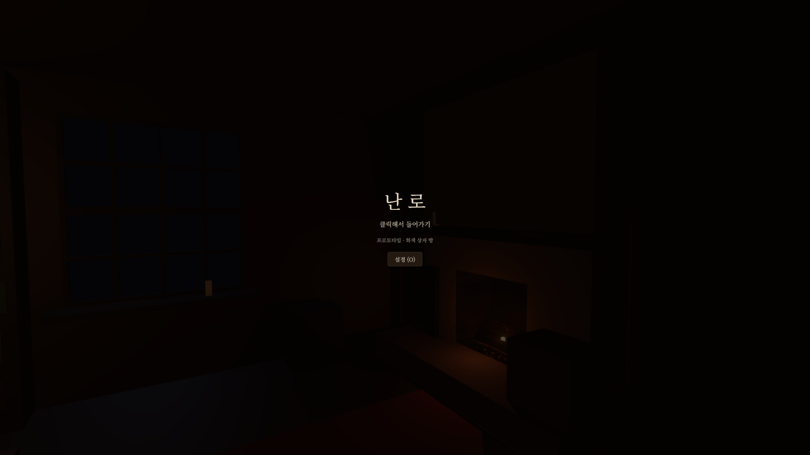
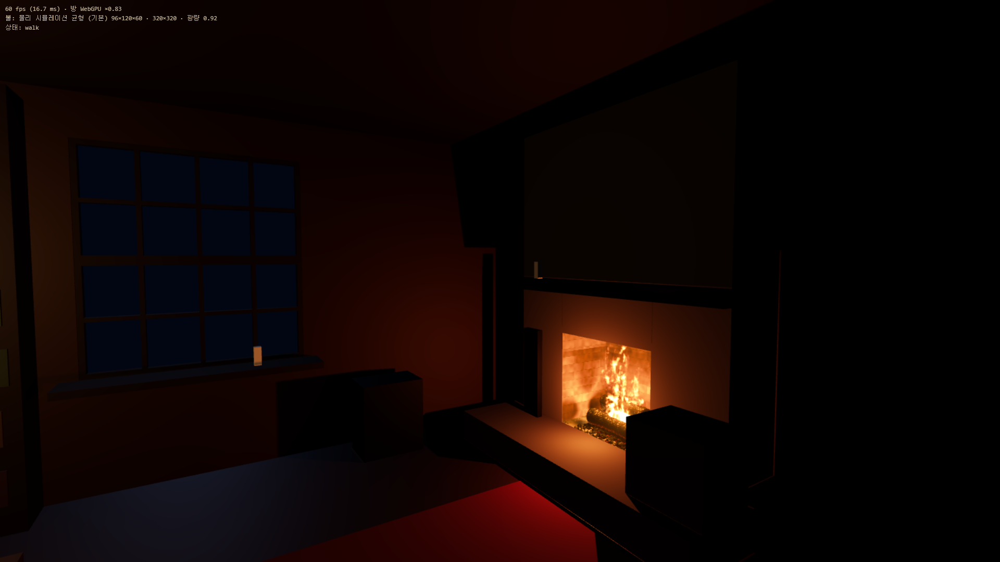
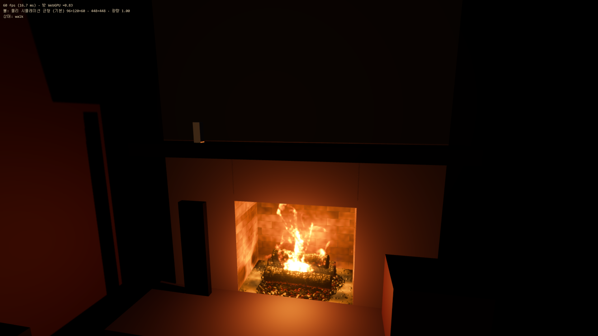
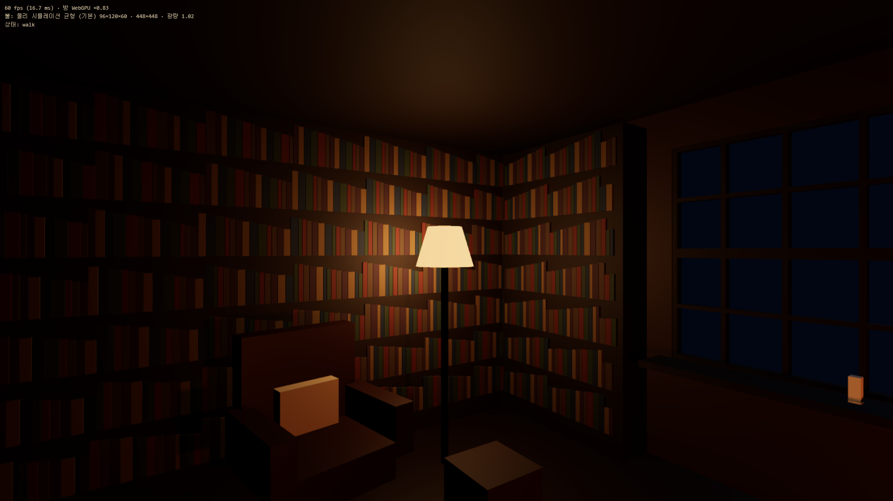
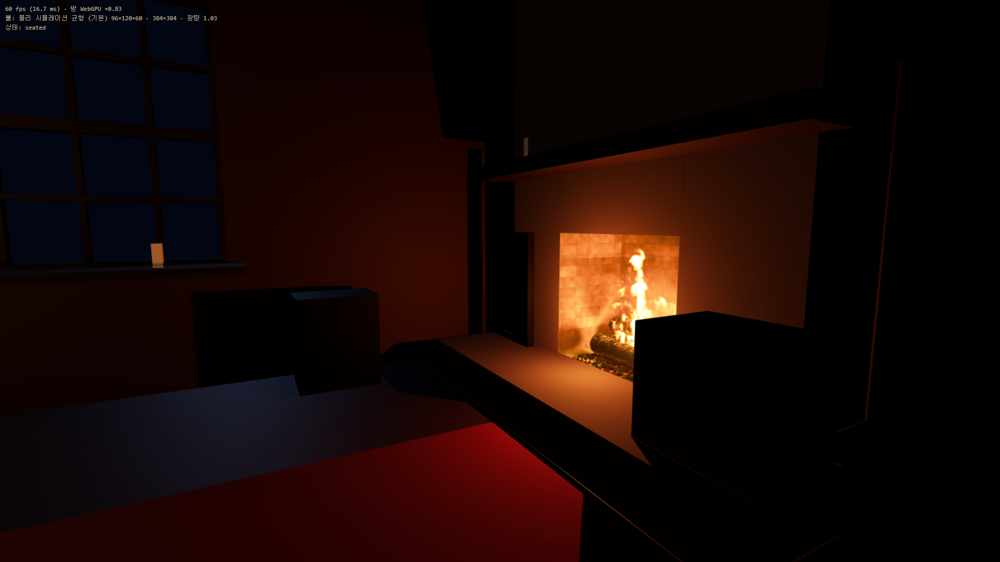
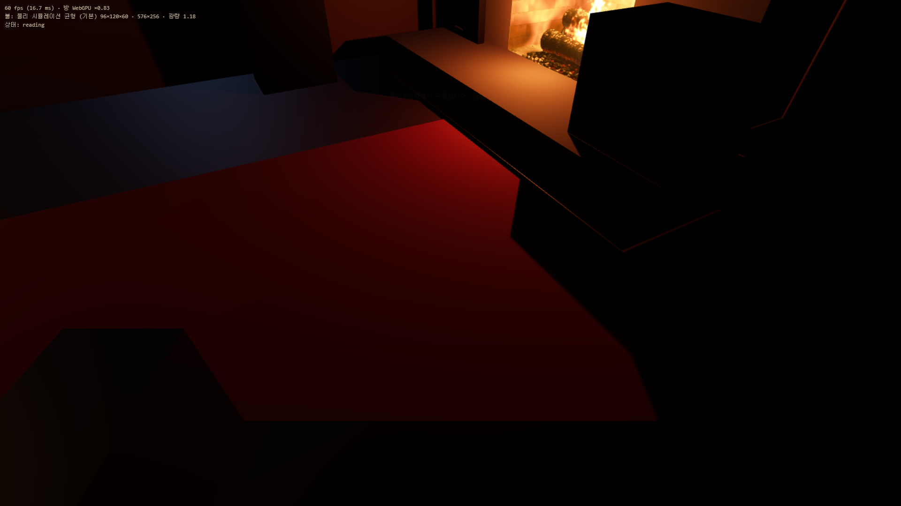
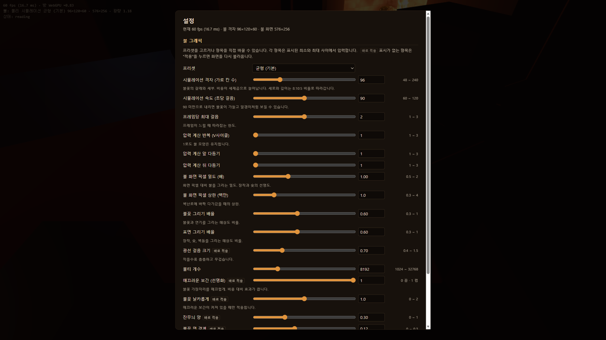
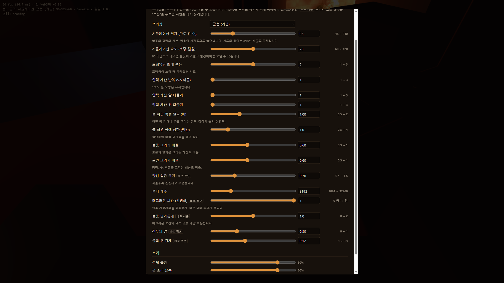

# 1단계 마무리 사진 (Arc B390, 커밋 4027c01)

2026-11-22, Edge 창 모드 1920×1080, 기본 설정(프리셋 "균형", 격자 96×120×60). 네 시점 모두 60 fps.

| 사진 | 내용 |
|---|---|
|  | 시작 화면 |
|  | 시작 위치 |
|  | 불 보기 |
|  | 책장과 스탠드 쪽 |
|  | 독서 의자에 앉음 |
|  | 책 펼치기 상태(책은 5단계에서 구현, 지금은 무릎 쪽을 내려다보는 시점만) |
|  | 설정창 (O 키) |
|  | 설정창 아래쪽(소리) |
