# 불 품질 4단계 실측 (60Hz 고정): Intel Arc B390

측정일 2026-11-21. 브랜치 `claude/project-thread-hycyb7`, 커밋 80064d1 (4단계 재구성 7761840 + 측정용 `?grid=N`). 이전 3단계 측정은 [measure.md](measure.md).

## 결론

- **60fps가 풀리는 지점은 medium과 high 사이가 아니라 medium 안에 있다.** low만 세 시점 모두에서 여유 있게 60fps를 지킨다(GPU 3D 사용률 70~79%).
- **medium(112×144×72)은 경계선이다.** 시작과 불 보기 시점은 60fps를 지키지만 GPU 사용률이 82~99%이고, 같은 조건을 다시 재면 58.5fps로 떨어진 적이 있다. **앉은 시점에서는 55.5fps로 못 지킨다**(프레임의 8%가 두 배 길이).
- **high(128×160×80)는 못 지킨다**: 37~48fps, 시뮬레이션이 실제 시간의 61~80% 속도로 느려진다.
- **ultra(160×200×104)는 못 지킨다**: 20~23fps, 시뮬레이션이 실제 시간의 33~39% 속도다.
- 격자로 좁힌 경계(불 보기 시점): medium 설정은 **가로 104칸까지 지키고 112칸에서 경계, 120칸에서 깨진다**. high 설정은 **가로 72칸까지 지키고 80칸에서 깨진다**. high와 ultra는 격자보다 그리기 설정(volScale 1.0, surfScale 1.0, 촘촘한 광선 걸음)의 부담이 커서, 격자를 low와 같은 96칸으로 낮춰도 60fps를 못 지킨다.
- 네 단계 모두 불 화면 해상도는 1600×900으로 같다. 단계를 올려도 화면에 그려지는 불의 픽셀 수는 늘지 않는다.

## 환경과 방법

| 항목 | 값 |
|---|---|
| GPU | Intel(R) Arc(TM) B390 GPU, 드라이버 32.0.101.8622 |
| 브라우저 | Microsoft Edge 157.0.4341.60, 창 모드, 수직 동기 켬 |
| 실행 인자 | `--enable-unsafe-webgpu --autoplay-policy=no-user-gesture-required` |
| 화면 / 뷰포트 | 1920×1080, 60Hz, devicePixelRatio 1 |
| 주소 | `/?q=<품질>&stats&fixed` (해상도 자동 조절 끔), 2차는 `&grid=N` 추가 |
| 방 렌더러 | WebGPU, 픽셀 배율 0.833 고정, 캔버스 버퍼 1600×900 |

- 페이지마다 `NANRO.ready` 대기 → 시작 화면 숨김 → 25초 대기 → 시점별 10초 측정.
- 프레임은 requestAnimationFrame 간격으로 쟀다. 1% low는 가장 느린 1% 프레임의 평균 시간을 fps로 바꾼 값이다.
- 시뮬레이션 비율은 같은 10초 동안 `NANRO.fire.sim.time` 증가량 ÷ 실제 경과 시간이다. 1.0이면 실시간이다.
- GPU 3D는 측정 중 `Get-Counter '\GPU Engine(*engtype_3D)\Utilization Percentage'`를 1초 간격으로 8번 읽어 엔진 합계를 평균한 값이다.
- **60fps 기준**: 평균 59fps 이상, 16.9ms 초과 프레임 2% 이하, 시뮬레이션 비율 0.97 이상.
- **지킴(*)**: 16.9ms 초과 비율만 2%를 넘었는데 가장 긴 프레임이 17.0~17.4ms인 경우다. 60Hz에서 프레임 간격은 16.7ms 앞뒤로 0.3ms쯤 흔들리기 때문에 16.9ms 기준에는 정상 프레임도 걸린다. 실제로 프레임을 놓쳤는지는 "20ms 초과" 열로 판단했고, 이 경우는 0%다.

## 1차: 품질 × 시점

| 품질 | 시점 | 평균 fps | 1% low | 중앙값 (ms) | 최대 (ms) | 16.9ms 초과 | 20ms 초과 | 시뮬레이션 비율 | GPU 3D | 60fps 기준 |
|---|---|---|---|---|---|---|---|---|---|---|
| low | start | 60.0 | 59.2 | 16.7 | 16.9 | 1.3% | 0.0% | 1.001 | 71% | 지킴 |
| low | fire | 60.0 | 58.9 | 16.7 | 17.4 | 2.7% | 0.0% | 1.001 | 70% | 지킴(*) |
| low | seated | 60.0 | 59.2 | 16.7 | 16.9 | 1.0% | 0.0% | 1.002 | 79% | 지킴 |
| medium | start | 60.0 | 59.2 | 16.7 | 16.9 | 0.7% | 0.0% | 1.001 | 82% | 지킴 |
| medium | fire | 60.0 | 59.2 | 16.7 | 16.9 | 0.7% | 0.0% | 1.002 | 85% | 지킴 |
| medium | seated | 55.5 | 29.9 | 16.7 | 33.6 | 10.5% | 8.1% | 0.972 | 99% | **못 지킴** |
| high | start | 47.7 | 29.9 | 16.7 | 33.5 | 26.2% | 25.7% | 0.795 | 100% | **못 지킴** |
| high | fire | 43.4 | 29.9 | 16.7 | 33.5 | 39.2% | 38.2% | 0.724 | 100% | **못 지킴** |
| high | seated | 36.6 | 29.8 | 33.3 | 33.6 | 64.5% | 63.9% | 0.611 | 100% | **못 지킴** |
| ultra | start | 23.4 | 19.9 | 49.9 | 50.2 | 100.0% | 100.0% | 0.391 | 100% | **못 지킴** |
| ultra | fire | 21.6 | 19.9 | 50.0 | 50.3 | 100.0% | 100.0% | 0.360 | 100% | **못 지킴** |
| ultra | seated | 19.9 | 15.0 | 50.0 | 66.8 | 100.0% | 100.0% | 0.332 | 100% | **못 지킴** |

| 품질 | 시점 | 불 격자 | 불 화면 해상도 | light.level | light.raw | light.ref | power | 시뮬레이션 시각 (초) |
|---|---|---|---|---|---|---|---|---|
| low | start | 96×120×60 | 1600×900 | 1.01 | 0.285 | 0.283 | 0.62 | 26.9 |
| low | fire | 96×120×60 | 1600×900 | 0.89 | 0.263 | 0.295 | 0.62 | 37.6 |
| low | seated | 96×120×60 | 1600×900 | 0.99 | 0.269 | 0.273 | 0.62 | 49.8 |
| medium | start | 112×144×72 | 1600×900 | 0.88 | 0.240 | 0.273 | 0.62 | 28.1 |
| medium | fire | 112×144×72 | 1600×900 | 0.88 | 0.231 | 0.263 | 0.62 | 38.7 |
| medium | seated | 112×144×72 | 1600×900 | 0.93 | 0.247 | 0.266 | 0.62 | 50.6 |
| high | start | 128×160×80 | 1600×900 | 1.01 | 0.270 | 0.268 | 0.62 | 22.6 |
| high | fire | 128×160×80 | 1600×900 | 0.96 | 0.234 | 0.244 | 0.62 | 30.6 |
| high | seated | 128×160×80 | 1600×900 | 0.92 | 0.224 | 0.244 | 0.62 | 38.4 |
| ultra | start | 160×200×104 | 1600×900 | 1.12 | 0.312 | 0.278 | 0.62 | 11.4 |
| ultra | fire | 160×200×104 | 1600×900 | 1.16 | 0.326 | 0.280 | 0.62 | 15.4 |
| ultra | seated | 160×200×104 | 1600×900 | 0.99 | 0.309 | 0.313 | 0.62 | 19.9 |

카메라 자세는 이전 측정과 같다(start: x 2.6, z 4.1, yaw -0.569 / fire: x 3.2, z 2.0, yaw -1.385, pitch -0.18 / seated: x 3.4, z 3.5, yaw -0.499).

못 지키는 단계에서 중앙값이 16.7ms인데 평균이 낮은 것은, 프레임이 16.7ms와 33.3ms(한 번 건너뜀) 두 가지로 섞여 나오기 때문이다. ultra는 대부분 50ms(세 번에 한 번)다.

## 2차: 60fps가 풀리는 격자 (불 보기 시점)

1차에서 high가 이미 기준을 못 지켜서, ultra에서 위로 올리는 탐색 대신 깨진 단계 아래 구간을 좁혔다. `q=<설정>&grid=N`은 그 단계의 그리기 설정을 그대로 두고 격자만 바꾼다. 같은 값을 여러 번 잰 줄은 재현 확인이다.

| 설정 | 격자 | 실행 | 평균 fps | 1% low | 최대 (ms) | 16.9ms 초과 | 20ms 초과 | 시뮬레이션 비율 | GPU 3D | 60fps 기준 |
|---|---|---|---|---|---|---|---|---|---|---|
| low | 96×120×60 | 1차 | 60.0 | 58.9 | 17.4 | 2.7% | 0.0% | 1.001 | 70% | 지킴(*) |
| low | 96×120×60 | 2차-3 | 60.0 | 59.2 | 16.9 | 1.2% | 0.0% | 1.001 | 68% | 지킴 |
| medium | 96×120×60 | 2차-3 | 60.0 | 59.2 | 16.9 | 2.5% | 0.0% | 1.000 | 77% | 지킴(*) |
| medium | 104×128×64 | 2차-3 | 60.0 | 59.1 | 17.0 | 2.7% | 0.0% | 1.001 | 80% | 지킴(*) |
| medium | 112×144×72 | 1차 | 60.0 | 59.2 | 16.9 | 0.7% | 0.0% | 1.002 | 85% | 지킴 |
| medium | 112×144×72 | 2차-2 | 58.5 | 29.9 | 33.4 | 5.1% | 2.6% | 0.992 | 99% | **못 지킴** |
| medium | 112×144×72 | 2차-3 | 59.9 | 50.6 | 33.4 | 2.8% | 0.2% | 0.999 | 99% | 지킴(*) |
| medium | 120×152×76 | 2차-1 | 52.1 | 29.9 | 33.5 | 16.1% | 15.2% | 0.942 | 99% | **못 지킴** |
| medium | 120×152×76 | 2차-2 | 52.2 | 29.6 | 34.8 | 16.9% | 14.9% | 0.953 | 99% | **못 지킴** |
| medium | 128×160×80 | 2차-1 | 48.8 | 29.8 | 33.7 | 23.4% | 23.0% | 0.939 | 100% | **못 지킴** |
| high | 64×80×40 | 2차-2 | 60.0 | 59.2 | 16.9 | 1.0% | 0.0% | 1.001 | 85% | 지킴 |
| high | 64×80×40 | 2차-3 | 60.0 | 59.1 | 17.0 | 0.8% | 0.0% | 1.001 | 83% | 지킴 |
| high | 72×88×44 | 2차-3 | 60.0 | 58.8 | 17.0 | 5.3% | 0.0% | 1.001 | 94% | 지킴(*) |
| high | 80×104×52 | 2차-2 | 55.1 | 29.7 | 33.8 | 11.6% | 8.9% | 0.919 | 99% | **못 지킴** |
| high | 80×104×52 | 2차-3 | 57.7 | 29.9 | 33.6 | 5.2% | 4.0% | 0.962 | 99% | **못 지킴** |
| high | 88×112×56 | 2차-2 | 54.0 | 29.7 | 33.9 | 13.3% | 11.1% | 0.901 | 99% | **못 지킴** |
| high | 96×120×60 | 2차-1 | 55.9 | 29.7 | 33.8 | 10.0% | 7.3% | 0.932 | 99% | **못 지킴** |
| high | 96×120×60 | 2차-2 | 50.7 | 29.7 | 33.7 | 18.7% | 18.3% | 0.846 | 99% | **못 지킴** |
| high | 104×128×64 | 2차-1 | 51.8 | 29.7 | 33.7 | 16.4% | 15.8% | 0.864 | 99% | **못 지킴** |
| high | 112×144×72 | 2차-1 | 44.8 | 29.9 | 33.5 | 33.9% | 33.9% | 0.746 | 99% | **못 지킴** |
| high | 120×152×76 | 2차-1 | 40.6 | 29.9 | 33.5 | 48.5% | 47.8% | 0.676 | 99% | **못 지킴** |
| high | 128×160×80 | 1차 | 43.4 | 29.9 | 33.5 | 39.2% | 38.2% | 0.724 | 100% | **못 지킴** |
| ultra | 160×200×104 | 1차 | 21.6 | 19.9 | 50.3 | 100.0% | 100.0% | 0.360 | 100% | **못 지킴** |

- **medium 설정**: 96, 104칸은 지킨다(GPU 77~80%). 112칸은 세 번 중 두 번 지키고 한 번 깨졌다(60.0 / 58.5 / 59.9fps, GPU 85~99%). 120칸은 두 번 모두 52fps로 깨졌다. 128칸도 깨진다.
- **high 설정**: 64칸은 두 번 모두 지킨다(GPU 83~85%). 72칸은 프레임을 놓치지 않았다(GPU 94%, 여유 거의 없음). 80칸은 두 번 모두 깨졌다(55.1 / 57.7fps). 88, 96, 104, 112, 120, 128칸은 모두 깨진다.
- **ultra 설정**: 기본 격자 160칸에서 22fps다. 1차에서 이미 크게 벗어나 더 큰 격자는 재지 않았다. 장치 오류나 메모리 오류는 어느 실행에서도 없었다.

## 콘솔 오류와 경고

- `[error] Failed to load resource: the server responded with a status of 404 (Not Found)`
- `[warning] The powerPreference option is currently ignored when calling requestAdapter() on Windows. See https://crbug.com/369219127`
- `[warning] THREE.Clock: This module has been deprecated. Please use THREE.Timer instead.`
- `[warning] THREE.WebGPURenderer: PCFSoftShadowMap has been removed. Using PCFShadowMap instead.`

404는 브라우저를 새로 띄운 첫 페이지에서만 한 번 나온다(`/favicon.ico` 없음으로 추정, 이전 측정과 같음). 페이지 예외, WebGPU 검증 오류, 장치 손실은 없었다.

## 스크린샷 관찰

품질 × 시점 12장은 `q4/<품질>-<시점>.png`, 불 보기 시점의 벽난로 구멍 확대(같은 영역 700×500)는 `q4/crop-<품질>.png`.

| low | medium |
|---|---|
| 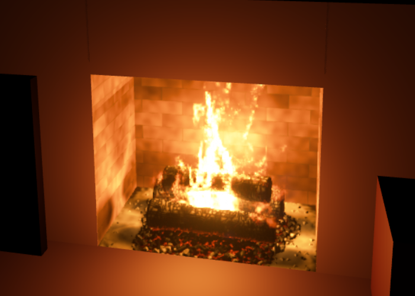 | 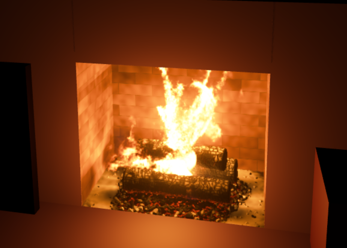 |
| **high** | **ultra** |
| 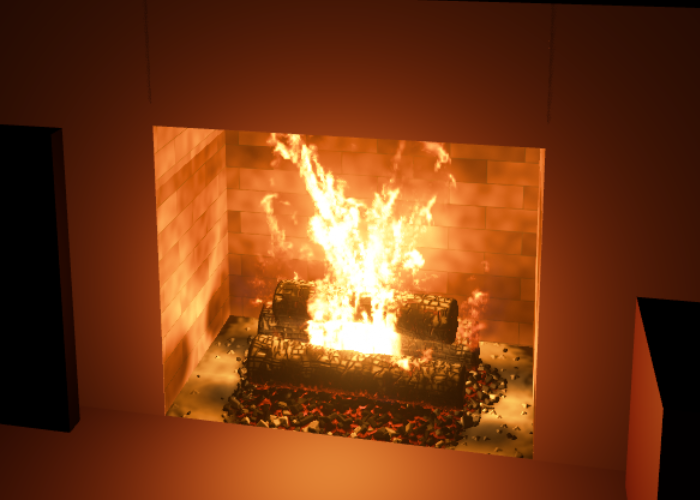 | 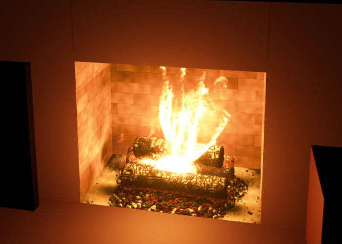 |

| | start | fire | seated |
|---|---|---|---|
| low |  | 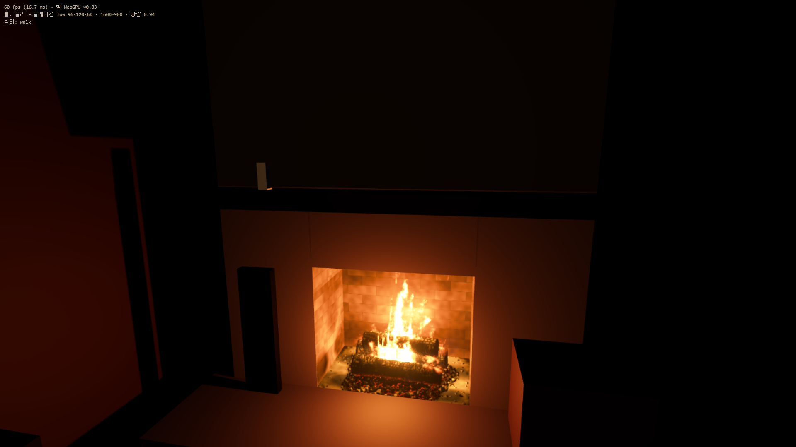 | 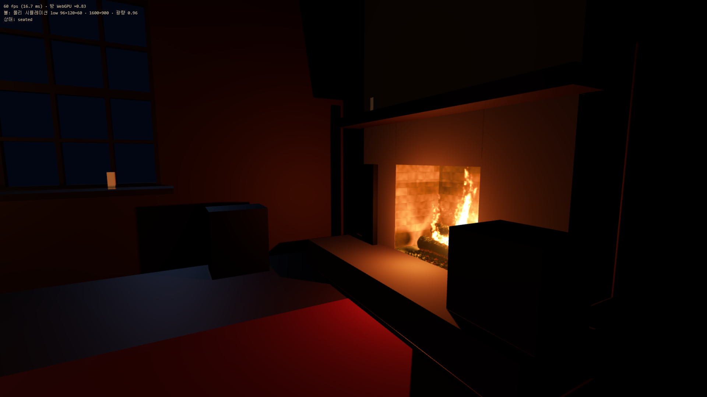 |
| medium |  | 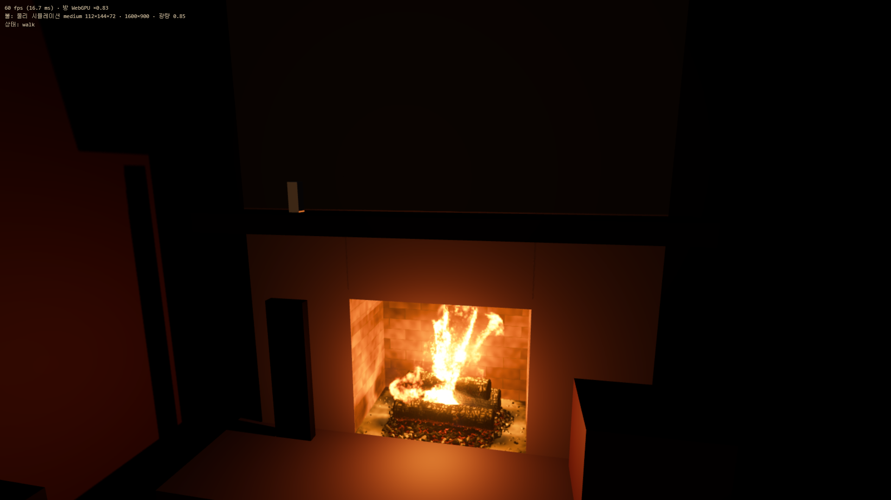 | 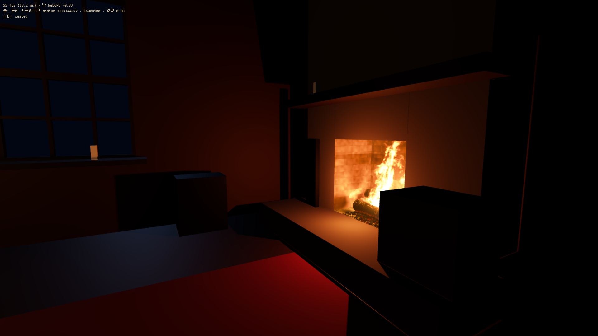 |
| high |  | 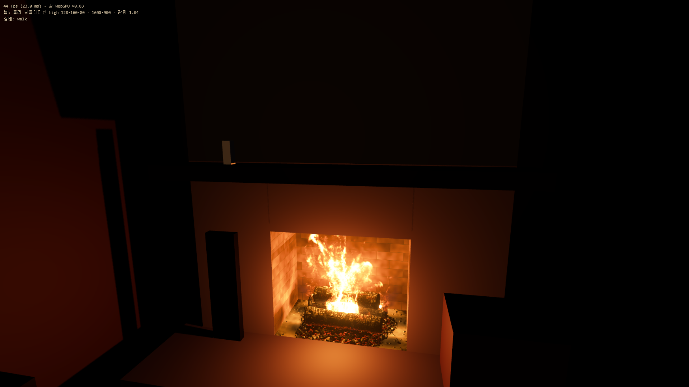 | 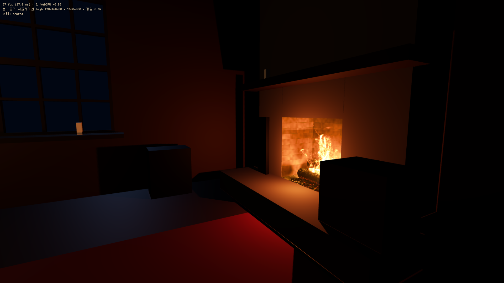 |
| ultra | 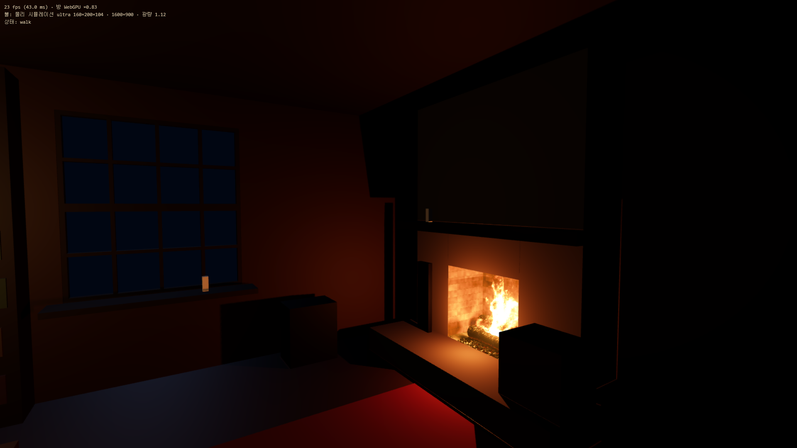 | 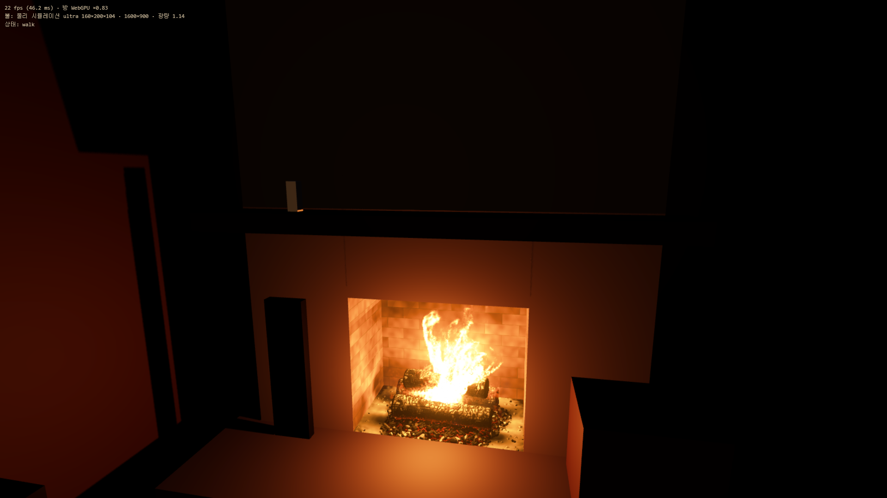 |  |

- **이상 유무**: 16장 모두 벽난로 구멍 안에 불꽃, 벽돌 화실, 장작, 숯이 보이고 구멍 테두리와 맞는다. 검은 화면, 깨진 부분, 빈 사각형은 없다.
- **품질 차이는 불꽃 모양에서만 보인다.** low는 불꽃이 굵은 덩어리와 뿌연 연기 같은 부분으로 보인다. medium은 불꽃 갈래가 나뉘고 가장자리가 또렷해진다. high와 ultra는 갈래가 더 가늘고 날카로우며 장작 표면의 갈라진 무늬가 조금 더 선명하다. high와 ultra 사이의 차이는 정지 화면에서는 작다.
- **단계를 올려도 그대로인 것**: 벽돌 화실은 네 단계 모두 줄눈이 흐릿하게 뭉개져 보인다. 장작과 숯의 선명도도 거의 같다. 불 화면 해상도가 네 단계 모두 1600×900이기 때문으로 보인다.
- 정지 화면이라 high와 ultra에서 시뮬레이션이 느려진 것(불이 느리게 움직임)은 그림에 드러나지 않는다.

## 문제점

1. **기본값 medium이 이 PC에서 60fps를 안정적으로 못 지킨다.** 앉아서 책 읽는 시점이 가장 무겁고(55.5fps), 불 보기 시점도 GPU가 99%까지 찬다. 여유를 두려면 medium은 격자 104칸 이하가 맞다.
2. **high와 ultra는 격자를 줄여도 안 된다.** 그리기 설정(volScale 1.0, surfScale 1.0, stepMul 0.6 / 0.5)이 부담의 대부분이다. high 설정은 72칸, 즉 low(96칸)보다 성긴 격자에서만 60fps가 나온다.
3. **속도가 떨어지면 불이 느리게 탄다.** 한 프레임에 시뮬레이션을 최대 2걸음만 돌리기 때문에 60fps 아래로 내려가면 시뮬레이션 시간이 실제보다 느리게 간다(high 0.61~0.80, ultra 0.33~0.39).
4. **불 화면 해상도가 단계와 무관하게 1600×900이다.** 방 픽셀 배율 0.833(1920 폭 화면에서 1600 폭으로 그림)에 불 배율 1.0이 곱해진 값이다. 불을 화면 해상도(1920×1080)로 그리는 단계는 없다.
5. **16.9ms 기준은 측정 흔들림에 걸린다.** low 불 보기(2.7%), medium 96칸(2.5%), 104칸(2.7%), high 72칸(5.3%)은 가장 긴 프레임이 17.0~17.4ms인데도 글자 그대로의 기준으로는 탈락이다. 표에는 지킴(*)으로 적었다.
6. **경계 근처는 실행마다 달라진다.** medium 112칸이 그 예다. 측정을 이어서 하는 동안 노트북이 데워진 영향일 수 있으나 온도는 재지 않았다.
7. 소리는 켜지 않은 상태로 쟀다(시작 화면을 클릭하지 않음).

## 참고: 무효 (주사율 상한 해제 측정)

수직 동기를 끄고(`--disable-gpu-vsync --disable-frame-rate-limit`) 5초씩 잰 값이다. 방 렌더링도 같이 빨라져 GPU가 항상 99%가 되므로 불의 부담을 따로 볼 수 없어 판단에 쓰지 않는다. 원본은 `q4/ref-uncapped.json`.

| 품질 | 시점 | 평균 fps | 1% low | 중앙값 (ms) | 최대 (ms) | GPU 3D |
|---|---|---|---|---|---|---|
| low | start | 124.8 | 80.5 | 8.3 | 13.7 | 99% |
| low | fire | 104.1 | 61.0 | 9.7 | 16.9 | 99% |
| low | seated | 82.2 | 32.4 | 12.0 | 32.2 | 99% |
| medium | start | 87.3 | 37.0 | 11.3 | 28.7 | 99% |
| medium | fire | 77.7 | 31.8 | 12.3 | 33.1 | 100% |
| medium | seated | 57.3 | 27.8 | 16.9 | 36.2 | 99% |
| high | start | 50.1 | 29.1 | 20.0 | 35.3 | 99% |
| high | fire | 44.7 | 9.1 | 21.4 | 268.9 | 100% |
| high | seated | 43.0 | 6.7 | 22.1 | 221.4 | 96% |
| ultra | start | 23.5 | 16.2 | 42.5 | 62.0 | 100% |
| ultra | fire | 23.0 | 20.0 | 43.2 | 50.2 | 100% |
| ultra | seated | 21.1 | 16.6 | 47.1 | 67.8 | 100% |

원본 값: `q4/measure-fixed.json`(1차), `q4/measure-grid1.json` ~ `measure-grid3.json`(2차).
