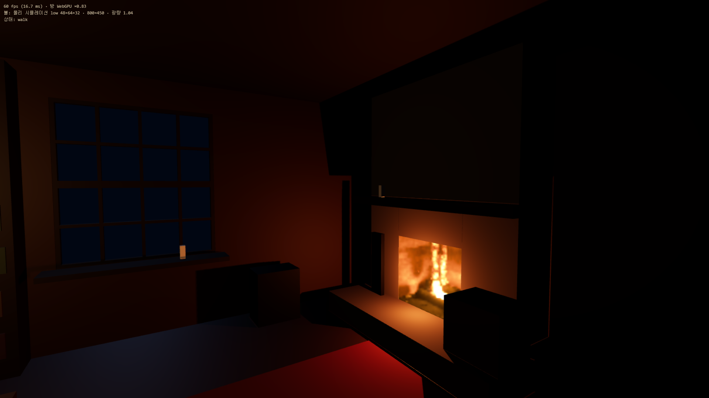
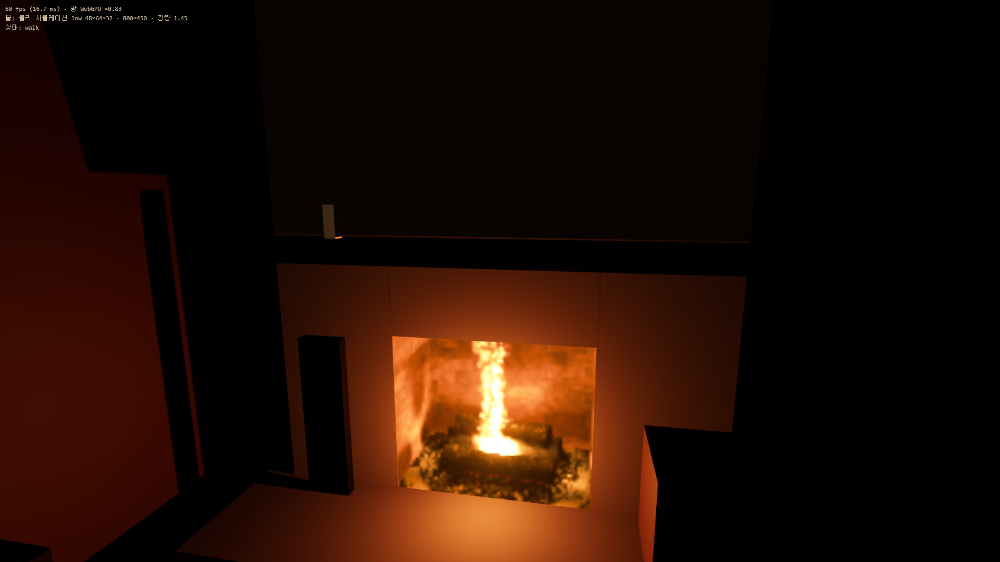
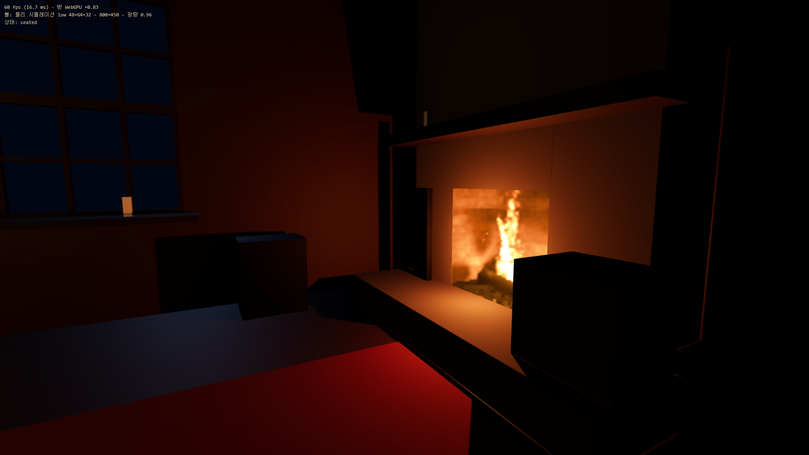
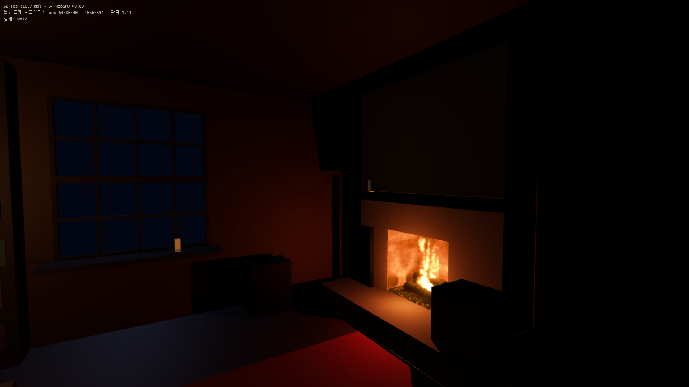
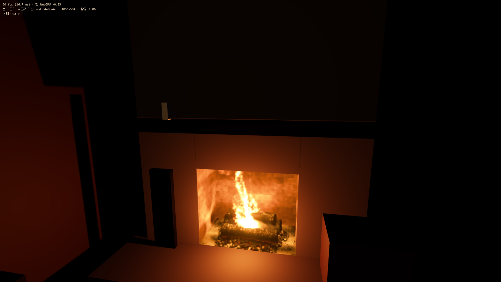
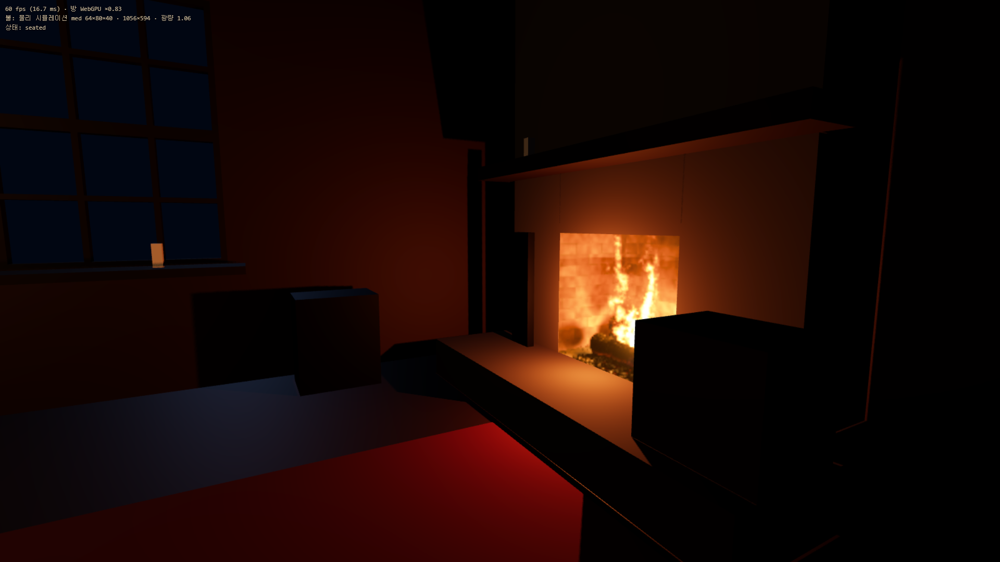
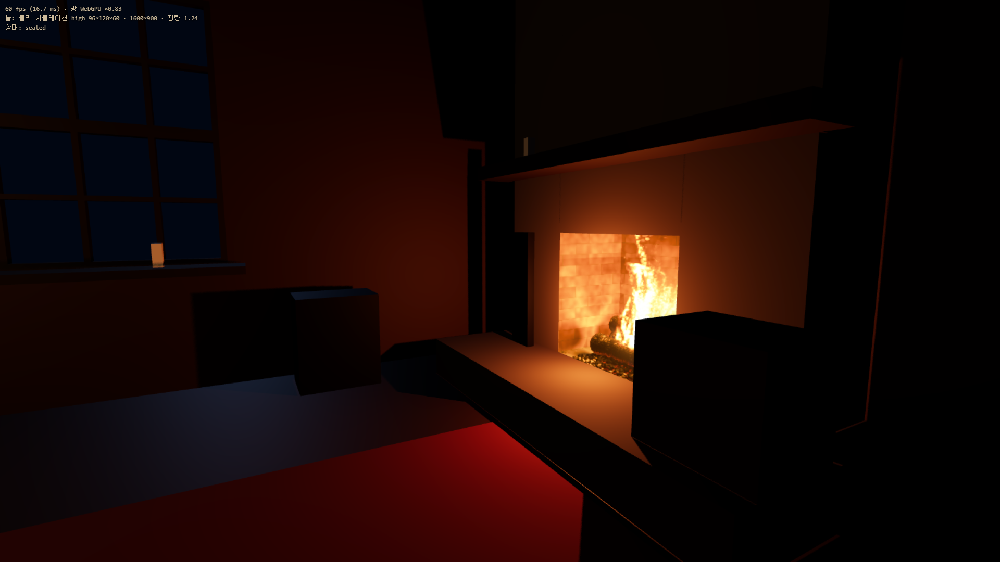

# 1단계 실측: Intel Arc B390

측정일 2026-11-21. 브랜치 `claude/project-thread-hycyb7` (커밋 62d8114), `npm run dev` 서버에 설치된 Edge를 창 모드(headless 아님)로 붙여 실제 GPU에서 쟀다.

## 요약

- 세 품질(low, med, high) 모두, 세 시점 모두 **평균 60 fps**로 화면 주사율 상한에 붙어 있다. 가장 느린 프레임도 17.6 ms 이하다.
- 60 fps 상한(수직 동기)에 걸려 있어서 품질 사이의 여유 차이는 이 측정으로는 알 수 없다. high도 상한을 채운다는 것까지만 확인됐다.
- 해상도 자동 조절은 한 번도 내려가지 않았다(방 배율이 처음 값 ×0.83 = 1600/1920 그대로).
- 물리 불꽃이 세 품질 모두 정상 동작했다(대체 표시로 떨어지지 않음). 불과 벽돌 화실, 장작이 벽난로 구멍 안에 맞게 보인다.
- 콘솔 오류는 404 한 건(`/favicon.ico` 없음)뿐이고, 나머지는 경고 3종이다.

## 환경

| 항목 | 값 |
|---|---|
| 브라우저 | Microsoft Edge 157.0.4341.60 (Playwright `channel: 'msedge'`, `headless: false`) |
| 실행 인자 | `--enable-unsafe-webgpu --autoplay-policy=no-user-gesture-required` |
| 뷰포트 | 1920×1080, devicePixelRatio 1 |
| 화면 | 1920×1080 |
| 방 렌더러 | WebGPU, 픽셀 배율 0.833, 캔버스 버퍼 1600×900 (표시 1920×1080) |
| 어댑터 vendor | `intel` |
| 어댑터 architecture | `xe-3lpg` |
| 어댑터 device | (빈 문자열) |
| 어댑터 description | (빈 문자열) |
| float32-filterable | 있음 |
| texture-formats-tier2 | 있음 |
| shader-f16 | 있음 |

어댑터 features 전체(25개):
`atomic-vec2u-min-max`, `bgra8unorm-storage`, `chromium-experimental-multi-draw-indirect`, `chromium-experimental-sampling-resource-table`, `chromium-experimental-timestamp-query-inside-passes`, `clip-distances`, `core-features-and-limits`, `depth-clip-control`, `depth32float-stencil8`, `dual-source-blending`, `float32-blendable`, `float32-filterable`, `indirect-first-instance`, `primitive-index`, `rg11b10ufloat-renderable`, `shader-f16`, `subgroup-size-control`, `subgroups`, `texture-component-swizzle`, `texture-compression-bc`, `texture-compression-bc-sliced-3d`, `texture-compression-unaligned`, `texture-formats-tier1`, `texture-formats-tier2`, `timestamp-query`

## 측정 방법

- 페이지: `/?q=low&stats`, `/?q=med&stats`, `/?q=high&stats` (headless 쿼리 없음). 품질마다 새 페이지.
- `NANRO.ready` 대기 → 시작 화면 숨김 → 25초 대기 → 시점 3개를 차례로(시작 위치, 불 보기, 독서 의자에 앉기 후 2초) 각각 5초 측정.
- 프레임: 페이지 안에서 requestAnimationFrame 간격을 5초 모았다. 1% low는 가장 느린 1% 프레임의 평균 시간을 fps로 바꾼 값이다.
- 측정 직후 `page.screenshot`으로 저장하고 같은 순간의 값을 기록했다. 원본 값은 [measure.json](measure.json).
- 전체를 두 번 돌렸다. 표는 두 번째 실행이고, 첫 번째 실행의 프레임 수치도 같은 범위였다(평균 60.0 fps, 최대 17.1 ms).

## 성능 (품질 × 시점)

| 품질 | 시점 | 평균 fps | 1% low fps | 최대 프레임 (ms) | 프레임 수 / 5초 | 불 시뮬레이션 격자 | 불 해상도 | light.level | light.raw | light.ref | power | 시뮬레이션 시각 (초) |
|---|---|---|---|---|---|---|---|---|---|---|---|---|
| low | start | 60.0 | 58.6 | 17.2 | 300 | 48×64×32 | 800×450 | 1.15 | 0.206 | 0.180 | 0.62 | 30.2 |
| low | fire | 60.0 | 58.8 | 17.0 | 300 | 48×64×32 | 800×450 | 1.25 | 0.273 | 0.219 | 0.62 | 35.9 |
| low | seated | 60.0 | 58.8 | 17.0 | 301 | 48×64×32 | 800×450 | 1.20 | 0.223 | 0.185 | 0.62 | 43.0 |
| med | start | 60.0 | 58.7 | 17.1 | 300 | 64×80×40 | 1056×594 | 0.93 | 0.239 | 0.257 | 0.62 | 23.8 |
| med | fire | 60.0 | 58.8 | 17.0 | 300 | 64×80×40 | 1056×594 | 1.06 | 0.261 | 0.248 | 0.62 | 29.5 |
| med | seated | 60.0 | 57.9 | 17.6 | 300 | 64×80×40 | 1056×594 | 1.09 | 0.301 | 0.276 | 0.62 | 36.7 |
| high | start | 60.0 | 58.9 | 17.0 | 300 | 96×120×60 | 1600×900 | 1.01 | 0.263 | 0.261 | 0.62 | 23.5 |
| high | fire | 60.0 | 58.9 | 17.0 | 300 | 96×120×60 | 1600×900 | 1.07 | 0.255 | 0.238 | 0.62 | 29.2 |
| high | seated | 60.0 | 58.9 | 17.0 | 300 | 96×120×60 | 1600×900 | 1.09 | 0.327 | 0.300 | 0.62 | 36.3 |

모든 시점에서 중앙값 프레임 시간은 16.7 ms, 방 픽셀 배율은 0.833, 캔버스 버퍼는 1600×900이었다. 화면의 stats 표시는 전부 `60 fps (16.7 ms) · 방 WebGPU ×0.83`.

카메라 자세(세 품질 동일): start는 x 2.6, z 4.1, yaw -0.569, pitch -0.05. fire는 x 3.2, z 2.0, yaw -1.385, pitch -0.18. seated는 x 3.4, z 3.5, yaw -0.499, pitch -0.12, 상태 `seated`.

## 콘솔 오류와 경고

| 품질 | 종류 | 내용 |
|---|---|---|
| low (첫 페이지만) | error | `Failed to load resource: the server responded with a status of 404 (Not Found)` |
| 전부 | warning | `The powerPreference option is currently ignored when calling requestAdapter() on Windows. See https://crbug.com/369219127` |
| 전부 | warning | `THREE.Clock: This module has been deprecated. Please use THREE.Timer instead.` |
| 전부 | warning | `THREE.WebGPURenderer: PCFSoftShadowMap has been removed. Using PCFShadowMap instead.` |

- 404의 주소는 콘솔 메시지에도 Playwright 응답 이벤트에도 나오지 않았다. `index.html`에 아이콘 지정이 없고 `http://127.0.0.1:5320/favicon.ico`가 404를 돌려주는 것, 브라우저를 새로 띄운 첫 페이지에서만 한 번 나오는 것으로 보아 파비콘 요청으로 판단한다(추정).
- 페이지 예외(pageerror)와 WebGPU 검증 오류는 없었다.

## 스크린샷 관찰

파일: `<품질>-<시점>.png` 9장 (1920×1080).

| | start | fire | seated |
|---|---|---|---|
| low |  |  |  |
| med |  |  |  |
| high |  |  |  |

- **불과 화실**: 9장 모두 벽난로 구멍 안에 불꽃, 벽돌 화실(뒷벽과 왼쪽 옆벽), 장작 더미, 바닥의 숯이 보인다. 검은 화면이나 깨진 부분, 빈 사각형은 없다.
- **위치 맞춤**: 불 그림이 구멍 테두리에 딱 맞는다. 세 시점 모두 구멍 밖으로 새거나 안쪽이 비는 곳이 없고, 화실 벽의 원근이 방의 원근과 맞는다. 앉은 시점과 시작 시점에서는 앞에 놓인 상자(안락의자로 보임)가 구멍 오른쪽 아래를 제대로 가린다.
- **품질 차이**: low는 불과 벽돌이 눈에 띄게 뭉개지고 계단 모양이 보인다(800×450을 늘린 결과). med는 벽돌 줄눈이 구분되고, high는 벽돌, 장작 결, 숯 알갱이, 불꽃 갈래가 선명하다.
- **방 조명**: 불빛이 벽난로 앞면, 난로 바닥돌, 붉은 러그, 왼쪽 벽을 주황색으로 비춘다. 그 밖은 매우 어둡다. 벽난로 위쪽 벽과 오른쪽은 거의 검정이다(회색 상자 단계의 임시 조명).
- **stats 표시**: 왼쪽 위에 정상 표시된다. 시작 화면은 숨긴 상태다.

## 문제점과 한계

1. **60 fps 상한에 막힌 측정**: 세 품질이 전부 상한이라 high에 여유가 얼마나 남는지는 모른다. 여유를 재려면 수직 동기를 끄거나(`--disable-gpu-vsync --disable-frame-rate-limit`) GPU 시간(timestamp-query, 이 어댑터에 있음)을 재야 한다. 이번에는 지시된 인자만 썼다.
2. **첫 실행의 low-start 시점 불일치(재현 안 됨)**: 첫 번째 실행에서 low의 시작 시점 스크린샷만 카메라가 다른 방향이었다(왼쪽에 책장이 보이고 벽난로가 오른쪽으로 치우침, [low-start-run1.png](low-start-run1.png)). 같은 실행의 med, high와 두 번째 실행 전체, 따로 돌린 확인(low, med 모두 x 2.6, z 4.1, yaw -0.569)에서는 시작 자세가 같았다. 첫 실행은 자세 값을 기록하지 않아 원인을 확인하지 못했다. 그 페이지는 준비까지 약 15초 더 걸린 첫 로드였다. 표와 스크린샷 9장은 두 번째 실행 것이다.
3. **`/favicon.ico` 404**: 위 오류 목록 참고. 동작에는 영향이 없다.
4. **경고 2종은 코드 쪽 정리 대상**: `THREE.Clock` 사용 중단 예고, `PCFSoftShadowMap` 제거(현재 `PCFShadowMap`으로 대체되어 그림자 가장자리가 의도와 다를 수 있음).
5. **어댑터 device, description이 빈 문자열**: Edge가 값을 내주지 않아 "Arc B390"이라는 이름은 WebGPU로 확인되지 않는다. vendor `intel`, architecture `xe-3lpg`만 확인된다.
6. **소리는 확인하지 않았다**: 시작 화면을 클릭하지 않고 숨겼기 때문에 소리 엔진은 켜지지 않은 상태로 쟀다.
