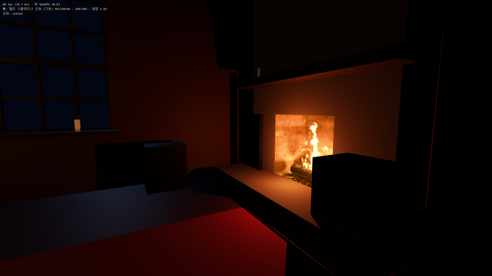
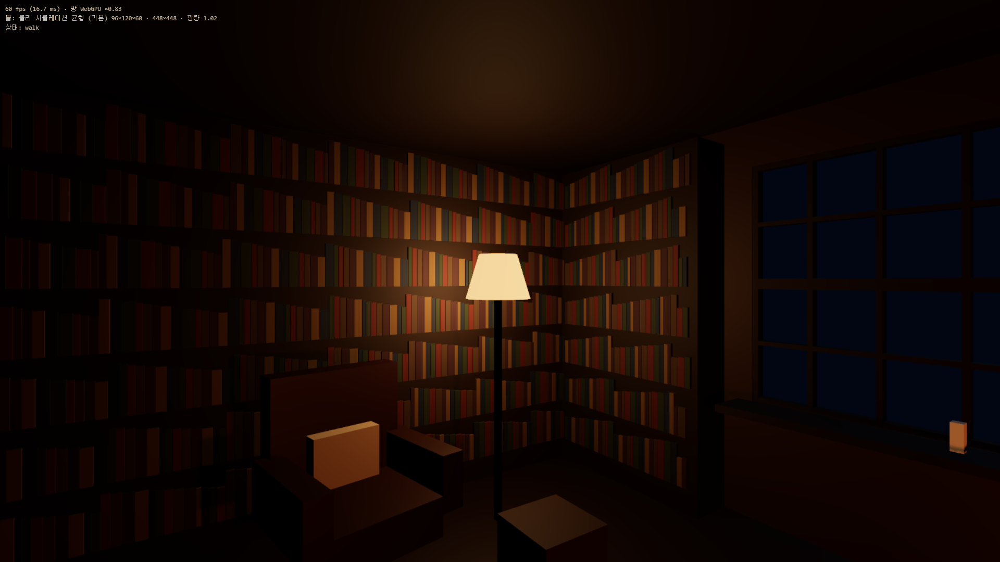
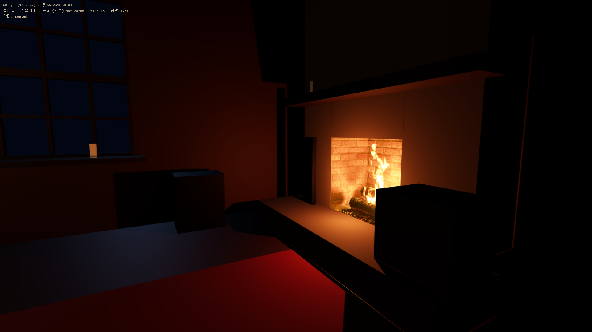
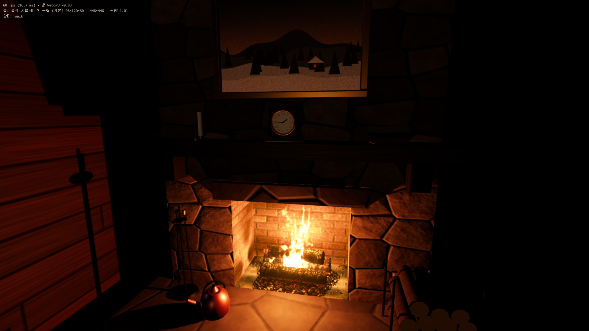
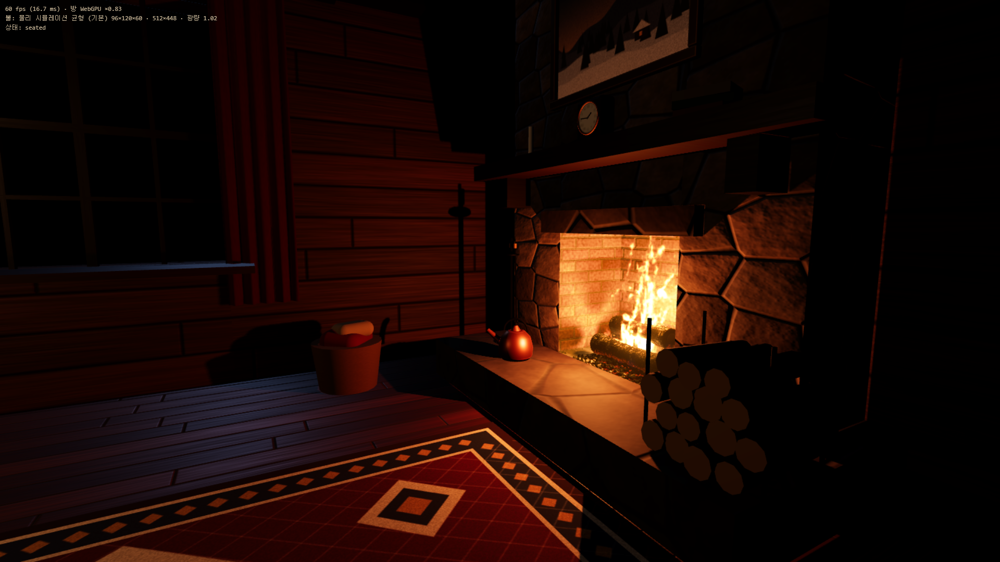

# 단계별 사진 (Arc B390 실제 화면)

Edge 창 모드 1920×1080, 기본 설정(프리셋 "균형", 격자 96×120×60). 각 단계의 커밋을 따로 받아 같은 시점에서 찍었다. 모든 시점에서 60 fps, 콘솔 오류 없음. 촬영 시각은 밤(PC 시계 기준 새벽 1~2시)이다.

| 단계 | 커밋 | 시작 위치 | 불 보기 | 책장 쪽 | 앉은 시점 |
|---|---|---|---|---|---|
| 1단계 마무리 (설정창) | 4027c01 |  |  |  |  |
| 화실 벽돌 무늬 | 0dfb0c6 |  |  |  |  |
| 3단계 재질과 가구 | c196aa2 |  |  |  |  |
| 4단계 해·달, 계절·날씨 | 30294c8 |  |  |  |  |

각 폴더에는 시작 화면(1-title), 창 쪽(4b-window), 책 펼치기(6-reading), 설정창(7, 8) 사진도 있다.

## 관찰

- **화실 벽돌 (0dfb0c6)**: 흐릿하던 벽돌에 줄눈이 또렷하게 보이고 벽돌마다 색이 조금씩 다르다.
- **3단계 (c196aa2)**: 회색 상자가 널빤지 벽과 천장, 자연석 벽난로, 가죽 안락의자, 무늬 러그, 주전자, 장작 더미, 벽난로 위 그림과 시계, 커튼으로 바뀌었다. 깨진 면이나 빈 재질은 보이지 않는다.
- **4단계 (30294c8)**: 창밖에 별이 보이고 창턱과 벽난로 선반의 초에 불이 켜졌다. 밤이라 해와 낮 조명은 이 사진으로 확인되지 않는다.
- **공통**: 벽난로 오른쪽과 방의 오른쪽 절반이 거의 검정으로 나온다. 불 보기 시점에서 화면 오른쪽 3분의 1이 비어 보인다.
