# 2차 개선 실제 화면 확인 (Intel Arc B390)

2026-11-22, 커밋 e246076. Edge 157 창 모드, 1920×1080, 60Hz 수직 동기, 기본 설정(프리셋 "균형", 격자 96×120×60). 사진은 `pc-photos/`. 밤 장면의 주소 옵션은 `?time=22&season=winter&weather=clear`.

## 요약

- 모든 장면이 60fps이고 콘솔 오류, 깨진 화면, 깜박임은 없었다.
- **읽기 중 불 기록 재생은 조건이 맞을 때만 켜진다.** 불을 60초 넘게 본 뒤에 책을 펴면 바로 켜지고 GPU가 62% → 42%로 내려간다. 들어와서 바로 책을 펴면 몇 분을 읽어도 켜지지 않는다(아래 3번).
- 장작 상태에 따라 불 세기와 장작 모양이 분명히 달라진다.
- 읽기 자세의 글자는 또렷하고 1080p에서 편하게 읽힌다.
- 실사 효과(`nopost`, `noenv`)의 비용은 GPU 1~2%p로 측정 흔들림 안이다.

## 2. 사진

### 방 전경과 창밖

| 밤 전경 1 | 밤 전경 2 |
|---|---|
| 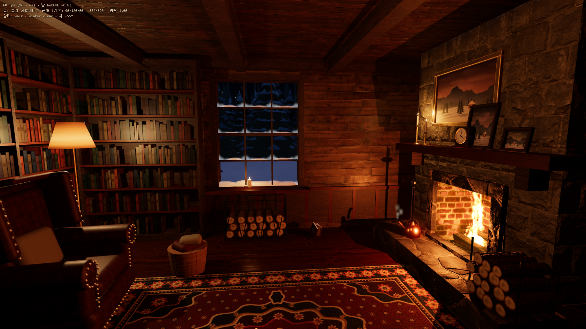 | 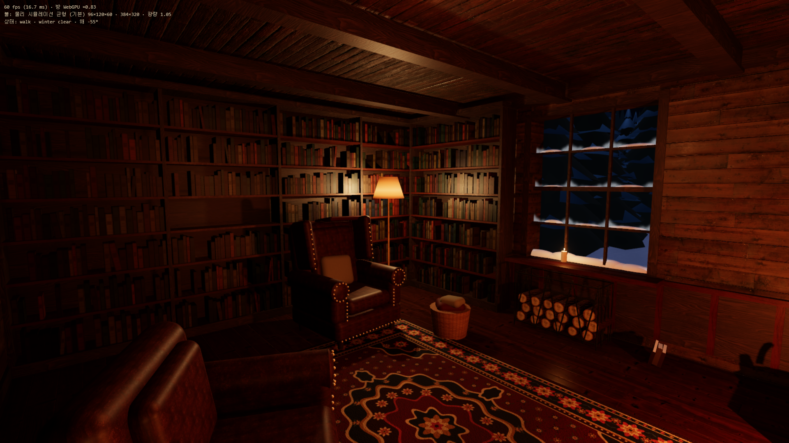 |

| 창밖 밤 | 창밖 낮 (`?time=12`) | 낮 전경 |
|---|---|---|
| 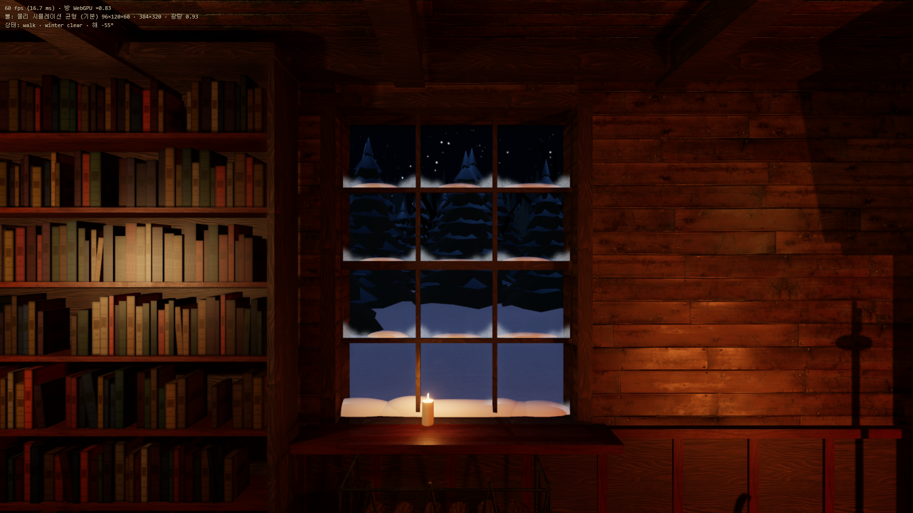 | 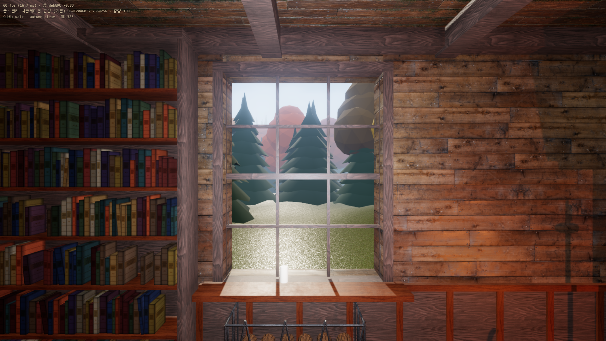 | 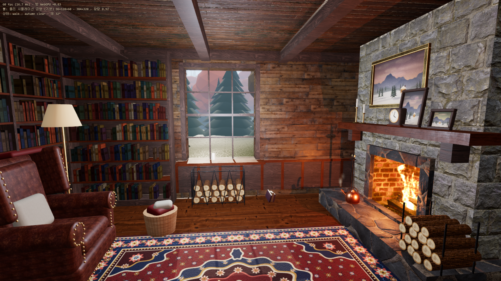 |

- 배치가 참고 사진과 같은 구성이다: 왼쪽 벽 가득 책장, 그 앞에 징 장식 가죽 의자와 스탠드, 가운데 벽에 격자창과 창턱 촛불, 창 아래 장작 선반, 오른쪽에 돌 벽난로와 액자 3개, 바닥에 페르시아풍 러그.
- 밤 창밖은 눈 덮인 전나무가 층층이 보이고 별이 있다. 창턱에 눈이 쌓여 있다.
- 낮 창밖은 전나무와 붉은 활엽수, 풀밭이 보인다. 풀밭은 잔 점이 많은 무늬로 보여 조금 거칠다.
- 밤 전경 2(책장 쪽)는 스탠드 하나만 밝아 전체가 꽤 어둡다.

### 벽난로와 장작 상태

각 상태로 바꾸고 20초 뒤에 찍었다.

| 장작 | 불 보기 | 가까이 |
|---|---|---|
| [1, 1, 1] | 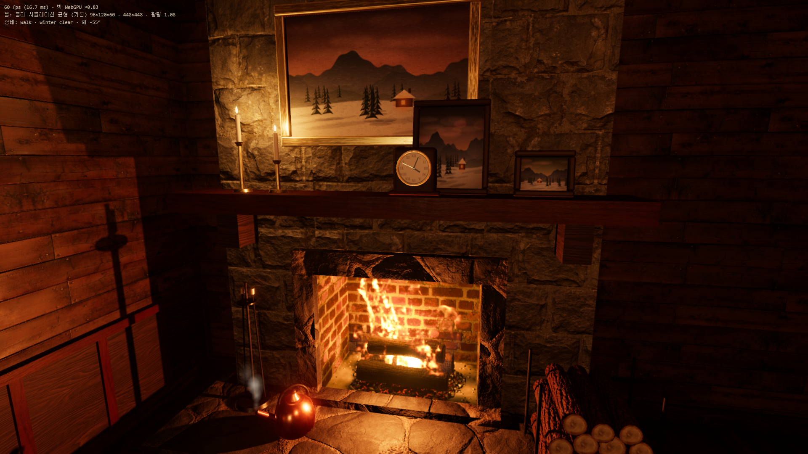 | 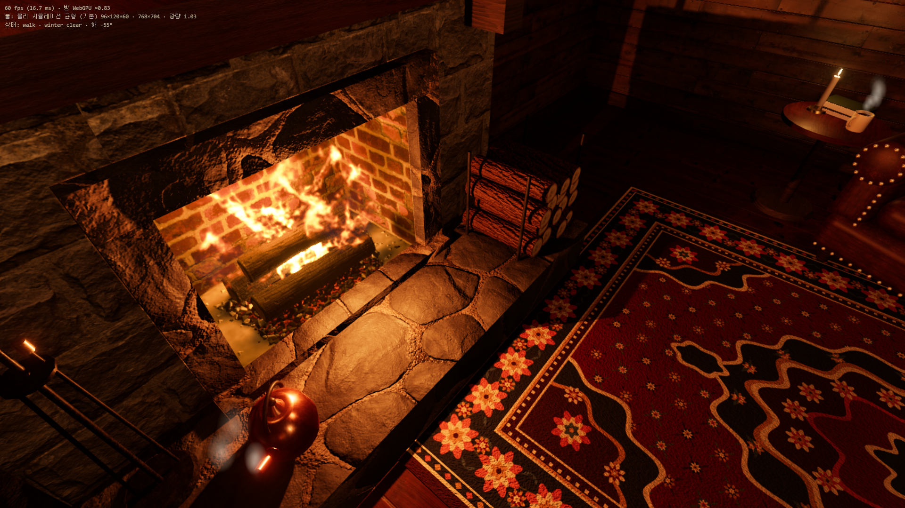 |
| [0.5, 0.25, 0.08] | 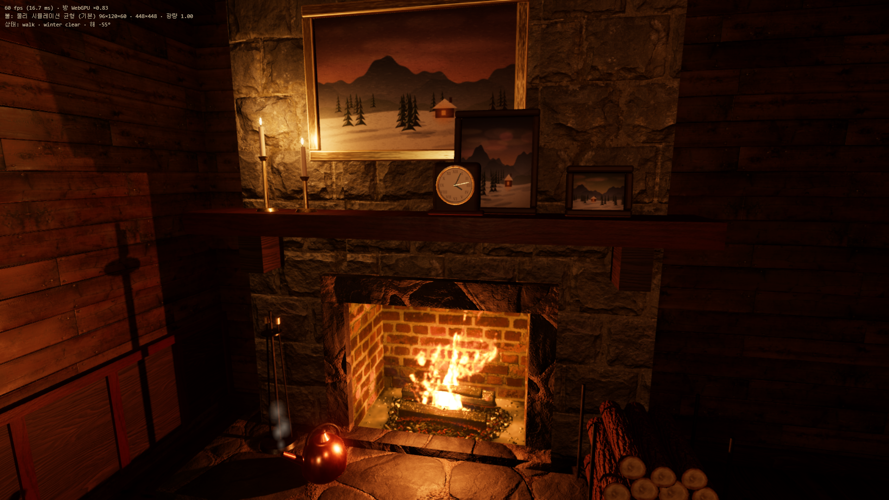 | 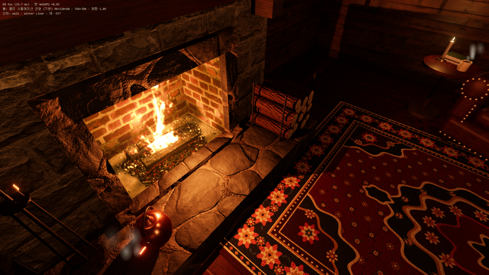 |
| [0, 0, 0] | 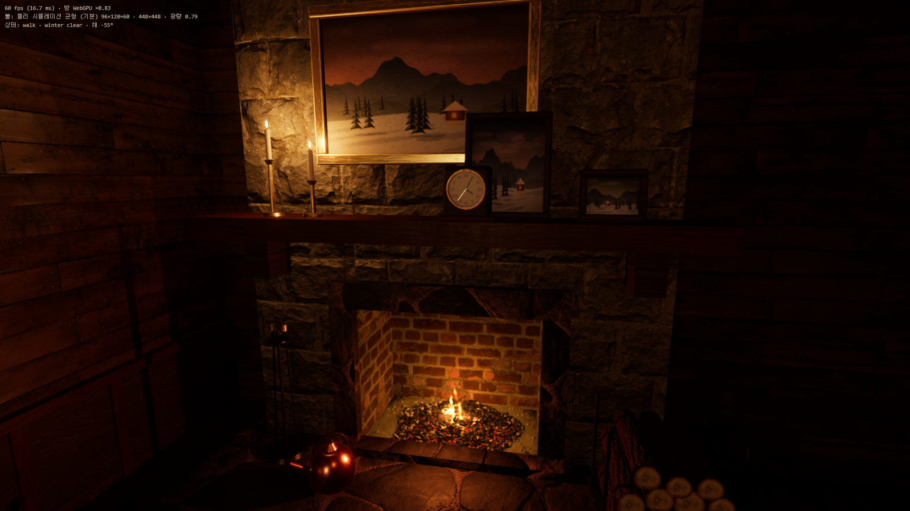 | 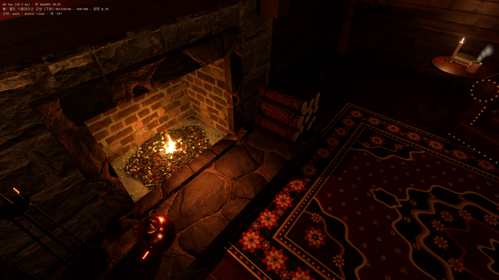 |

| 장작 | 불 세기 (목표값) | 광량 원값 | 보이는 모습 |
|---|---|---|---|
| [1, 1, 1] | 0.68 | 0.256 | 굵은 장작 세 개가 또렷하고 불꽃이 화실 높이의 3분의 2까지 여러 갈래로 오른다 |
| [0.5, 0.25, 0.08] | 0.52 | 0.198 | 장작이 가늘어지고 검게 그을린 숯처럼 보이며 불꽃이 조금 낮아진다 |
| [0, 0, 0] | 0.20 | 0.048 | 장작은 사라지고 붉은 숯 더미에 작은 불꽃 하나만 남는다. 화실과 방이 눈에 띄게 어두워진다 |

장작이 검게 변하고 가늘어지는 것, 불 세기가 달라지는 것이 모두 확인된다. 다 타면 "장작이 다 타고 숯불만 남았습니다. 장작을 넣어 주세요" 알림이 뜬다.

### 장작 더미

| 가득 (15개) | `startLog()` 4번 뒤 (11개) |
|---|---|
| 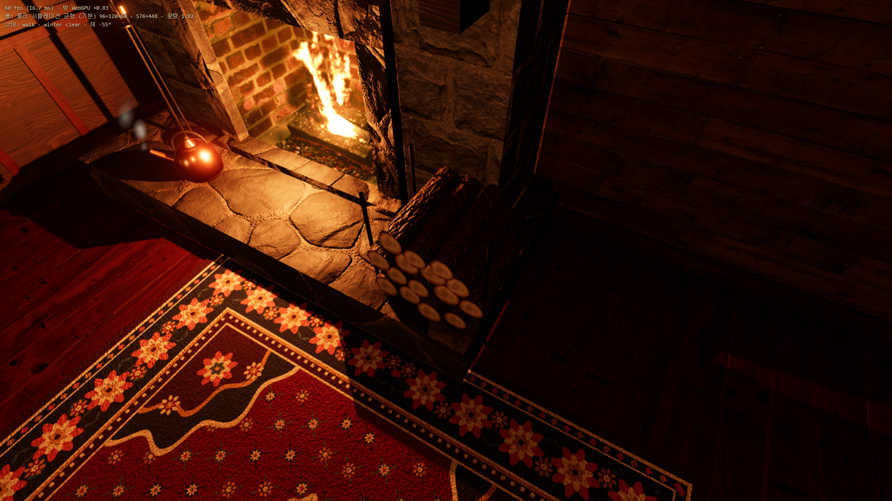 | 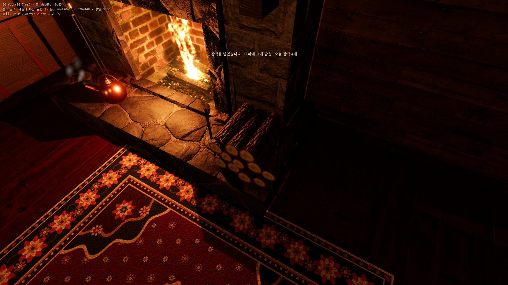 |

부를 때마다 더미가 15 → 14 → 13 → 12 → 11개로 줄고 "장작을 넣었습니다 · 더미에 N개 남음" 알림이 뜬다. 화실이 가득 차 있으면 넣어지지 않아서, 시험할 때는 매번 화실을 20%로 낮춘 뒤 불렀다. 사진에서는 더미가 화면 가장자리에 걸려 줄어든 차이가 작게 보인다.

### 읽기 자세 (견본 책 "겨울 난롯가에서")

| 읽기 의자 (demo3) | 다른 의자 (demo3wing) |
|---|---|
| 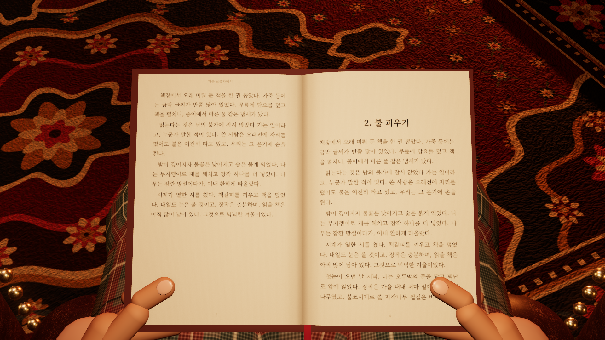 | 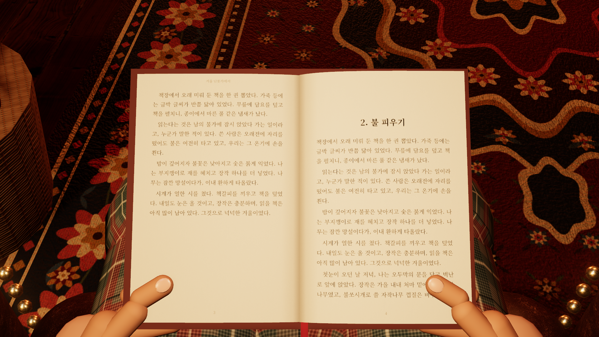 |

- 체크 담요를 덮은 무릎 위에 책을 두 손으로 잡은 자세로 보인다. 두 의자 모두 같은 자세가 나오고 배경(러그, 의자 팔걸이, 협탁)만 다르다.
- **글자 선명도**: 본문이 또렷하다. 획이 뭉개지거나 번지지 않고 장 제목과 본문이 선명하게 구분된다. 본문 글자는 약 20픽셀로 1080p에서 편하게 읽힌다. 지난번의 흐릿함은 없다.
- 손은 엄지와 손가락 몇 개가 단순한 모양으로 보인다. 오른쪽 엄지가 본문 마지막 두 줄의 끝 글자를 가린다.

## 3. 측정 (각 30초, 60Hz)

### 의자에 앉은 상태

| 조건 | fps | 1% low | 최대 프레임 | GPU 3D |
|---|---|---|---|---|
| 기본 | 60.0 | 58.5 | 20.3ms | 70% |
| `&nopost` | 60.0 | 59.1 | 17.0ms | 69% |
| `&noenv` | 60.0 | 59.0 | 17.1ms | 68% |
| `&nopost&noenv` | 60.0 | 59.0 | 17.2ms | 68% |

실사 효과와 반사 환경 맵의 비용은 1~2%p다. 앉은 상태의 GPU는 텍스처 단계(59%)보다 약 10%p 올랐다.

### 읽기 상태

| 조건 | fps | 최대 프레임 | GPU 3D | 통계 표시 |
|---|---|---|---|---|
| 들어와 30초 뒤 책을 폄, 직후 30초 (재생 켬) | 60.0 | 20.5ms | 61% | 불: 물리 시뮬레이션 |
| 같은 실행, 70초 뒤 30초 (재생 켬) | 60.0 | 17.8ms | 58% | 불: 물리 시뮬레이션 (**재생으로 바뀌지 않음**) |
| 재생 끔, 직후 30초 | 60.0 | 17.2ms | 57% | 불: 물리 시뮬레이션 |
| 재생 끔, 70초 뒤 30초 | 60.0 | 17.1ms | 67% | 불: 물리 시뮬레이션 |
| **불을 75초 본 뒤 책을 폄 (재생 켬)** | 60.0 | 17.2ms | **42%** | **불: 기록 재생 중 (60초)** |
| 같은 자리에서 재생 끔 | 60.0 | 20.7ms | 62% | 불: 물리 시뮬레이션 |
| 다시 켬 | 60.0 | 17.7ms | 43% | 불: 기록 재생 중 (60초) |

- **재생이 켜지면 GPU가 62% → 42~43%로 약 20%p 내려간다.** 끊김은 없었다(최대 17.7ms). 책을 덮으면 곧바로 물리 시뮬레이션으로 돌아온다.
- **들어와서 30초 안에 책을 펴면 100초를 읽어도 재생으로 바뀌지 않는다.** 두 의자 모두 75초까지 지켜봤는데 그대로였다. 불빛 기록은 불이 화면에 보이는 동안에만 쌓이는데, 읽기 자세에서는 불이 화면 밖이라 기록이 멈추는 것으로 보인다(`fireLayer.update`가 구멍이 안 보이면 불빛 읽어오기 전에 끝나고, 기록은 불빛 값이 0.5초 안에 갱신됐을 때만 쌓임). 기록 60초가 책을 펴기 전에 다 차 있어야 재생이 켜진다.
- 지난번의 83ms, 166ms 끊김은 이번 측정에서는 나오지 않았다.

### 불이 붙기까지

| 실행 | 첫 화면 | 광량이 마지막 값의 50% | 80% |
|---|---|---|---|
| 1 | 1.6초 | 8초 | 9초 |
| 2 | 1.5초 | 8초 | 9초 |

들어온 뒤 5초까지는 광량이 0이고 화실이 어둡다(`ignite-0-5s.png`). 8~9초에 불이 붙고 10초부터 정상 밝기다(`ignite-0-15s.png`). 지난번 확인(약 25초에도 숯불만 보임)보다 훨씬 빨라졌다.

## 4. 이상한 점

| 항목 | 결과 |
|---|---|
| 깜박임, 반짝이는 점 | 정지 사진과 연속 측정에서는 보이지 않았다 |
| 구멍 주변 검은 테두리 | 화실 구멍 위쪽 돌 아래에 어두운 띠가 있다. 그림자인지 틈인지는 사진으로 구분되지 않는다. 구멍 옆과 아래에는 눈에 띄는 검은 선이 없다 |
| 창 주변 | 밤 창은 자연스럽다. 낮에는 창틀과 그 주변 벽이 회보라색으로 밝게 떠 보여 따뜻한 나무 벽과 어울리지 않는다(`day-window.png`) |
| 낮 풀밭 | 잔 점 무늬가 거칠게 보인다 |
| 콘솔 오류 | 사진과 측정에서는 없음. 책을 덮을 때 `The root document of this element is not valid for pointer lock.`가 한 번 나왔다(스크립트가 클릭 없이 호출해서 생긴 것으로 보임) |
| 불 기록 재생 | 위 3번. 바로 책을 펴면 켜지지 않는다 |
| 읽기 자세 | 오른쪽 엄지가 본문 끝 글자를 가린다 |
| 밤 밝기 | 책장 쪽 전경이 스탠드 주변 말고는 많이 어둡다 |

확인하지 않은 것: 가구 옮기기, 액자에 사진 넣기, 선반 시계가 PC 시계와 분 단위로 맞는지, 소리.

## 재확인 (커밋 01dae63)

같은 조건(Edge 창 모드, 1920×1080, 60Hz, 밤 `?time=22&season=winter&weather=clear`).

### 1. 불 기록 재생

들어와서 20초 뒤에 책을 폈다.

| 구간 | fps | 최대 프레임 | GPU 3D | 통계 표시 |
|---|---|---|---|---|
| 책을 편 직후 30초 | 60.0 | 17.1ms | 63% | 불: 물리 시뮬레이션 |
| 책을 펴고 70초 뒤 30초 | 60.0 | 17.3ms | **38%** | **불: 기록 재생 중 (60초)** |

책을 펴고 50초 뒤에 "기록 재생 중"으로 바뀌었다(들어와서 약 70초). 바뀐 뒤 GPU가 63% → 38%로 내려갔고 끊김은 없었다. 고쳐졌다.

### 2. 앉은 상태 GPU가 오른 원인

| 조건 | fps | 최대 프레임 | GPU 3D |
|---|---|---|---|
| 기본 | 60.0 | 33.4ms | 68% |
| `&nolampshadow` | 60.0 | 17.2ms | 69% |
| 바깥 숨김 (`NANRO.env.group.visible=false`) | 60.0 | 20.0ms | 71% |
| `&nolampshadow` + 바깥 숨김 | 60.0 | 20.5ms | 72% |

네 조건이 68~72%로 측정 흔들림(±5%p) 안이다. 스탠드 그림자와 바깥 풍경은 원인이 아니다. 앞서 잰 `nopost`, `noenv`도 차이가 없었으므로, 이 네 가지 가운데에는 원인이 없다. 남은 후보는 2차에서 늘어난 방 안의 물체(책장의 책, 가구, 러그 무늬)와 재질이지만 이번에는 재지 않았다. 기본 조건에서 33ms 프레임이 한 번 있었다.

### 3. 사진

| 읽기 자세 (demo3) | 낮 창 (`?time=12`) |
|---|---|
| 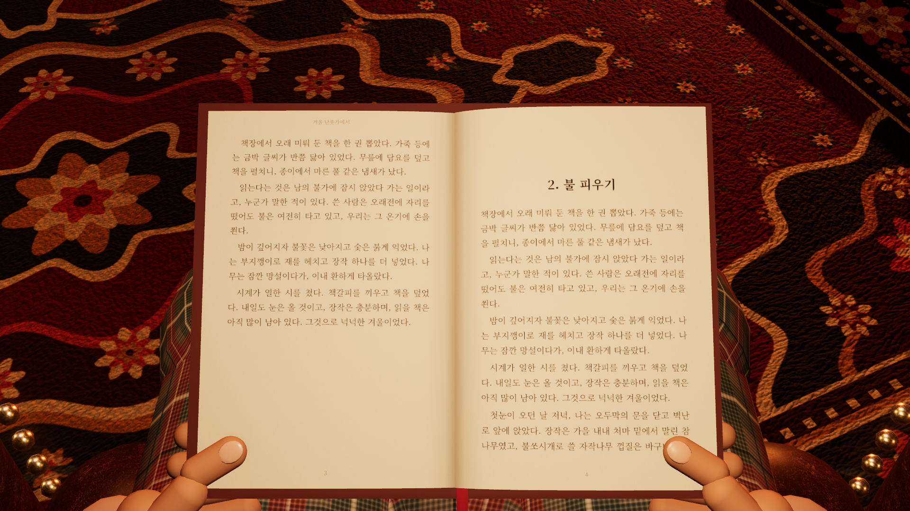 | 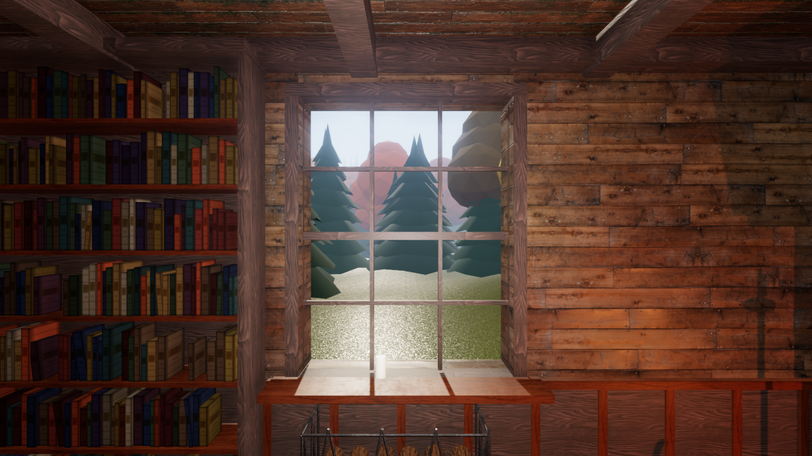 |

- **엄지**: 왼쪽 엄지는 글이 없는 여백에 있다. 오른쪽 엄지는 아래로 내려갔지만 마지막 줄의 끝 두세 글자("바구…" 뒤)를 아직 가린다. 지난번에는 두 줄을 가렸고 지금은 한 줄이다.
- **낮 창틀**: 회보라색으로 떠 보이던 것이 없어지고 창틀과 벽이 따뜻한 갈색으로 보인다. 자연스럽다. 풀밭의 잔 점 무늬는 그대로다.

## GPU 나눠 재기 (커밋 c03f322)

읽기 의자에 앉은 상태, 밤(`?time=22&season=winter&weather=clear`), 각 30초, 60Hz. 모든 조건에서 60.0fps.

| 조건 | 내용 | 최대 프레임 | GPU 3D |
|---|---|---|---|
| 기본 | 방 + 불 | 17.0ms | 69% |
| `&nofire` | 방만 | 18.6ms | **65%** |
| `&norender` | 방 + 불 계산만 | 17.1ms | 67% |
| `&nosim` | 방 + 불 그리기만 (계산은 18.5초에서 멈춤) | 17.1ms | 66% |
| `&q=light` | 방 + 가벼운 불 (격자 80×104×52) | 20.7ms | 69% |
| 기본 (다시) | 방 + 불 | 17.3ms | 79% |

- **GPU의 대부분은 방에서 나온다.** 불을 완전히 꺼도 65%다. 불 계산이나 그리기를 하나씩 빼도, 프리셋을 가벼움으로 바꿔도 66~69%로 거의 그대로다.
- 방만 그릴 때의 GPU는 1단계(회색 상자 방)에서 21~23%였다. 지금은 65%로 약 3배다.
- 같은 "기본"을 두 번 쟀는데 69%와 79%로 10%p 차이가 났다. 표의 조건 사이 차이(65~69%)는 이 흔들림보다 작아서, 불의 몫을 숫자로 정하기는 어렵다. 불이 없을 때가 가장 낮았다는 것까지만 말할 수 있다.
- `&q=light`는 통계 표시에 프리셋 이름이 "사용자 지정"으로 나온다(격자는 80×104×52로 맞음).

### 불 화면 크기와 방 배율

| | 방 배율 | 방 버퍼 | 불 화면 (앉은 시점) |
|---|---|---|---|
| 지금 (c03f322) | ×0.83 | 1600×900 | 384×320 |
| 텍스처 단계 (498dade) | ×0.83 | 1600×900 | 384×384 |
| 설정창 단계 (4027c01) | ×0.83 | 1600×900 | 384×384 |

불 화면은 예전보다 조금 작아졌고(세로 384 → 320) 방 배율은 같다. 불 쪽에서 GPU가 오른 것은 아니다.

### 읽기 자세

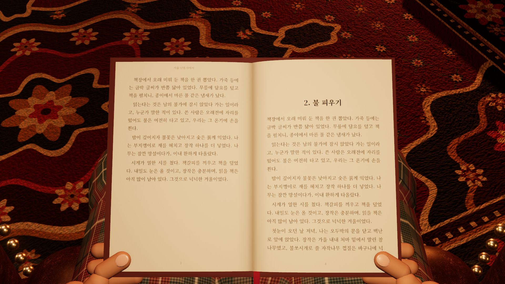

두 엄지가 모두 책 아래 귀퉁이의 여백으로 내려가 본문을 가리지 않는다. 마지막 줄까지 끝 글자가 다 보인다.

## 방 GPU 좁히기 (커밋 4d1edb4)

읽기 의자에 앉은 상태, 밤, 불 없음(`&nofire`), 각 30초, 60Hz. 모든 조건에서 60.0fps. "전속력"은 루프를 멈추고 방을 40번 연달아 그려 GPU가 끝낼 때까지 잰 한 프레임 시간이다(`renderer.render`만 부르므로 실사 효과 단계는 들어 있지 않다).

### 하나씩 끄기

| 조건 | GPU 3D | 전속력 한 프레임 | 그리기 호출 | 삼각형 | 방 버퍼 |
|---|---|---|---|---|---|
| 기준 `&nofire` (처음) | 66% | 4.12ms | 702 | 434,536 | 1600×900 |
| `&noshadow` | 65% | 3.75ms | 326 | 396,032 | 1600×900 |
| `&nomsaa` | 66% | 4.06ms | 702 | 434,536 | 1600×900 |
| `&nocandle` | 66% | 4.16ms | 702 | 434,536 | 1600×900 |
| `&rs=0.6` | 58% | 3.06ms | 702 | 434,536 | 1152×648 |
| `&rs=1` | 66% | 4.85ms | 702 | 434,536 | 1920×1080 |
| `&notex` | 66% | 3.94ms | 702 | 434,536 | 1600×900 |
| `&nopost` | 64% | 4.70ms | 687 | 434,521 | 1600×900 |
| `&noenv` | 66% | 3.96ms | 702 | 434,536 | 1600×900 |
| 인스턴스(책, 나무) 숨김 | 65% | 3.67ms | 697 | 242,848 | 1600×900 |
| 기준 `&nofire` (끝) | 68% | 4.08ms | 702 | 434,536 | 1600×900 |

기준이 처음 66%, 끝 68%로 흔들림은 2%p였다. **하나만 끄면 어느 것도 GPU 사용률을 거의 못 내린다**(64~66%). 방 배율 0.6만 58%로 조금 내려간다.

### 여러 개 끄기

| 조건 | GPU 3D | 전속력 한 프레임 | 그리기 호출 |
|---|---|---|---|
| 전부 끔 (`noshadow`, `nomsaa`, `nocandle`, `nopost`, `noenv`) | **25%** | 2.44ms | 311 |
| 전부에서 `nomsaa`만 켬 (계단 방지만 켬) | 32% | 3.21ms | 311 |
| 전부에서 `nopost`만 켬 (실사 효과만 켬) | 42% | 3.17ms | 326 |
| 전부에서 `noshadow`만 켬 (그림자만 켬) | 44% | 3.21ms | 687 |
| `nopost` + `noshadow` | 45% | 2.72ms | 311 |
| `nopost` + `noenv` | 60% | 4.63ms | 687 |

### 읽는 법

- **방의 GPU는 그림자, 실사 효과, 계단 방지 세 가지가 나눠 갖는다.** 전부 끈 25%에서 하나씩 다시 켜면 그림자 +19%p, 실사 효과 +17%p, 계단 방지 +7%p다. 촛불 조명과 반사 환경 맵은 거의 영향이 없다.
- **GPU 사용률은 부하에 비례하지 않는다.** 하나만 끄면 65% 안팎에 그대로 머물고, 둘 이상을 꺼야 40%대로 내려간다. 부하가 어느 선 아래로 내려가야 수치가 떨어지는 모양이라, 한 가지씩 끄는 비교로는 원인이 안 보였다.
- **그림자가 그리기 호출의 절반 이상이다**(702 → 326). 그림자를 끄면 호출 376개와 삼각형 약 38,000개가 줄어든다.
- **실사 효과와 그림자를 같이 끄면 45%다.** 기준 66%에서 21%p 내려가고, 두 가지만으로 목표인 50% 아래가 된다.
- 책과 나무 인스턴스는 삼각형의 44%(약 19만 개)를 차지하지만 숨겨도 GPU는 그대로다(65%). 삼각형 수는 원인이 아니다.
- 사진 텍스처도 원인이 아니다(66%).
- 방 배율은 0.6에서 58%, 1.0에서 66%다. 픽셀 수가 2.8배 차이인데 8%p 차이다.

## GPU 줄이기 확인 (커밋 63176ef)

읽기 의자에 앉은 상태, 밤, 각 30초, 60Hz.

| 조건 | fps | 최대 프레임 | GPU 3D | 그리기 호출 | 지난 측정 |
|---|---|---|---|---|---|
| `&nofire` (방만) | 60.0 | 17.1ms | 66% | 326 | 66~68%, 702 |
| 기본 (방 + 불) | 60.0 | 17.3ms | 68% | 321 | 69~79% |
| `&nopost` | 59.9 | 33.6ms | 67% | 306 | 64% (불 없이) |
| `&noshadow` | 60.0 | 17.1ms | 68% | 321 | 65% (불 없이) |
| 기본 (다시) | 60.0 | 17.9ms | 70% | 321 | |
| 읽기, 책을 편 직후 | 60.0 | 18.0ms | 57% | | 63% |
| 읽기, 70초 뒤 (불: 기록 재생 중) | 60.0 | 19.2ms | **34%** | | 38% |

- **앉은 상태의 GPU 사용률은 내려가지 않았다.** 방만 66%, 방 + 불 68~70%로 지난 측정과 같다.
- **그리기 호출은 절반 아래로 줄었다**(702 → 326). 그림자를 매 프레임 그리지 않게 된 것은 확인된다. 그런데도 사용률이 그대로인 것은, 앞서 본 대로 이 GPU의 사용률이 부하가 어느 선 아래로 내려가야 떨어지기 때문으로 보인다. `nopost`나 `noshadow`를 하나씩 더해도 67~68%다.
- **읽기 상태는 내려갔다**: 직후 63% → 57%, 기록 재생 중 38% → 34%.

### 화면 확인

| 밤 방 전경 | 구석 (천장 쪽) | 구석 (바닥 쪽) |
|---|---|---|
| 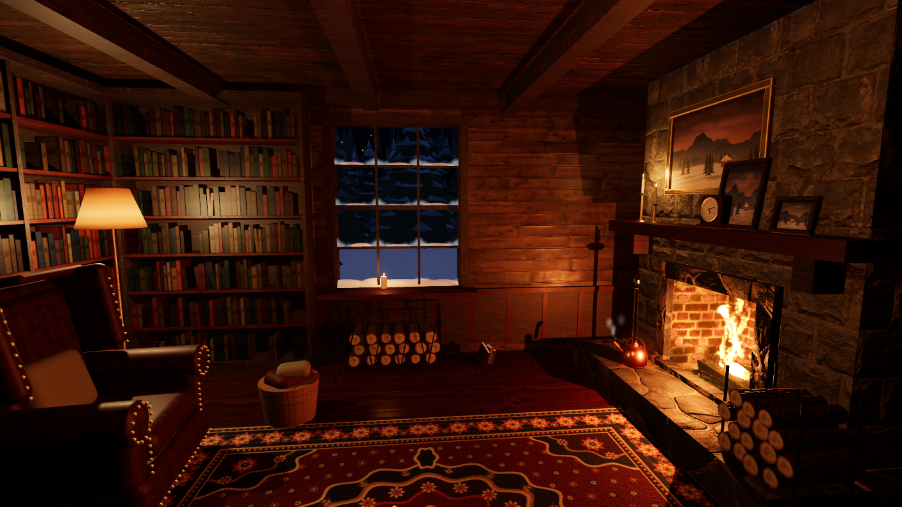 | 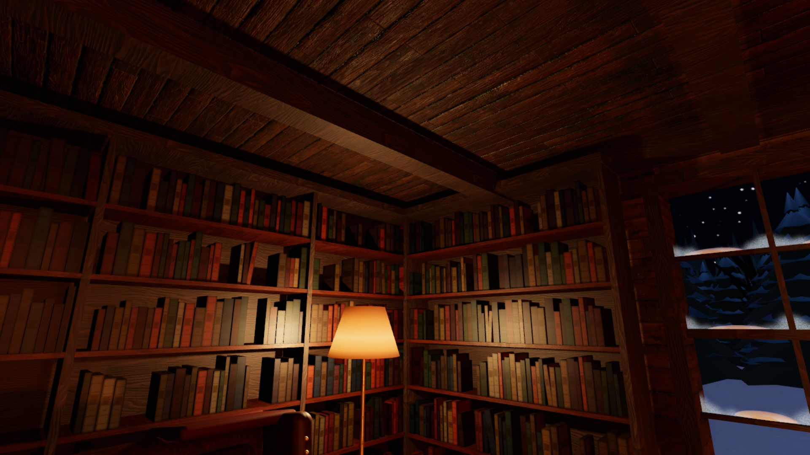 | 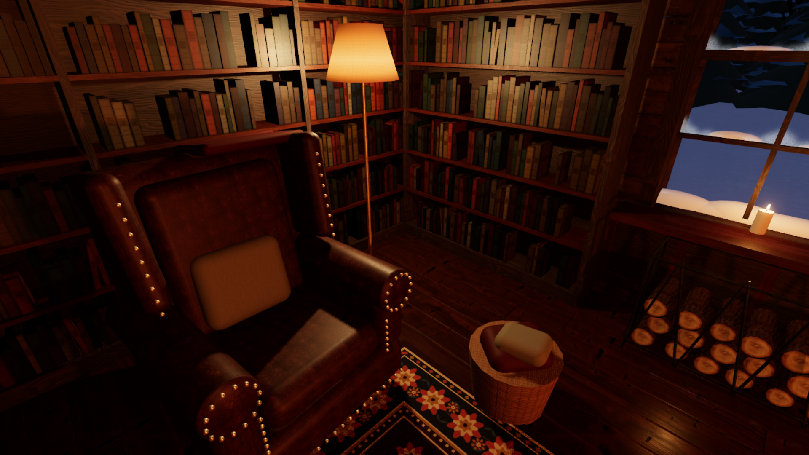 |

| 가구를 든 상태 | 내려놓은 뒤 | 책장 넘기는 중 |
|---|---|---|
| 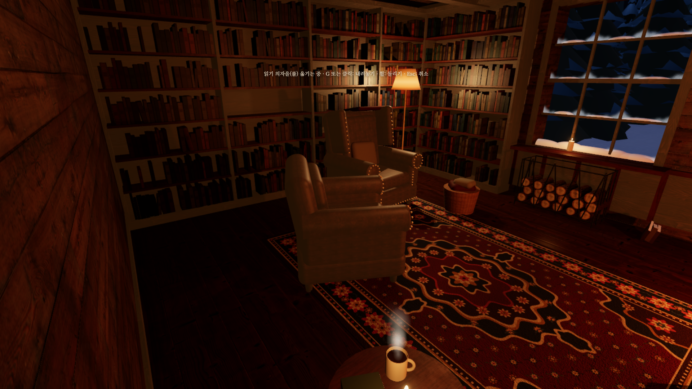 | 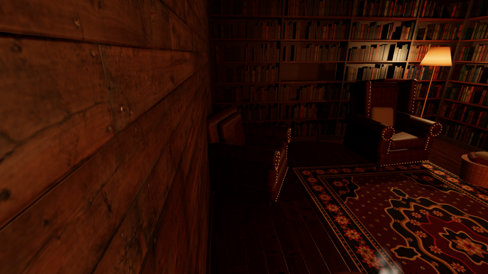 | 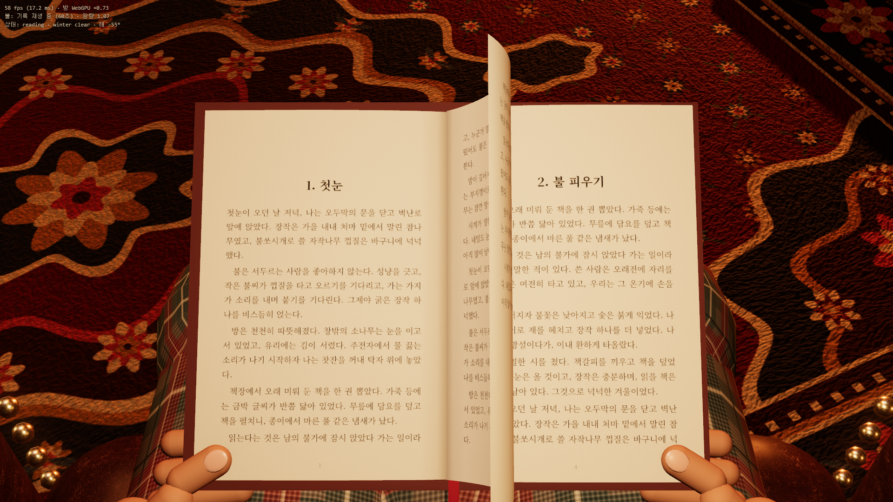 |

- **구석 음영**: 책장 구석, 천장과 벽이 만나는 곳, 의자 아래에 얼룩이나 줄무늬는 보이지 않는다. 음영이 부드럽게 이어진다.
- **불빛 그림자**: 벽난로 왼쪽 벽의 부지깽이 그림자를 약 100ms 간격으로 12장 찍었다(`cut-shadow-00.png` ~ `11.png`). 그림자 위치와 모양은 12장 내내 같고 벽의 밝기만 조금씩 달라진다. 정지 사진에서는 끊겨 보이는 흔적이 없다. 초당 10번 갱신이 움직이는 화면에서 뚝뚝 끊겨 보이는지는 사진 간격이 갱신 간격과 같아서 판단할 수 없다.
- **가구 옮기기**: 읽기 의자를 들면 의자가 밝은 색으로 바뀌어 떠 있고 "읽기 의자을(를) 옮기는 중" 안내가 뜬다. 든 상태와 내려놓은 뒤 모두 바닥에 의자 그림자가 붙어 있다. 내려놓은 사진은 시점이 벽 쪽으로 돌아가 의자가 화면 왼쪽 가장자리에 걸렸다. 옮기는 동안 그림자가 따라오는 모습은 정지 사진 2장으로만 봤다. 옮길 수 있는 가구는 읽기 의자, 다른 의자, 협탁, 스탠드, 바구니, 장작 선반 6개다.
- **책장 넘기기**: 넘어가는 쪽이 세워져 보이고 양쪽 본문이 그대로 선명하다. 넘어가는 쪽이 아래 쪽에 드리우는 그림자는 뚜렷하지 않다.
- 안내 문구의 "읽기 의자을(를)"은 조사가 어색하다.
- 읽기 상태를 100초쯤 유지한 뒤의 통계 표시에 방 배율이 ×0.73으로 나왔다(다른 측정은 ×0.83). 해상도 자동 조절이 한 번 내려간 것이다. 이번 측정은 `&fixed` 없이 했다.
- 콘솔 오류는 없었다.

## 새 의자, 다리, 책 확인 (커밋 08db44f)

3840×2160 크기(화면 배율 2)로 열어 확인했다. 밤, 기본 설정.

| 새 의자 | 앉아서 내려다본 다리 | 무릎 위의 책 (견본 책) |
|---|---|---|
| 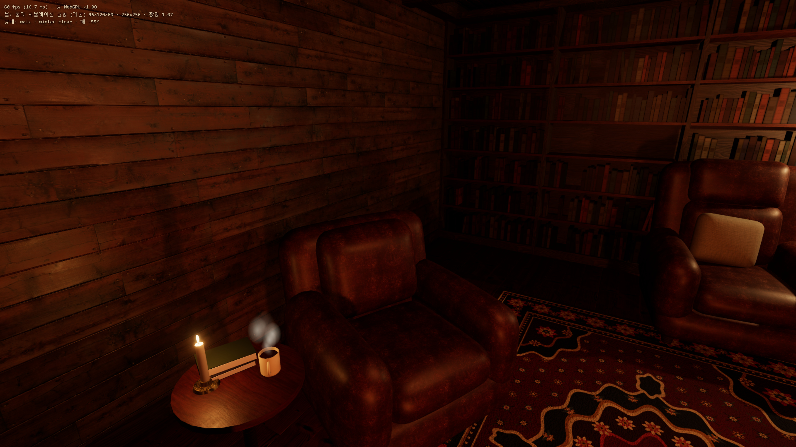 | 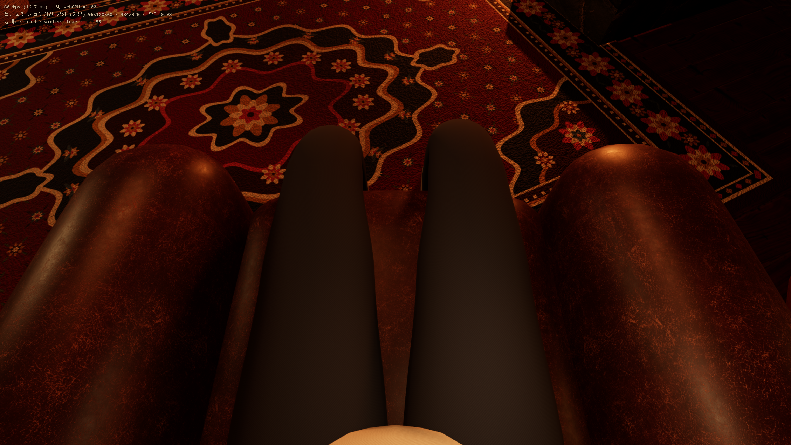 | 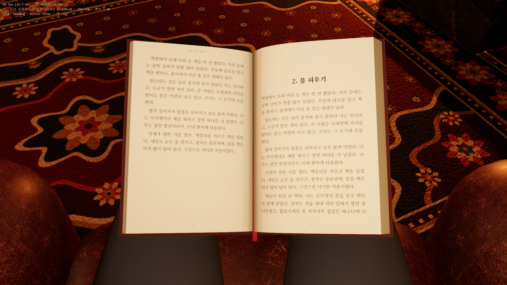 |

책장 넘기는 7단계: 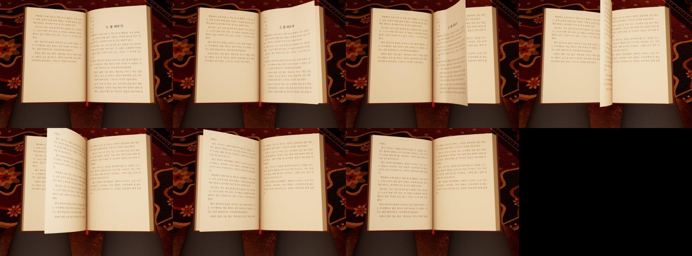

| 3840×2160에서 | fps | 최대 프레임 | GPU 3D | 방 버퍼 |
|---|---|---|---|---|
| 앉아서 방 보기 | 60.0 | 16.9ms | 77% | 1920×1080 |
| 책 읽기 | 60.0 | 17.2ms | 67% | 2240×1260 |

- **4K 성능**: 두 경우 모두 60fps다. 지난번 같은 크기에서는 36fps였다. 방을 가로 1920까지만 그리는 것이 확인된다(책을 읽을 때는 2240×1260). GPU는 1080p 창에서 잰 값(앉은 상태 68~70%)보다 조금 높다.
- **의자**: 징 장식이 없어졌고 등받이, 좌석, 팔걸이가 둥글고 불룩한 쿠션 모양이다. 가죽 질감은 그대로다.
- **다리**: 어두운 색의 매끈한 원통 두 개가 무릎에서 둥글게 끝나는 모양이다. 납작한 판은 아니지만 옷 주름이나 무늬가 없어 단순하고, 체크 담요는 보이지 않는다.
- **책**: 양쪽 면이 가운데 골에서 바깥으로 볼록하게 휘고, 골이 그늘져 있다. 오른쪽 가장자리에 책장 두께가 층으로 보이고 표지가 종이보다 조금 나와 있다. 본문은 휜 면을 따라 휘어 보이고 또렷하다.
- **책장 넘기기**: 넘어가는 종이가 휘면서 넘어가고, 뚫고 나오거나 갑자기 튀는 단계는 없었다. 다만 넘김 시작 단계(1, 2번째 그림)에서 오른쪽 면의 왼쪽 여백에 다른 쪽의 글자가 겹쳐 보인다. 넘김 후반(5, 6번째 그림)에는 넘어가는 종이의 위쪽 끝이 책 위로 조금 올라와 보인다.
- 콘솔 오류는 없었다.
