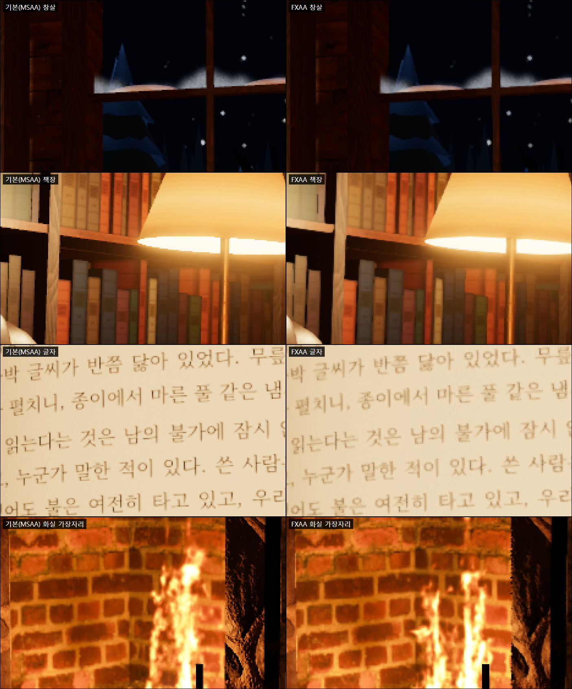

# 3차 효율 측정 (Intel Arc B390, 커밋 b025c44)

2026-11-22. Edge 157 창 모드, 60Hz, 밤(`?time=22&season=winter&weather=clear`), 불 켜짐, `fixed` 없음. 읽기 의자에 앉아 시선을 움직이지 않고 3초 뒤부터 GPU 3D 사용률을 3번 쟀다(각 7초 평균). 모든 조건에서 60fps.

## 요점

- **가만히 있을 때 절전(새 동작)이 가장 효과가 크다**: 앉은 상태 72% → 57%. 4K에서도 71% → 57%로 같다.
- **`aa=fxaa`는 GPU를 줄이지 않는다**: 절전과 함께 59~60%, 절전 없이 70%로 기본과 차이가 없다.
- `noidle`에 `nopost`, `noshadow`, `nomsaa`를 하나씩 더해도 68~70%로 거의 그대로다(지난 측정과 같은 결과).
- 목표 50%에는 아직 7%p쯤 남는다.

## A. 1920×1080 창, 앉은 상태

| 조건 | GPU 3D (3회) | 평균 | fps | 방 버퍼 |
|---|---|---|---|---|
| 1. `noidle` (이전 동작) | 72 / 72 / 71 | **72%** | 60 | 1920×1080 |
| 2. 옵션 없음 (새 동작) | 57 / 57 / 56 | **57%** | 60 | 1920×1080 |
| 3. `aa=fxaa` | 57 / 60 / 61 | 59% | 60 | 1920×1080 |
| 4. `noidle&aa=fxaa` | 72 / 67 / 70 | 70% | 60 | 1920×1080 |
| 5. `noidle&nopost` | 67 / 70 / 68 | 68% | 60 | 1920×1080 |
| 6. `noidle&noshadow` | 68 / 69 / 69 | 69% | 60 | 1920×1080 |
| 7. `noidle&nomsaa` | 69 / 70 / 70 | 70% | 60 | 1920×1080 |

방 버퍼가 1080p 창에서 1920×1080이다. 지난 측정 때는 1600×900(×0.83)이었다.

## B. 3840×2160 (화면 배율 2)

| 조건 | GPU 3D (3회) | 평균 | fps | 방 버퍼 |
|---|---|---|---|---|
| 1. 앉음, `noidle` | 71 / 72 / 71 | 71% | 60 | 1920×1080 |
| 2. 앉음, 옵션 없음 | 57 / 57 / 57 | **57%** | 60 | 1920×1080 |
| 3. 앉음, `aa=fxaa` | 57 / 61 / 61 | 60% | 60 | 1920×1080 |
| 4. 읽기, 옵션 없음 | 66 / 51 / 68 | 62% | 60 | 2240×1260 |
| 5. 읽기, `aa=fxaa` | 63 / 73 / 59 | 65% | 60 | 2240×1260 |
| 6. 읽기, `nopost` | 57 / 72 / 71 | 67% | 60 | 2240×1260 |

- 앉은 상태는 4K와 1080p가 같다(방 버퍼가 둘 다 1920×1080).
- 읽기 상태는 3회 사이에 51~73%로 크게 흔들려 세 조건의 차이를 가릴 수 없다. 측정 중에 불 기록 재생으로 넘어가는 시점이 섞였을 수 있다(확인하지 않음).

## C. 화질 비교 (1080p, 3배 확대)

- **창살**: 두 방식 모두 가장자리가 매끈하다. 차이가 거의 없다.
- **책장과 스탠드**: 책 가장자리는 비슷하다. FXAA 쪽에서 스탠드 갓 아래의 밝은 타원 가장자리가 조금 더 부드럽다.
- **글자**: FXAA 쪽이 눈에 띄게 흐리다. 획이 번져 가늘고 연하게 보인다.
- **화실 구멍 가장자리**: FXAA에서 구멍 오른쪽 세로 가장자리에 톱니 모양이 보인다. 기본에서는 곧은 선이다. 검은 테두리나 깨짐은 두 방식 모두 없다.
- 콘솔 오류는 두 방식 모두 없었다.

## D. 가만히 있을 때 절전

- GPU 사용률로는 동작이 확인된다(72% → 57%).
- 방을 실제로 건너뛰는지를 렌더러의 프레임 카운터로 세어 보려 했으나, 가만히 있을 때도 초당 61로 나와 이 방법으로는 확인하지 못했다(카운터가 다른 단계도 세는 것으로 보인다).
- 김, 촛불, 눈이 끊겨 보이는지, 시선을 움직이는 순간 부드러워지는지는 정지 사진으로 판단할 수 없어 3차 확인(`pc-verify.md`)에서 다시 본다.
