# 3차 확인 (Intel Arc B390)

2026-11-22. 1~5번은 커밋 6f36777, 측정(6, E, F, G)은 b67c881. Edge 157 창 모드, 60Hz. 시험용 창이 화면 앞에 있지 않을 때가 있어 마우스 잡기(포인터 잠금)가 거부됐다. 그래서 마우스를 잡아야 하는 항목은 확인하지 못했다(아래 표시).

## 항목별 결과

| 번호 | 항목 | 결과 |
|---|---|---|
| 1 | 시작 카드 | **확인됨.** 제목, "책 넣고 읽기"(서재가 비었을 때), "방 둘러보기", 설정, 조작법이 보인다 |
| 1 | "방 둘러보기" → 걷기와 안내 | **확인 못 함.** 누른 뒤 마우스 잡기가 거부돼(`The root document of this element is not valid for pointer lock.`) 카드가 그대로 남았다. 시험용 창의 한계로 보인다 |
| 1 | Esc 뒤 작은 "멈춤" 띠 | **확인 못 함.** 같은 이유. 띠 자체는 있고 문구는 "화면을 클릭하면 계속 둘러봅니다 · O 설정 · L 서재 · H 조작법" |
| 1 | H 조작법 창 | **확인됨.** H로 열리고 다시 H로 닫힌다 |
| 1 | "이어서 읽기" | **문제 있음.** 책을 읽다가 다시 열면 버튼은 "이어서 읽기 · 겨울 난롯가에서 · 25%"로 바뀌지만, 누르기 전에 이미 의자에 앉아 책이 펴지는 상태로 들어가 있다(자리 기억). 시작 카드가 책 화면 위에 겹쳐 있는 채로 책이 펴진다. 누른 뒤에는 읽던 쪽이 맞게 나온다 |
| 2 | 창밖 나무 | **확인됨.** 가을 낮, 겨울 낮, 밤 모두 층진 침엽수와 활엽수가 그림처럼 보이고 판자 같은 느낌은 없다. 같은 자리에서 연속으로 찍은 10장에서 가장자리 깜박임은 보이지 않았다. 시선을 좌우로 돌린 사진에서 어색한 겹침은 없었다 |
| 2 | 낮 풀밭 반짝임 | **확인됨.** 잔 점 무늬가 없어지고 고른 풀색이다 |
| 3 | 책 펼치기와 덮기 | **확인됨.** 접힌 책이 무릎에서 올라오며 펴지고, 덮을 때 접히며 손 쪽으로 내려간다. 끊김 없음(최대 프레임 17.0ms) |
| 3 | 앉기와 일어서기 | **확인됨(끊김 기준).** 최대 프레임 17.1~17.2ms. 숙이는 움직임이 멀미를 일으키는지는 사진으로 판단할 수 없다 |
| 3 | 설정창과 읽기 메뉴 | **확인됨(끊김 기준).** 최대 프레임 16.9~17.0ms |
| 3 | 책 덮기 첫 번째, 책장 넘기기 | **문제 있음.** 처음 한 번씩 167ms 끊김이 있었다. 두 번째부터는 없다 |
| 4 | 가만히 있을 때 절전 | **일부 확인.** 가만히 3초 동안 최대 프레임 17.1ms, 시선을 움직이기 시작한 직후 프레임 간격이 16.5~16.8ms로 덜컥거림이 없다. 김, 촛불, 눈이 끊겨 보이는지는 정지 사진으로 판단할 수 없다 |
| 5 | 콘솔 오류 | 새 오류 없음. 위의 포인터 잠금 거부만 있었다 |

| 시작 카드 | 조작법 | 이어서 읽기 뒤 |
|---|---|---|
| 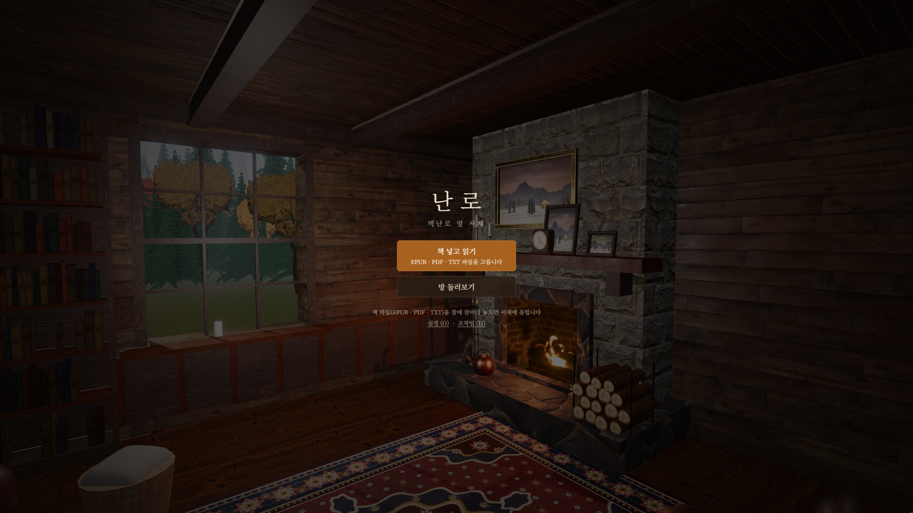 | 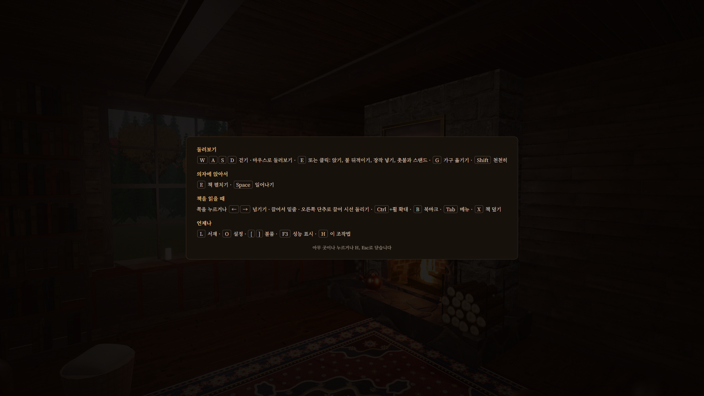 | 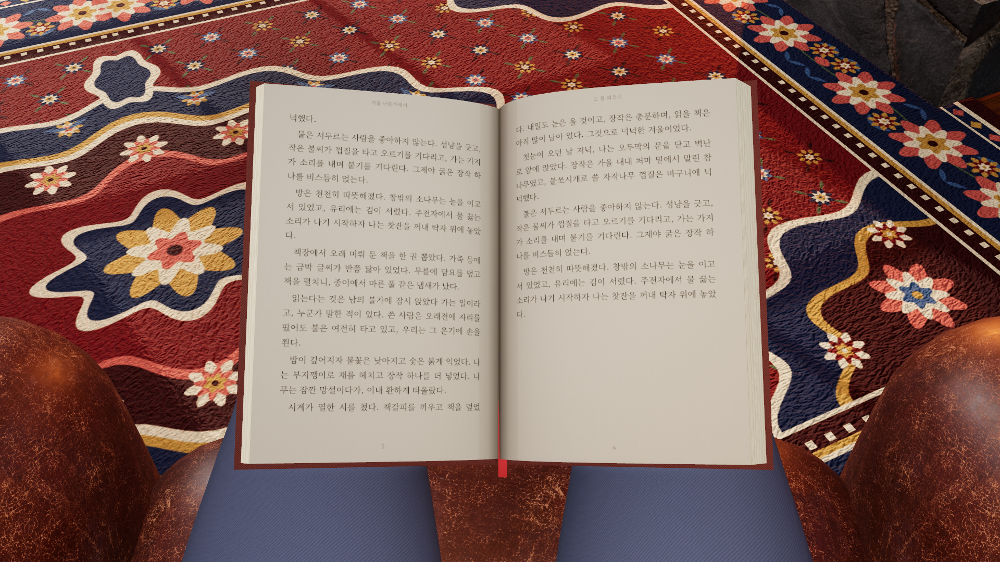 |

| 가을 낮 | 겨울 낮 | 밤 |
|---|---|---|
| 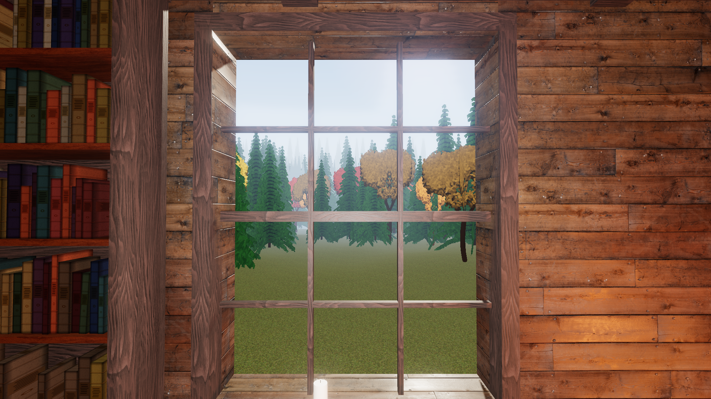 | 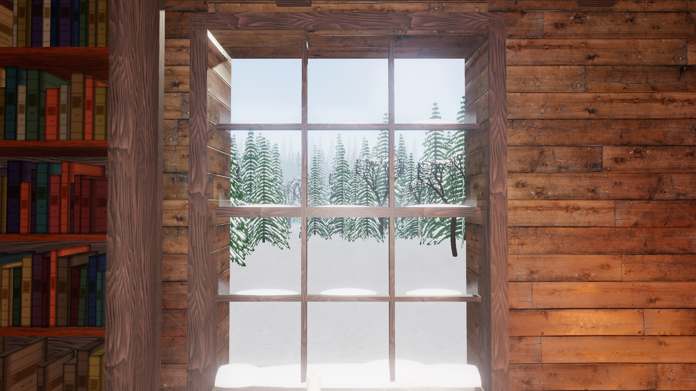 | 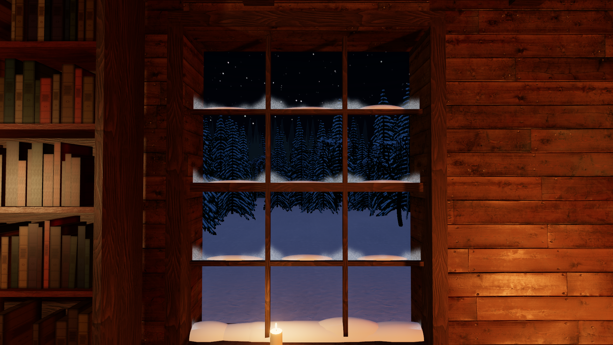 |

책 펼치기(앞 6장)와 덮기(뒤 2장): 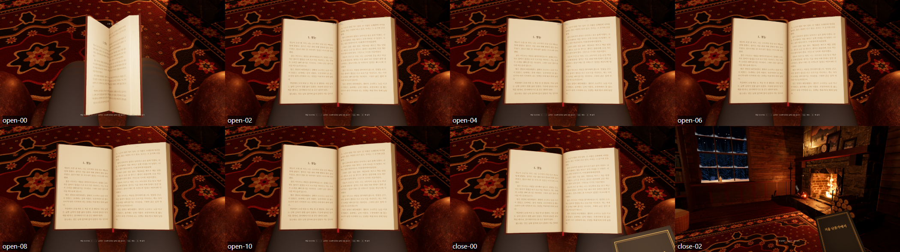

## 6, F. 앉은 상태 (불을 바라봄, 밤, 20초 × 3회)

| 화면 | 조건 | GPU 3D (3회) | 평균 | fps | 최대 프레임 (ms) |
|---|---|---|---|---|---|
| 1080p | 기본 (절반 속도) | 56 / 56 / 56 | **56%** | 59.9 | 33.4 / 33.6 / 33.3 |
| 1080p | `idle=3` | 58 / 59 / 61 | 59% | 60.0 | 17.1 / 17.2 / 17.9 |
| 1080p | `idle=4` | 61 / 62 / 61 | 61% | 60.0 | 22.3 / 17.2 / 17.2 |
| 1080p | `noidle` | 70 / 71 / 69 | 70% | 60.0 | 17.0 / 16.9 / 17.0 |
| 4K | 기본 (절반 속도) | 59 / 60 / 57 | **59%** | 60.0 | 17.1 / 17.2 / 17.7 |
| 4K | `idle=3` | 60 / 62 / 62 | 61% | 60.0 | 17.2 / 17.1 / 17.1 |
| 4K | `idle=4` | 62 / 63 / 61 | 62% | 60.0 | 17.2 / 17.1 / 18.2 |
| 4K | `noidle` | 72 / 70 / 71 | 71% | 60.0 | 16.9 / 17.0 / 17.0 |

- **앉은 상태에서는 방을 더 드물게 그려도 내려가지 않는다.** `idle=3`, `idle=4`가 기본(절반)보다 오히려 2~5%p 높다. 불 계산과 그리기는 매 프레임 그대로이기 때문으로 보인다(추정).
- 1080p 기본에서 20초마다 33ms 프레임이 한 번씩 있었다.
- `idle=3`, `idle=4`에서 김, 촛불, 불빛 일렁임이 끊겨 보이는지는 연속 캡처(약 1초에 14장)로는 판단하지 못했다. 캡처 간격이 갱신 간격과 비슷하다. 수치상 이득이 없으므로 기본(절반)을 유지하면 된다.

## 6, E. 읽기 상태 (밤, 20초 × 3회)

"재생 중"은 통계 표시에 "불: 기록 재생 중"이 뜬 뒤에 쟀다. 빨리 켜지게 하려고 `&rec=10`(기록 10초)을 붙였다. "재생 끔"은 설정의 불 기록 재생을 끈 상태다.

| 화면 | 불 | 조건 | GPU 3D (3회) | 평균 | fps | 방 버퍼 |
|---|---|---|---|---|---|---|
| 1080p | 재생 중 | 기본 (3분의 1 속도) | 22 / 24 / 23 | **23%** | 60.0 | 1920×1080 |
| 1080p | 재생 중 | `idle=2` (이전 동작) | 37 / 39 / 36 | 37% | 60.0 | 1920×1080 |
| 1080p | 재생 중 | `noidle` | 66 / 67 / 68 | 67% | 60.0 | 1920×1080 |
| 1080p | 재생 끔 | 기본 | 54 / 62 / 59 | 58% | 60.0 | 1920×1080 |
| 1080p | 재생 끔 | `idle=2` | 68 / 65 / 62 | 65% | 60.0 | 1920×1080 |
| 1080p | 재생 끔 | `noidle` | 67 / 65 / 67 | 66% | 60.0 | 1920×1080 |
| 4K | 재생 중 | 기본 (3분의 1 속도) | 30 / 33 / 25 | **29%** | 60.0 | 2240×1260 |
| 4K | 재생 중 | `idle=2` | 46 / 44 / 49 | 46% | 60.0 | 2240×1260 |
| 4K | 재생 중 | `noidle` | 68 / 67 / 67 | 67% | 60.0 | 2240×1260 |
| 4K | 재생 끔 | 기본 | 50 / 67 / 54 | 57% | 60.0 | 2240×1260 |
| 4K | 재생 끔 | `idle=2` | 69 / 68 / 72 | 70% | 60.0 | 2240×1260 |
| 4K | 재생 끔 | `noidle` | 66 / 66 / 66 | 66% | 60.0 | 2240×1260 |

- **읽기 상태(불 기록 재생 중)는 목표 50% 아래다**: 1080p 23%, 4K 29%. 이전 동작(절반 속도)은 37%, 46%였다.
- **불 기록 재생을 끄면 57~58%로 올라간다.** 재생이 켜지기 전(책을 펴고 약 1분)도 이 수준일 것이다.
- 재생을 끈 상태의 4K 기본은 50~67%로 흔들림이 컸다.

## G. 읽기 조작 (기본 주소, 1080p)

| 조작 | 결과 | 최대 프레임 |
|---|---|---|
| → 키로 책장 넘기기 (2번) | 넘어감 (쪽 0 → 4). 167ms 끊김 1번 | 166.6ms |
| 마우스로 글자 끌기 | 끌기 뒤 "사전", "인용구 카드" 단추가 뜸. 끊김 없음. 밑줄 단추는 목록에서 확인하지 못함 | 17.0ms |
| 오른쪽 단추로 끌어 시선 돌리기 | 시선이 돌아감 (좌우 -0.44 → -1.02, 상하 -0.80 → -0.65). 읽기 상태 유지. 끊김 없음 | 17.0ms |

## 그 밖에 눈에 띈 것

- **책장을 처음 넘길 때와 책을 처음 덮을 때 167ms 끊김**이 세 번의 실행에서 모두 나왔다. 두 번째부터는 없다. 처음 쓰는 그림이나 재질을 그때 준비하는 것으로 보인다(추정).
- **낮에 책이 펴지는 도중 종이가 하얗게 빛난다.** 낮 시간에 다시 열어 책이 펴지는 중간 장면에서 종이가 번지듯 밝았다. 다 펴진 뒤에는 정상이다.
- 앉은 상태의 GPU는 아직 56~59%로 목표 50%를 조금 넘는다.
- 포인터 잠금이 필요한 항목(둘러보기 시작, 멈춤 띠, G로 가구 옮기기)은 사람이 직접 눌러 봐야 한다.

## 재확인 (커밋 2192b76)

### 1. 처음 넘길 때와 덮을 때의 끊김

`NANRO_GPU=1`로 실제 GPU에서 `tools/warm-check.mjs`를 3번씩 돌린 출력이다. 괄호 안은 그 구간의 가장 긴 프레임 간격이다.

| 실행 | 시작 화면까지 준비 | 책을 펼 때 | 처음 넘길 때 | 처음 덮을 때 |
|---|---|---|---|---|
| 미리 준비 켬 1 | 84개 | +0 (100ms) | +0 (17ms) | +0 (17ms) |
| 미리 준비 켬 2 | 83개 | +0 (50ms) | +0 (17ms) | +0 (17ms) |
| 미리 준비 켬 3 | 84개 | +0 (50ms) | +0 (17ms) | +0 (17ms) |
| 미리 준비 끔 1 | 73개 | +6 (317ms) | +2 (150ms) | +0 (17ms) |
| 미리 준비 끔 2 | 73개 | +6 (300ms) | +2 (150ms) | +0 (17ms) |
| 미리 준비 끔 3 | 74개 | +6 (300ms) | +2 (150ms) | +0 (17ms) |

**확인됨.** 미리 준비를 켜면 처음 넘김의 끊김이 150ms → 17ms로 없어지고, 책을 펼 때는 300ms → 50~100ms로 줄었다. 책을 펼 때는 아직 50~100ms가 남는다. 도구가 적은 오류는 404 두 건뿐이다(파비콘으로 보임).

### 2. 미리 준비의 부작용

**일부 확인.** 페이지를 연 직후부터 찍은 4장(0.2초, 0.3초, 2.8초, 10.9초)에서 번쩍임이나 책, 무릎이 보이는 장면은 없었다. 다만 창이 준비되는 동안 촬영이 2.5초와 8초씩 멈춰서, 미리 그리는 순간(텍스처를 읽고 약 1.2초 뒤)을 놓쳤을 수 있다. 카드를 숨기고 본 방에는 책이나 무릎, 그 그림자가 남아 있지 않았다.

### 3. 다시 열기

**확인됨.** 책을 읽다가 새로 고치면 의자에 앉은 화면에 시작 카드가 뜨고 책은 펴지지 않는다. 단추는 "이어서 읽기 · 겨울 난롯가에서 · 34%"다. 누르면 읽던 쪽(펼침면 6)으로 펴지고 카드가 사라진다.

| 새로 고친 직후 | "이어서 읽기" 뒤 |
|---|---|
| 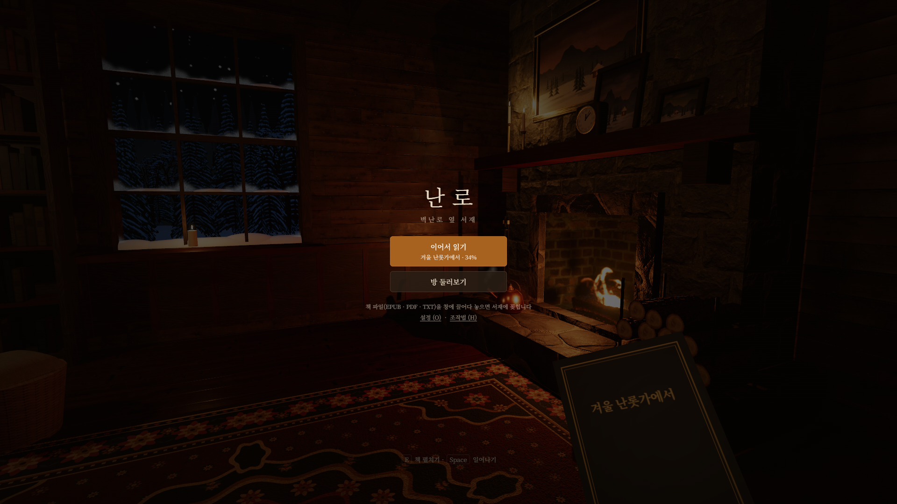 | 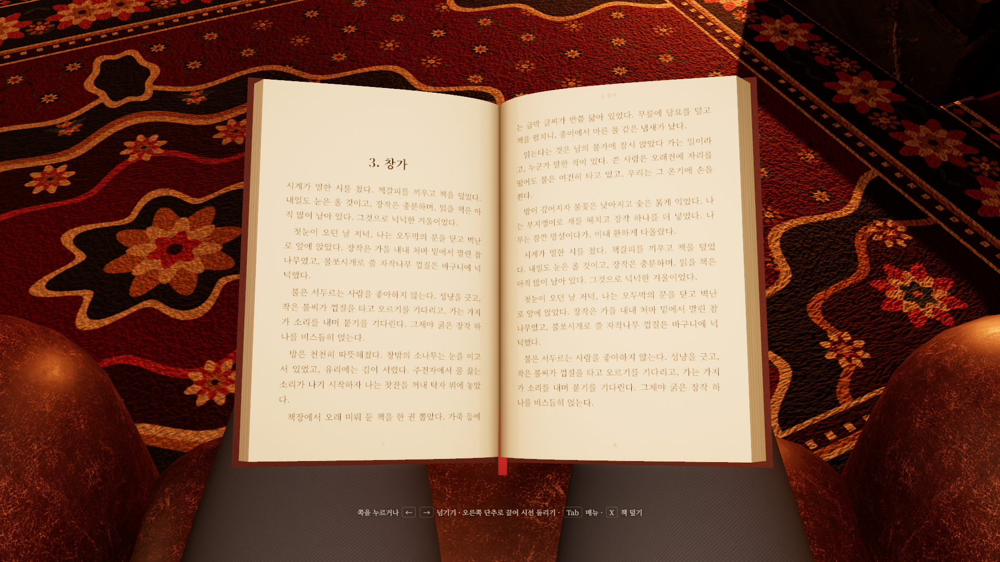 |

### 4. 낮에 책이 펴지는 도중

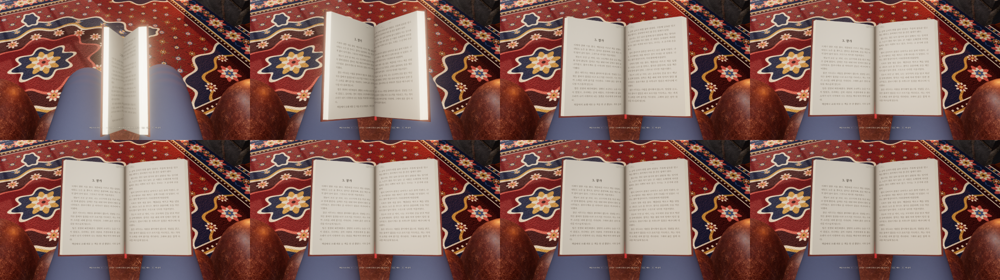

**줄었지만 남아 있다.** `?time=12`에서 펴지는 처음 두 장면에 책의 왼쪽과 오른쪽 가장자리(책장 두께 부분)가 하얗게 빛나는 띠로 보인다. 종이 면 자체는 글자가 읽힐 만큼 정상이다. 세 번째 장면부터는 빛나는 곳이 없다.

### 5. `tools/flow.mjs` (실제 GPU)

19개 가운데 통과 15, 실패 4.

- 실패: "(파일을 고른 뒤) 시작 카드가 사라진다"
- 실패: "마우스가 풀리면 멈춤 띠가 보인다"
- 실패: "(책을 끌어다 놓은 뒤) 그때 시작 카드가 사라진다"
- 실패: "오류가 없다" (404 두 건과 `The root document of this element is not valid for pointer lock.`)

통과한 것: 시작 카드, 단추 글("책 넣고 읽기", "이어서 읽기"), 조작법 창 열고 닫기, 파일을 고르면 읽기 상태, 책이 화면에 나옴, 다음 쪽 넘김, Esc로 덮으면 앉은 상태, 덮은 뒤 카드가 다시 뜨지 않음, "이어서 읽기" 한 번으로 읽던 쪽에서 이어짐, 책을 끌어다 놓으면 읽기 상태.

실패 가운데 멈춤 띠와 오류 항목은 시험용 창에서 마우스 잡기가 거부되는 것과 관련 있어 보인다. 카드가 사라지지 않는 두 건은 3번에서 단추를 눌렀을 때는 카드가 사라졌으므로, 파일 고르기와 끌어다 놓기 경로에서만 남는 것인지 확인이 필요하다.

## 마지막 확인 (커밋 e097355)

- **흐름 점검** (`NANRO_GPU=1`, `tools/flow.mjs`): 19개 모두 통과. 지난번에 실패한 4건(파일을 고른 뒤와 끌어다 놓은 뒤 시작 카드가 사라짐, 마우스가 풀리면 멈춤 띠, 오류 없음)도 통과했다.
- **낮에 책이 펴지는 도중** (`?time=12`): 책 가장자리(책장 두께 면)의 하얀 띠가 없어졌다. 펴지는 첫 장면부터 책장 두께가 누런 종이색 층으로 보인다.
- **바지**: 연보라가 아니라 남색으로 보인다.

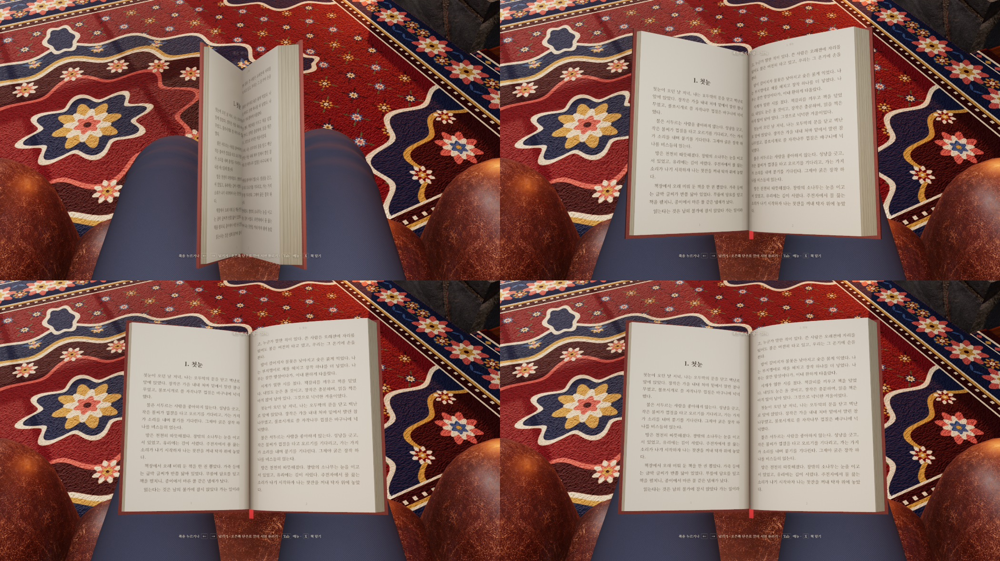
