# 윈도우 프로그램 1단계: 빌드와 확인 (Intel Arc B390)

2026-11-22, 커밋 3f08652. 화면 3840×2160, 배율 175%. 시험은 자료 폴더를 `NANRO_DATA=C:\claude-notebook\nanro-test\appdata`(매번 비우고 시작)로 주고 했다. `C:\Nanro`는 만들지 않았다. 책은 견본 책만 썼다.

## 요점

- 빌드와 설치 파일 만들기는 고친 것 없이 한 번에 됐다.
- 프로그램은 전체 화면으로 뜨고, WebGPU가 켜지며, 흐름 시험 19개를 모두 통과했다.
- **켠 직후 약 12초 동안 화면이 크게 버벅인다.** 시작 카드는 4초에 뜨지만, 그 뒤 5.7초와 4.3초짜리 멈춤이 이어진다.
- GPU는 전체 화면에서 앉은 상태 58~59%, 읽기 38%다.
- 백업 내보내기를 눌러도 파일이 생기지 않았다.

## 1. 빌드

| 단계 | 결과 | 걸린 시간 |
|---|---|---|
| `npm install`, `npm run build` | `dist` 77.1MB | 3초 |
| `cargo build --release --locked` (휴대용 MSVC, target은 `src-tauri\target`) | `src-tauri\target\release\nanro.exe` 84.0MB | 3분 27초 |
| `ISCC packaging\nanro.iss` | `release\NanroSetup-v0.1.0.exe` 81.5MB | 17초 |

`--locked` 그대로 통과했고 `Cargo.lock`은 바뀌지 않았다. 크레이트 몇 개(wry 0.57.3 등)를 새로 받았다. `nanro.iss`도 그대로 썼다(`Korean.isl` 있음). 실행 중인 개발 서버를 건드리지 않으려고 `npm ci` 대신 `npm install`을 썼다.

## 2. 실행 확인

### 처음 켜기

| 항목 | 결과 |
|---|---|
| 전체 화면 | 됨. 안쪽 2195×1235(CSS) = 화면 전체 |
| `location.origin` | `https://tauri.localhost` |
| WebGPU | 켜짐. 방 렌더러 WebGPU, 방 캔버스 1920×1080, 불 있음 |
| 엔진 | WebView2 Edg/157 |
| 끝내기 단추 | 시작 화면에 보임 |
| 콘솔 오류 | 없음 |

### 켠 직후의 끊김

켠 지 0.3~0.5초 뒤부터 프레임 간격을 쟀다.

| 실행 | 평균 fps (20초) | 가장 긴 프레임 | 100ms 넘는 프레임 |
|---|---|---|---|
| 처음 (새 자료 폴더, 전체 화면) | 2.2 | 14.2초 | 5 |
| 두 번째 (전체 화면) | 23.6 | 5.7초 | 6 |
| 세 번째 (창 상태) | 1.5 | 15.2초 | 5 |

네 번째 실행에서 언제 멈추는지를 따로 기록했다(시각은 페이지가 뜬 뒤 기준).

| 시각 | 멈춘 길이 |
|---|---|
| 0.2초 | 0.4초 |
| 0.6초 | 1.6초 |
| 2.6초 | 0.9초 |
| 3.5초 | **5.7초** |
| 9.2초 | 0.3초 |
| 9.5초 | **4.3초** |
| 14.8초 | 1.3초 |

- 실행부터 시작 카드의 단추가 뜨기까지는 4.0초다(`NANRO.ready` 3.7초).
- 그 뒤 약 12초 동안 화면이 거의 갱신되지 않는다. 그동안 타이머는 2초마다 정상으로 돌았고 창은 보이는 상태에 포커스도 있었다. 화면 그리기만 밀린 것이다.
- 켜져 있는 프로그램에서 페이지만 다시 불러오면 3초 안에 끝나고 그 뒤 멈춤이 없다(1.5초, 0.2초, 0.7초가 불러오는 동안에만). 프로그램을 새로 켤 때만 생긴다.
- 새 자료 폴더가 아니어도 생긴다(두 번째 이후에도 5~15초).
- 원인은 확인하지 않았다. 그래픽 쪽 준비(그리기 준비, 텍스처 올리기)가 새 프로세스에서 다시 일어나는 것으로 보인다(추정).

### 흐름 시험

`NANRO_CDP=http://127.0.0.1:9336`, `NANRO_URL=https://tauri.localhost`로 `node tools/flow.mjs`: **19개 모두 통과.**

### GPU (전체 화면 3840×2160, 밤)

측정 도구를 먼저 띄우고 5초 뒤부터 20초를 쟀다.

| 상태 | GPU 3D | fps | 가장 긴 프레임 | 방 캔버스 | 불 캔버스 |
|---|---|---|---|---|---|
| 앉음 1 | 59% | 59.9 | 33.0ms | 1920×1080 | 320×320 |
| 앉음 2 | 58% | 60.0 | 17.2ms | 1920×1080 | 320×320 |
| 앉음 3 | 58% | 60.0 | 17.3ms | 1920×1080 | 320×320 |
| 읽기 (불 기록 재생 중, `&rec=10`) | 38% | 60.0 | 17.2ms | 2240×1260 | |
| 최소화 (10초) | 20% | | | | |

- 앉은 상태는 Edge에서 잰 값(56~59%)과 같다.
- 읽기는 38%다. 흉내 낸 창에서 잰 23~29%보다 높다.
- 최소화하면 58% → 20%로 내려가지만 0에 가깝지는 않다. 최소화한 동안에도 페이지는 "보임" 상태로 남아 있었다.

### 창 명령

| 항목 | 결과 |
|---|---|
| `toggle_fullscreen` | 됨. 전체 화면 2195×1235 → 창 1601×901, 다시 부르면 전체 화면 |
| 창 크기와 위치 기억 | 됨. 창을 (200, 120)에 2400×1500으로 옮기고 끄니 `window.json`에 `{"x":200,"y":120,"w":2376,"h":1436,"fullscreen":false}`가 남았고, 다시 켜니 같은 크기(안쪽 1358×821)의 창으로 떴다 |
| 켜져 있을 때 한 번 더 실행 | 새 창이 뜨지 않음 (프로세스 1개, 페이지 1개 그대로). 기존 창이 앞으로 오는지는 눈으로 확인하지 못함 |
| `quit` | 됨. 프로세스가 끝나고 `window.json`이 저장됨 |

처음 전체 화면에서 `quit`하면 `window.json`의 크기가 `w:0, h:0`으로 남는다. 그 상태에서 F11로 창으로 바꾸면 기본 크기(1600×900)로 뜨므로 문제는 없었다.

### 프로그램 창에서 달라질 수 있는 것

| 항목 | 결과 |
|---|---|
| 유튜브 | 됨. 볼륨 0에서 공개 영상 링크를 넣으니 "불러오는 중…" → "재생 중"이 됐다. 오류 없음. 확인 뒤 멈추고 링크를 지웠다 |
| 위치 | 허용을 묻는 창은 뜨지 않았다. 권한 상태가 "denied"이고 `NANRO.env.opts.located`는 false, 기본 위치(37.57, 126.98)를 쓴다 |
| 낭독 목소리 | 1개: Microsoft Heami - Korean (ko-KR) |
| 내려받기 (백업 "파일 하나로 내보내기") | **안 됨.** 단추는 눌렸지만 내려받기, 문서, 바탕화면, 자료 폴더 어디에도 새 파일이 생기지 않았다 |

## 3. 사진

| 창 상태의 방 | 전체 화면 읽기 | 시작 화면 |
|---|---|---|
|  |  | 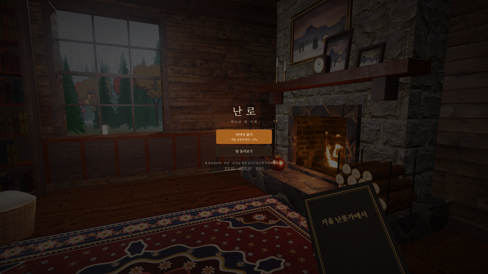 |

- 창 상태: 제목 표시줄에 난로 아이콘과 "난로", 최소화·최대화·닫기 단추가 보인다.
- 시작 화면: "이어서 읽기", "방 둘러보기" 아래에 설정, 조작법, **끝내기**가 보인다.

## 확인하지 못한 것

- 마우스 잡기(방 둘러보기)와 파일을 실제로 끌어다 놓기. 흐름 시험은 통과했지만 자동으로 누른 것이라, 사람이 직접 눌러 봐야 한다.
- 한 번 더 실행했을 때 기존 창이 실제로 앞으로 나오는지.
- F11 키와 Alt+F4 키(명령을 직접 불러 확인했다).
- 켠 직후 끊김의 원인.

시험 창이 떠 있던 시간은 합쳐서 약 9분으로, 정해 준 6분을 넘겼다. GPU 측정과 끊김 원인을 가리는 추가 실행 때문이다.

## 4. 설치

설치 명령을 담은 `.cmd`를 `explorer.exe`로 열어 실제 셸에서 `NanroSetup-v0.1.0.exe /SILENT /TASKS=desktopicon`을 실행했다. 설치 기록에 "Installation process succeeded"가 남았다.

| 확인 | 결과 |
|---|---|
| `C:\NanroApp\nanro.exe` | 있음 (84.0MB). 제거 프로그램 `unins000.exe`, `THIRD_PARTY_NOTICES.md`도 있음 |
| 시작 메뉴 "난로" | 있음 (`%APPDATA%\Microsoft\Windows\Start Menu\Programs\난로.lnk`) |
| 바탕화면 "난로" | 있음 (`C:\Users\pc\Desktop\난로.lnk`) |
| 제어판 제거 항목 | 있음 ("난로" 0.1.0, 설치 위치 `C:\NanroApp\`) |
| 설치 뒤 자동 실행 | 없음 (실행 중인 nanro 0개) |
| `C:\Nanro` | 만들어지지 않음. 처음 켤 때 깨끗하다 |

설치된 프로그램은 켜지 않았다. 시작 메뉴 바로가기는 설치 기록의 경로와 이 세션에서 본 경로가 같지만, 시작 메뉴에 실제로 보이는지는 눈으로 확인하지 못했다.

# 0.1.1 확인 (커밋 55b54ad)

## 빌드

| 단계 | 결과 | 걸린 시간 |
|---|---|---|
| `npm run build` | 됨 | 1초 |
| `cargo build --release --locked` | `nanro.exe` 84.0MB | 2분 49초 |
| `ISCC packaging\nanro.iss` | `release\NanroSetup-v0.1.1.exe` 81.5MB | 17초 |

고친 파일 없음.

## 고친 것 확인 (시험용 자료 폴더, 견본 책)

| 항목 | 결과 |
|---|---|
| a. 시작 단추 | 새 자료 폴더에서 켠 뒤 **24.6초**에 뜬다. 그때까지 "불러오는 중…" → "불을 지피는 중…"이 보인다. 단추가 뜬 뒤 10초 동안 가장 긴 프레임은 33ms다. 끊김이 단추 뒤로 넘어오지 않는다 |
| b. 흐름 시험 | 19개 모두 통과 |
| c. 파일 저장 | 됨. "저장했습니다: C:\Users\pc\Downloads\난로-백업-2026-11-22.json" 알림이 뜨고 파일(14KB)이 생긴다. 한 번 더 하면 "난로-백업-2026-11-22 (2).json"으로 번호가 붙는다. 시험 파일 2개는 지웠다 |
| d. 최소화 | 프로그램의 GPU가 57% → **0%**. 최소화한 5초 동안 `requestAnimationFrame` 0번. 다시 띄우면 60.0fps(가장 긴 프레임 17.1ms)로 돌아온다. 최소화 중에도 `document.visibilityState`는 "visible"로 읽혔다 |
| e. `window.json` | `quit` 명령과 창 닫기(WM_CLOSE) 둘 다 남는다 |

## 준비 시간을 줄일 수 있는지

준비 시간은 페이지가 열리기 시작한 때부터 50ms를 넘지 않는 프레임이 60장 이어진 첫 순간까지다. 같은 폴더로 두 번씩 켰다.

| 조건 | 1회 준비 | 2회 준비 | 가장 긴 프레임 (1회 / 2회) | 안쪽 크기 |
|---|---|---|---|---|
| a. 프로그램, 원래 주소, 전체 화면 (새 폴더) | 25.0초 | | 14.4초 | 2195×1235 |
| f. 프로그램, 개발 서버 주소 `http://127.0.0.1:5320/` | 25.2초 | 19.1초 | 14.4초 / 8.1초 | 2195×1235 |
| g. 프로그램, 원래 주소, 작은 창 | 26.6초 | 24.6초 | 15.2초 / 14.2초 | 1062×1031 |
| i. 프로그램, `?nowarmup`, 작은 창 | 14.0초 | | 5.8초 | 1062×1031 |
| h. Edge 고정 프로필, 전체 화면 | 15.6초 | 8.1초 | 7.0초 / 1.6초 | 2195×1192 |
| (0.1.0 프로그램, 지난 측정) | 16.7초 | 16.9초 | 5.8초 / 5.7초 | 2195×1235 |

읽는 법:

- **0.1.1에서 준비 시간이 17초 → 25초로 늘었다.** 3.5초 시점의 가장 긴 멈춤이 5.7초에서 14.4초로 커졌다. `?nowarmup`으로 켜면 그 멈춤이 5.8초로 돌아오고 준비가 14.0초다. 미리 그리기가 약 8.5초를 더 쓰고 있다.
- **창 크기는 원인이 아니다.** 작은 창(g)이 전체 화면(a)과 같다.
- **주소 방식은 일부 영향이 있다.** 개발 서버 주소(f)로 열면 두 번째에 25.2초 → 19.1초로 6초 줄었다. 원래 주소(g)는 26.6초 → 24.6초로 2초만 줄었다. 그래도 Edge만큼(절반)은 줄지 않는다.
- **Edge는 큰 창에서도 두 번째에 절반으로 준다**(15.6초 → 8.1초).
- 미리 그리기를 꺼도 3.4초 시점에 5.8초, 9.7초 시점에 3.4초짜리 멈춤이 남는다. 이 둘은 미리 그리기와 무관하다.

## 0.1.1 설치

`explorer.exe`로 여는 방식으로 `NanroSetup-v0.1.1.exe /SILENT /TASKS=desktopicon`을 덮어 깔았다. 설치 전에 난로가 켜져 있지 않은 것을 확인했다.

| 확인 | 결과 |
|---|---|
| `C:\NanroApp\nanro.exe` | 0.1.1로 바뀜 (빌드한 파일과 해시 같음) |
| 제어판 제거 항목 | "난로" 0.1.1 |
| 바탕화면 "난로" | 있음 |
| 설치 뒤 자동 실행 | 없음 |
| `C:\Nanro` | 아직 없음 |

# 0.1.2 확인: 켜는 시간 (커밋 897e59d)

빌드: `cargo build --release --locked` 2분 10초, `nanro.exe` 84.0MB, `release\NanroSetup-v0.1.2.exe` 81.5MB.

## 켜는 시간

| 실행 | 준비 시간 | 시작 단추 | 가장 긴 프레임 | 200ms 넘는 멈춤 [시각ms, 길이ms] |
|---|---|---|---|---|
| a. 프로그램, 새 자료 폴더 | 19.1초 | 18.6초 | 12.8초 (2.8초 시점) | [122,400] [572,1617] [2265,274] [2805,12751] [15673,367] [17356,350] |
| b1. 같은 폴더 | 11.7초 | 11.2초 | 6.1초 (2.6초 시점) | [111,383] [561,1567] [2645,6084] [8778,267] [9878,350] |
| b2. 같은 폴더 | 11.8초 | 11.3초 | 6.1초 (2.7초 시점) | [145,400] [612,1583] [2729,6117] [8879,283] [10046,350] [10596,200] |
| c1. Edge, 새 프로필, 개발 서버 주소, 전체 화면 | 11.5초 | 11.0초 | 5.9초 (2.7초 시점) | [555,1567] [2155,300] [2672,5917] [8639,417] |
| c2. Edge, 같은 프로필 | 5.4초 | 4.9초 | 1.6초 (0.3초 시점) | [332,1550] [1915,250] |

- **0.1.1보다 빨라졌다.** 시작 단추가 처음 24.6초 → 18.6초, 두 번째부터 11.2초다. 0.1.0의 준비 시간(17초)보다도 두 번째부터는 짧다.
- **프로그램에서도 두 번째부터 줄어든다**(19.1초 → 11.7초). 0.1.1까지는 켤 때마다 같았다.
- 단추가 뜬 뒤 10초 동안의 가장 긴 프레임은 17~21ms다. 끊김이 단추 뒤로 넘어오지 않는다.
- Edge는 같은 코드로 11.0초 → 4.9초다. 프로그램은 Edge보다 여전히 6~7초 더 걸린다.
- 남은 멈춤의 대부분은 2.7초 시점의 한 번(프로그램 6.1초, 처음에는 12.8초)이다.

## 준비되는 동안의 화면

| 준비 중 (켠 지 약 2초) | 단추가 뜬 뒤 |
|---|---|
| 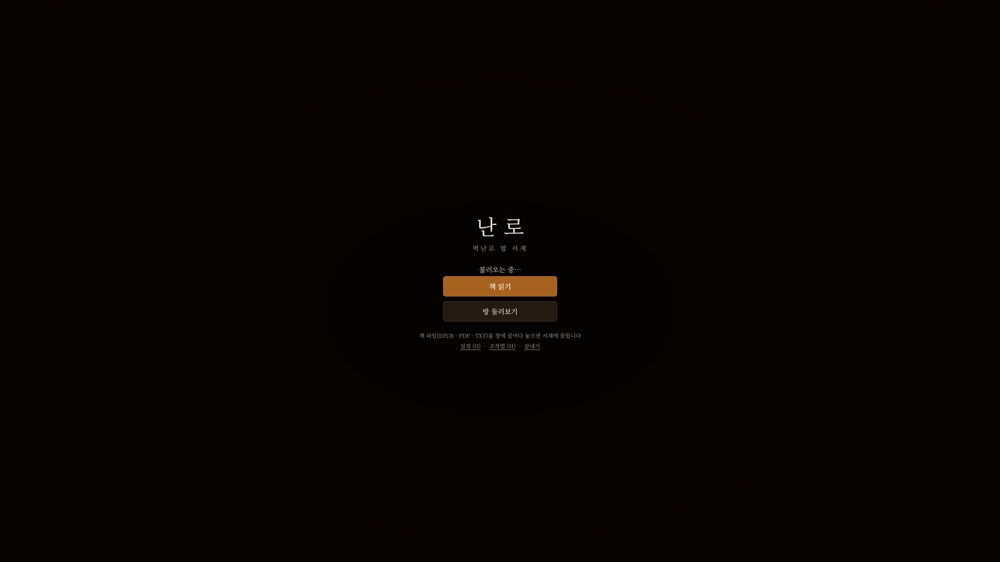 |  |

- 준비 중에는 **검은 화면**에 시작 카드만 보인다. 불은 보이지 않았다(켠 지 약 2초 시점의 사진).
- 그 사진에 "불러오는 중…" 글과 함께 **"책 읽기", "방 둘러보기" 단추가 이미 보인다.** 단추 묶음의 `hidden` 값은 켜져 있었는데 화면에는 그려져 있다. 준비가 끝나기 전에 눌리는지는 확인하지 않았다.
- 단추가 뜬 뒤의 방은 정상이다(텍스처, 불, 창밖, 손에 든 책).

## 흐름 시험과 책

- 흐름 시험: **19개 모두 통과.** 다만 처음에는 실패했다. 새 자료 폴더로 켜면 "tauri.localhost이(가) 사용자의 위치 파악을 하려고 합니다 (차단 / 이번만 허용)" 권한 창이 뜨고, `tools/flow.mjs`가 그 창을 프로그램 화면으로 잘못 골랐기 때문이다. `tools/flow.mjs`가 주소로 프로그램 화면을 고르게 한 줄을 고쳤다.
- 책을 처음 펼 때: 가장 긴 프레임 250ms 1번. 처음 넘길 때 33.6ms, 처음 덮을 때 33.3ms.

## 새로 눈에 띈 것

- **처음 켜면 위치 권한을 묻는 창이 뜬다.** 0.1.0 확인 때는 "denied" 상태로 창이 없었다(그때는 새 폴더가 아니었다). 주인님이 처음 켤 때 이 창을 보게 된다.

## 0.1.2 설치

난로가 켜져 있지 않은 것을 확인하고 `explorer.exe` 방식으로 덮어 깔았다. `C:\NanroApp\nanro.exe`가 빌드한 파일과 해시가 같고, 제거 항목이 "난로 0.1.2"다. 설치된 프로그램은 켜지 않았고 `C:\Nanro`는 아직 없다.

# 0.1.3 확인: 준비 중 화면, 위치 권한, 구간별 시간 (커밋 5ab4fa5)

빌드: `cargo build --release --locked` 2분 09초(종료 코드 0), `release\NanroSetup-v0.1.3.exe` 81.5MB. 전체 화면 안쪽 크기 2195×1235(CSS), 시험용 자료 폴더.

## 고친 것 확인

- **준비 중에 시작 단추가 보이지 않는다.** 준비 중 글은 "불러오는 중…" → "불을 지피는 중…"으로 바뀌고, 단추 묶음은 `display: none`이다. 아래쪽의 설정, 조작법, 끝내기 글자 단추는 준비 중에도 보인다.
- **위치 권한 창이 뜨지 않는다.** 새 자료 폴더로 켰을 때 권한 상태가 바로 `granted`이고 위치를 받아 왔다. 화면도 프로그램 화면 하나뿐이었다. (프로그램이 묻지 않고 위치 권한을 스스로 허용한다는 뜻이다.)
- 단추가 뜬 뒤의 방은 정상이다.

| 준비 중 | 단추가 뜬 뒤 |
|---|---|
| 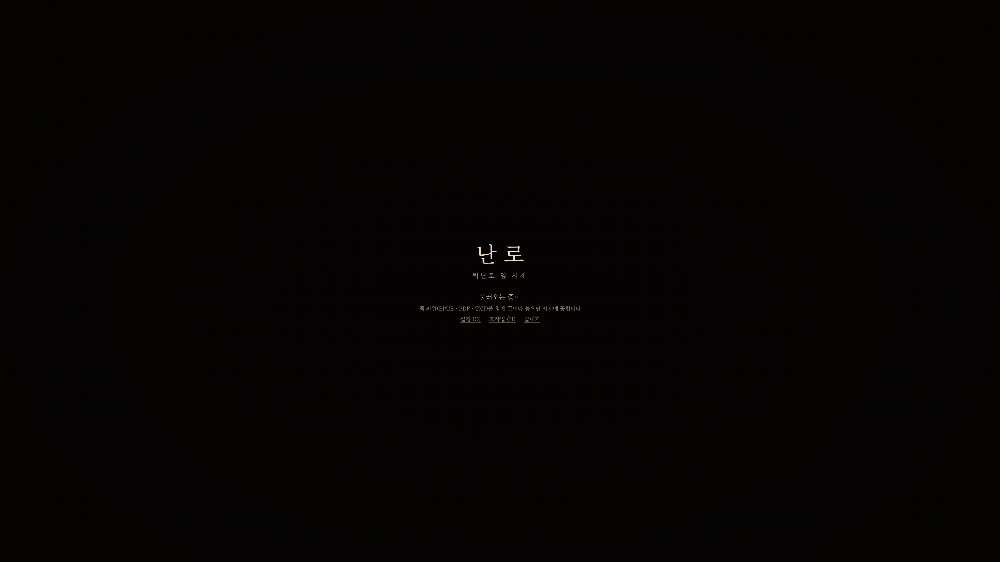 | 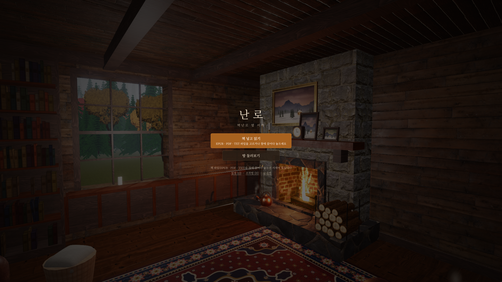 |

## 켜는 시간

| 실행 | 준비 시간 | 시작 단추 | 가장 긴 프레임 |
|---|---|---|---|
| a. 프로그램, 새 자료 폴더 | 19.1초 | 18.6초 | 12.8초 (2.7초 시점) |
| c. 프로그램, 같은 폴더 | 11.7초 | 11.2초 | 6.1초 (2.6초 시점) |
| d1. 프로그램, 개발 서버 주소, 처음 | 19.5초 | 19.0초 | 13.1초 |
| d2. 프로그램, 개발 서버 주소, 두 번째 | 12.0초 | 11.6초 | 6.1초 |
| e. Edge, 고정 프로필, 개발 서버 주소 | 5.4초 | 5.0초 | 1.5초 (0.4초 시점) |
| f1. 프로그램, `?nopost`, c 뒤 같은 폴더 | 18.9초 | 18.4초 | 13.1초 (2.6초 시점) |
| f2. 프로그램, `?noenv`, 같은 폴더 | 11.0초 | 10.7초 | 6.1초 (2.6초 시점) |

0.1.2와 같은 시간이다(18.6초 / 11.2초). 단추가 뜬 뒤 10초 동안의 가장 긴 프레임은 17ms다.

## 구간별 시각 (`NANRO.marks`, ms)

| 구간 | a 새 폴더 | c 같은 폴더 | d1 | d2 | e Edge | f1 nopost | f2 noenv |
|---|---|---|---|---|---|---|---|
| start | 98 | 117 | 256 | 160 | 134 | 104 | 130 |
| rendererInit | 563 | 580 | 724 | 625 | 338 | 566 | 597 |
| fireCreated | 2640 | 2539 | 2712 | 2611 | 2216 | 2548 | 2578 |
| mainDone | 2662 | 2565 | 2736 | 2635 | 2242 | 2572 | 2603 |
| textures | 2662 | 2574 | 2736 | 2635 | 2367 | 2572 | 2603 |
| envCompiled | 16300 | 9136 | 16733 | 9285 | 3289 | 16566 | (없음) |
| envDrawn | 16371 | 9203 | 16798 | 9347 | 3360 | 16632 | (없음) |
| roomCompiled | 17243 | 9820 | 17645 | 10148 | 3887 | 17407 | 9546 |
| roomReady | 17243 | 9821 | 17645 | 10148 | 3888 | 17407 | 9546 |
| warmStart | 17833 | 10446 | 18241 | 10786 | 4305 | 17714 | 10210 |
| warmEnd | 17855 | 10473 | 18270 | 10817 | 4329 | 17732 | 10217 |
| settled | 18550 | 11179 | 18973 | 11536 | 4938 | 18431 | 10710 |

읽은 것:

- **멈춤은 `textures` 다음의 첫 컴파일 한 곳에 있다.** `textures` → `envCompiled`가 프로그램 새 폴더 13.6초, 같은 폴더 6.6초, Edge 0.9초다. 나머지 구간은 프로그램과 Edge가 거의 같다(그 앞 약 2.6초, 그 뒤 약 2초).
- **환경맵 자체가 원인은 아니다.** `?noenv`로 환경맵을 건너뛰면 같은 길이의 멈춤(6.9초)이 그다음 컴파일인 `roomCompiled`로 옮겨 간다. 무엇이든 "처음 하는 큰 컴파일"이 그 시간을 낸다.
- **주소 방식은 원인이 아니다.** 프로그램을 개발 서버 주소로 켜도 19.0초 / 11.6초로 같다.
- `?nopost`는 같은 폴더의 두 번째 이후 실행인데도 처음 켠 것과 같은 시간(13.1초 멈춤)이 나왔다. 한 번만 쟀으므로 후처리를 끄면 저장해 둔 것을 못 쓰는 것인지, 우연인지는 가리지 못했다.
- `rendererInit` → `fireCreated`의 약 2초는 프로그램과 Edge가 같다(불 만들기).

## 0.1.3 설치

난로가 켜져 있지 않은 것을 확인하고 `explorer.exe` 방식으로 덮어 깔았다(종료 코드 0). `C:\NanroApp\nanro.exe` 0.1.3, 제거 항목 "난로 0.1.3", 바탕 화면 바로 가기 있음. 설치된 프로그램은 켜지 않았고 `C:\Nanro`는 아직 없다.

## 확인하지 못한 것

- 흐름 시험은 이번에 돌리지 않았다.
- 주인님 실제 사용 환경(설치된 프로그램, `C:\Nanro`)에서의 첫 실행 시간은 재지 않았다.
- `?nopost`, `?noenv`는 한 번씩만 쟀다.
# 0.2.0 확인: 책 파일로 열기, 서재 폴더, 옮겨 오기 (커밋 e51f517)

## 빌드

| 단계 | 결과 |
|---|---|
| `npm run build` | 됨 (1초 안쪽) |
| `cargo build --release --locked` | 2분 47초, 종료 코드 0. `nanro.exe` 84.0MB |
| ISCC | 15초. `release\NanroSetup-v0.2.0.exe` 81.6MB |

ISCC 는 처음 한 번 "Resource update error: EndUpdateResource failed (110)"로 실패했고, 몇 초 뒤 다시 돌리니 됐다(파일을 고치지는 않았다).

## 확인한 것 (시험용 자료 폴더, 견본 책과 직접 만든 글 파일)

| 항목 | 결과 |
|---|---|
| 2. 책 파일로 켜기 | **됨.** `nanro.exe "…\books\sample.epub"`로 켜면 아무것도 누르지 않아도 `reading` 상태가 되고 펴진 책은 "겨울 난롯가에서"다. 시작 카드는 꺼져 있다. 새 자료 폴더에서 켠 지 약 20초 뒤였다. |
| 3. 켜져 있는 창에 넘기기 | **됨.** "둘째 책.txt"를 넘기자 0.2초 안에 펴진 책이 "둘째 책"으로 바뀌었다. 두 번째 프로세스는 0.06초 만에 종료 코드 0으로 스스로 끝났고 프로세스는 하나만 남았다. |
| 4. 서재 폴더 칸 | **됨.** `<자료 폴더>\books · 책 파일 0개`로 나오고 그 폴더가 실제로 만들어져 있다. |
| 4. 다시 읽기 | **됨.** 폴더에 "셋째 책.txt"를 넣고 누르자 서재가 2권 → 3권이 되고 "서재 폴더에서 책 1권을 꽂았습니다" 알림이 떴다. 칸은 "책 파일 1개"로 바뀌었다. |
| 4. 폴더 열기 | **됨.** 그 폴더의 탐색기 창이 열렸다(확인 뒤 닫음). |
| 4. 폴더 바꾸기 | **창이 뜨는 것까지 확인.** "서재 폴더 고르기" 창이 떴고 닫으니 폴더는 그대로였다. 실제로 다른 폴더를 고르는 것은 해 보지 않았다. |
| 5. 내보내기 | **됨.** 내려받기 폴더에 `난로-백업-2026-11-22.json`(18KB)이 생기고 "저장했습니다: …" 알림이 떴다. |
| 5. 새 폴더의 안내 | **됨.** 서재가 빈 새 자료 폴더로 켜면 시작 카드에 "Edge에서 읽던 책과 설정이 있다면 … 여기를 눌러 가져오세요"가 보인다. |
| 5. 옮겨 오기 | **됨.** "여기를 눌러 가져오세요"로 열린 파일 고르기에 백업 파일을 넣자 서재에 세 권이 모두 들어왔고 안내는 사라졌다. 시험용 백업 파일은 지웠다. |
| 7. 흐름 시험 | **19개 모두 통과** (0.2.0 창, 새 자료 폴더). |

프로그램 끄기는 모두 `invoke('quit')`였고 0.3초 안에 끝났다. 화면 오류는 없었다.

| 책 파일로 켠 직후 | 서재 창의 서재 폴더 칸 | 새 자료 폴더의 시작 카드 |
|---|---|---|
| 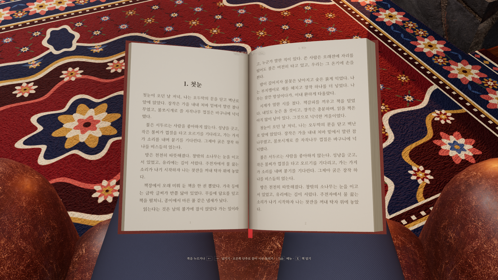 | 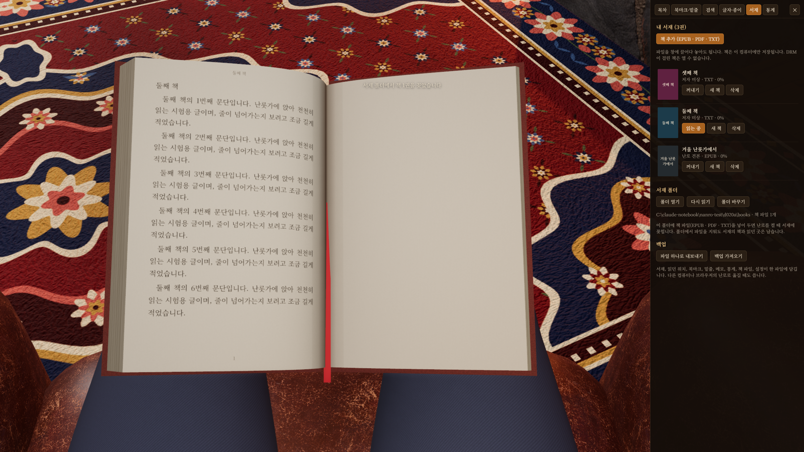 | 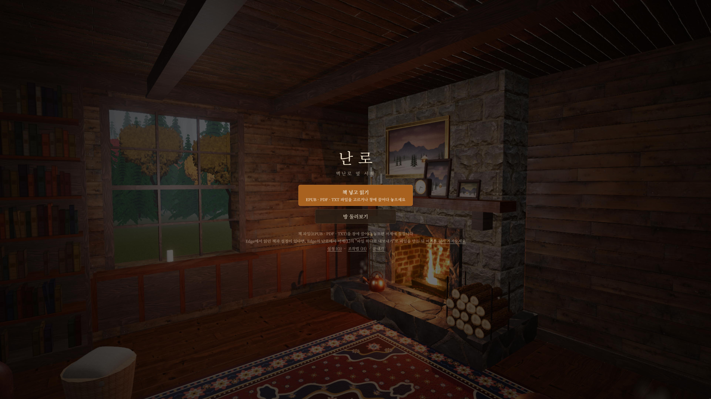 |

눈에 띈 것:

- 책 파일로 켠 지 2.5초 뒤의 사진에 "책을 펼치는 중… 13%" 글이 아직 떠 있다(책은 이미 펴져 있다).
- 옮겨 오기에서 확인한 것은 책 세 권이 들어오는 것까지다. 설정과 액자 그림이 함께 넘어오는지는 따로 보지 않았다.

## 0.2.0 설치

난로가 켜져 있지 않은 것을 확인하고 `explorer.exe` 방식으로 덮어 깔았다(종료 코드 0).

| 항목 | 결과 |
|---|---|
| 설치본 | `C:\NanroApp\nanro.exe` 0.2.0, 빌드한 파일과 해시 같음. 제거 항목 "난로" 0.2.0 |
| `C:\Nanro` | 설치 전에도 뒤에도 없음 |
| 책과 읽던 곳 | **그대로.** 설치 전에 견본 책을 7쪽(34%)까지 넘겨 두었고, 설치본을 같은 시험용 자료 폴더로 켜니 세 권과 그 위치(34%)가 그대로였다. |
| `Applications\nanro.exe` | `FriendlyAppName` 난로, 열기 명령 `"C:\NanroApp\nanro.exe" "%1"`, `SupportedTypes` .epub .pdf |
| `Nanro.Book` | "난로 책", 아이콘과 열기 명령이 설치본을 가리킴 |
| `.epub`, `.pdf` 의 `OpenWithProgids` | 둘 다 `Nanro.Book`이 들어감 (.pdf 에 원래 있던 항목은 그대로) |
| 기본 프로그램 | **바뀌지 않음.** `UserChoice`의 ProgId 가 설치 전후로 같다(.epub 은 기존 앱, .pdf 는 `MSEdgePDF`). |

탐색기에서 책 파일을 오른쪽 단추로 눌러 "연결 프로그램"에 난로가 보이는지는 눈으로 확인하지 않았다(레지스트리 값만 확인).
## 켜는 시간 조사 마지막 (0.2.0, 창 합계 88초)

| 실행 | textures | envCompiled | 사이 | settled |
|---|---|---|---|---|
| Playwright 없이 켠 Edge, 새 프로필 | 3282 | 16849 | 13.6초 | 19093 |
| Playwright 없이 켠 Edge, 두 번째 | 2776 | 9493 | 6.7초 | 11605 |
| 프로그램, 켤 때 | 2579 | 9435 | 6.9초 | 11644 |
| 프로그램, 같은 창에서 다시 읽기 | 9422 | 23341 | 13.9초 | 25009 |
| Playwright 로 켠 Edge, 켤 때 | 2337 | 3227 | 0.9초 | 4823 |
| Playwright 로 켠 Edge, 같은 창에서 다시 읽기 | 2449 | 9190 | 6.7초 | 10926 |

Playwright 없이 켠 Edge 는 `msedge.exe --remote-debugging-port=9337 --user-data-dir=<시험용 프로필> --start-fullscreen --no-first-run http://127.0.0.1:5320/` 로 켰다.

`textures` → `envCompiled` 구간의 자기 시간(CPU 프로파일, 다시 읽기 때):

| | 프로그램 (13.9초) | Edge (6.7초) |
|---|---|---|
| (idle) | 12990ms | 5687ms |
| copyExternalImageToTexture | 571ms | 665ms |
| (program) | 48ms | 44ms |
| (garbage collector) | 39ms | 29ms |
| build | 27ms | 45ms |
| getDataFromNode | 16ms | 17ms |
| 그 밖의 함수 | 각각 15ms 아래 | 각각 11ms 아래 |

읽은 것:

- **프로그램이 Edge 보다 느린 것이 아니다.** 보통 방식으로 켠 Edge 도 처음 13.6초, 두 번째 6.7초로 프로그램(13.6초 / 6.8초)과 같다. 지금까지 견준 0.9초는 Playwright 로 켠 Edge 를 처음 읽을 때만 나오는 값이고, 그 Edge 도 같은 창에서 다시 읽으면 6.7초다.
- **그 구간에 화면 쪽 코드는 거의 돌지 않는다.** 시간의 85~93%가 (idle)이다. 화면 쪽은 컴파일이 끝나기를 기다리고 있을 뿐이고, 자바스크립트가 쓰는 시간은 텍스처 올리기 0.6초를 빼면 0.2초 아래다.
- Playwright 로 켠 Edge 의 첫 읽기만 왜 0.9초인지는 가리지 못했다.
# 0.3.0 확인: 지붕과 문밖 마당, 그래픽 탭, 끝내기 단추 (커밋 a2f8e8a + 지붕 텍스처 ab29eab)

## 빌드와 지붕 텍스처

- 지붕 텍스처: ambientCG `RoofingTiles001`(어두운 슬레이트 지붕널, CC0, 2K JPG)을 `public/textures/roof/`에 `color.jpg`, `normal.jpg`, `roughness.jpg`로 넣었다(합계 3.5MB, 이 재질에는 ao 가 없다). `manifest.json`에 `roof` 항목을, `THIRD_PARTY_NOTICES.md`에 한 줄을 더했다. 크기는 타일 기준 치수가 없어 2m로 어림했다(`sizeEstimated`). 나무 지붕널 재질은 ambientCG 의 지붕 묶음에 없었다.
- `cargo build --release --locked` 2분 39초(종료 코드 0), ISCC 한 번에 됨. `release\NanroSetup-v0.3.0.exe` 85.2MB.

## 확인한 것 (시험용 자료 폴더, 전체 화면 3840×2160)

| 항목 | 결과 |
|---|---|
| 문을 E 로 열기 | **됨.** 문을 보고 E 를 누르면 열린다. |
| 밖으로 걸어 나가기 | **됨.** W 로 문간 → 마루(발 높이 0) → 계단 → 마당(발 높이 -0.45)까지 걸어 나갔다. 마당에서 방향을 바꿔도 계속 걸을 수 있다. |
| 지붕과 굴뚝 | **보인다.** 집 밖에서 슬레이트 지붕, 용마루, 돌 굴뚝, 마루와 돌계단, 돌 기초가 보인다. |
| 천장 | **하늘이 보이는 곳 없음.** 두 방향에서 올려다본 사진(낮, 밤)에 틈이나 반짝이는 곳이 없다. |
| 창틀과 창살 | 정지 사진에서는 깜빡임 무늬가 보이지 않는다(낮, 밤). 움직이는 화면을 오래 보며 확인하지는 않았다. |
| 책장 | **빈 칸 없음.** 왼쪽 벽과 모서리 책장이 모두 차 있다. |
| 그래픽 탭 | **있음.** "화면 3841×2161 · 지금 방을 그리는 크기 1920×1080 · 초당 58프레임"이 나오고 해상도, 자동 낮추기, 프레임 제한, 그림자, 실사 효과, 절전을 고를 수 있다. |
| 설정창의 "난로 끝내기" | **됨.** 누르면 0.3초 뒤 꺼진다. |
| 왼쪽 위 "끝내기" | **됨.** 마우스가 풀리면(Esc 뒤와 같은 상태) 나타나고, 누르면 0.3초 뒤 꺼진다. 둘러보는 동안에는 숨는다. |

Esc 키 자체는 자동 시험에서 마우스를 풀지 못해서(시험 도구의 한계), 마우스를 푸는 명령으로 같은 상태를 만들어 확인했다.

| | 집 바깥 (문 쪽) | 집 바깥 (뒤쪽) | 천장 | 창 |
|---|---|---|---|---|
| 낮 | 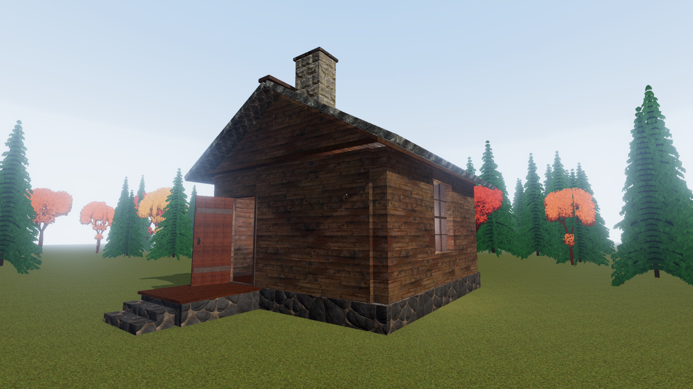 | 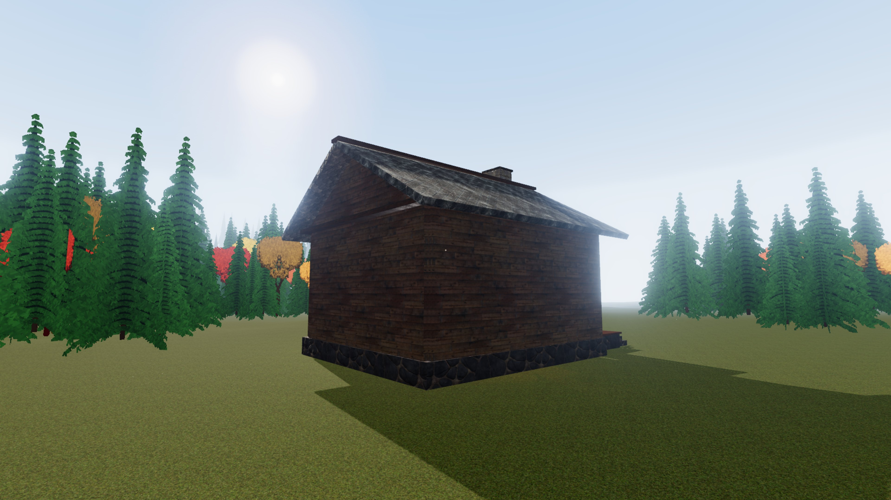 | 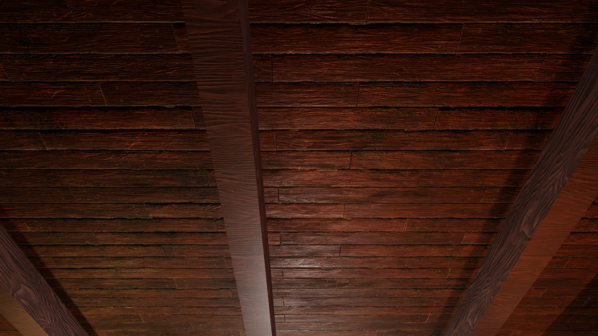 | 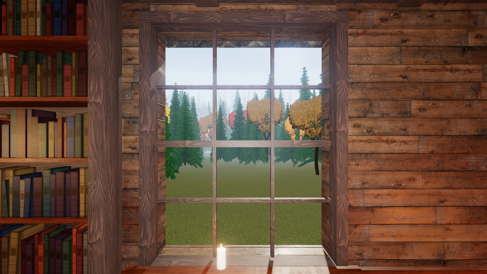 |
| 밤 | 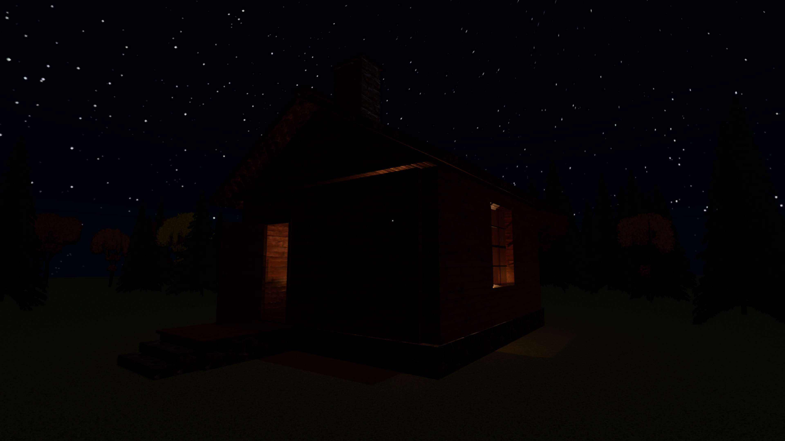 | | 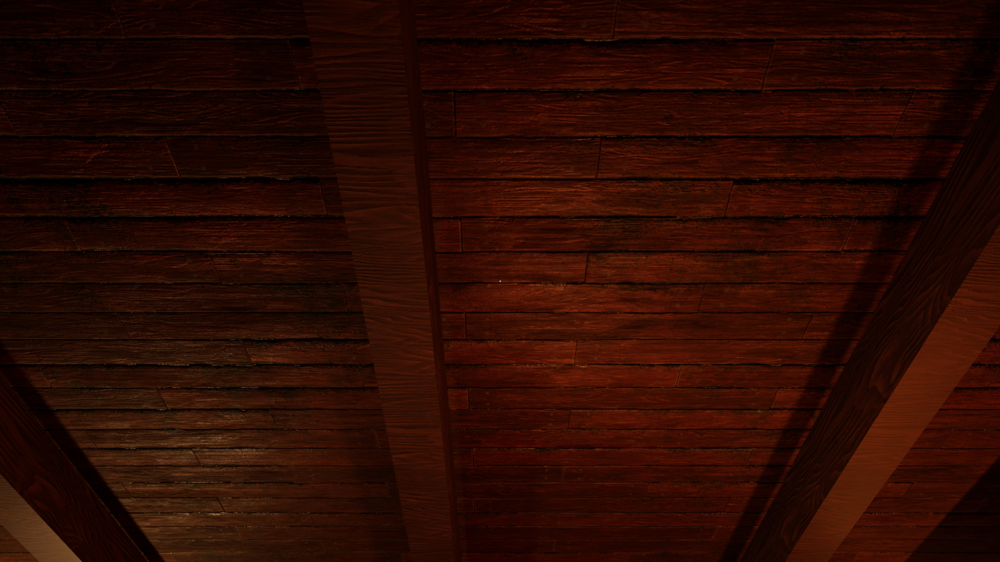 | 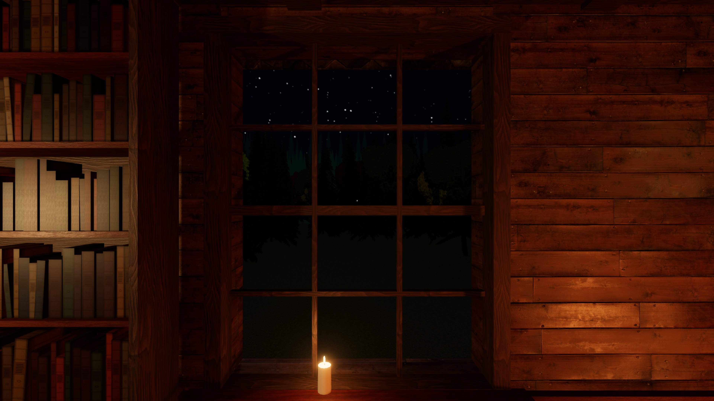 |

| | 안에서 본 열린 문 | 마루에서 | 책장 | 책장 (벽) |
|---|---|---|---|---|
| 낮 | 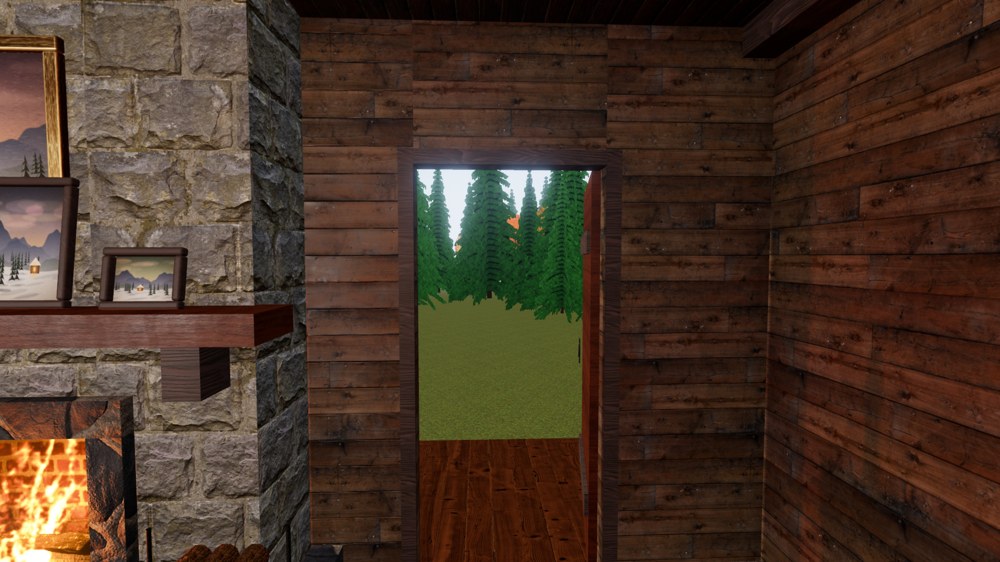 | 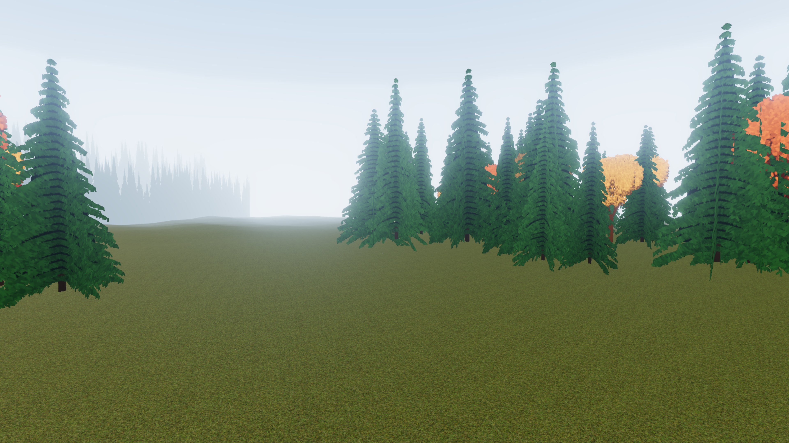 | 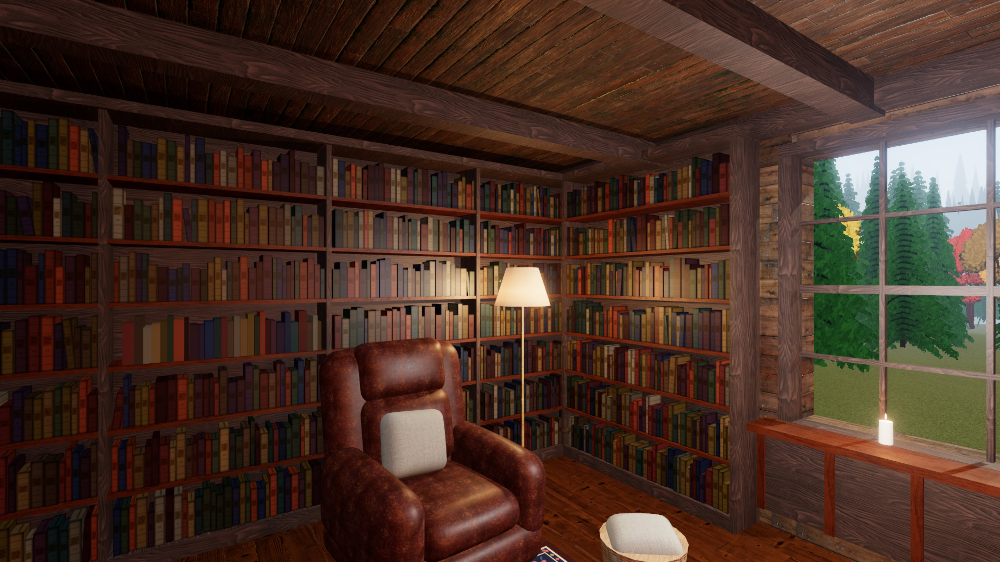 | 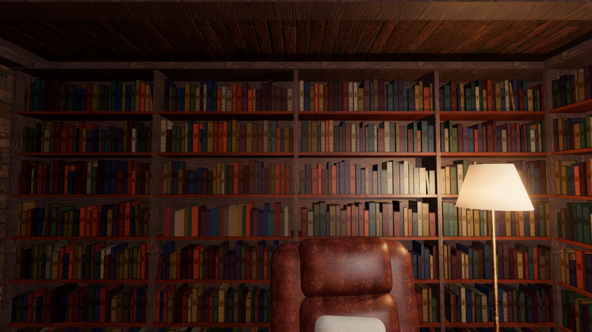 |
| 밤 | 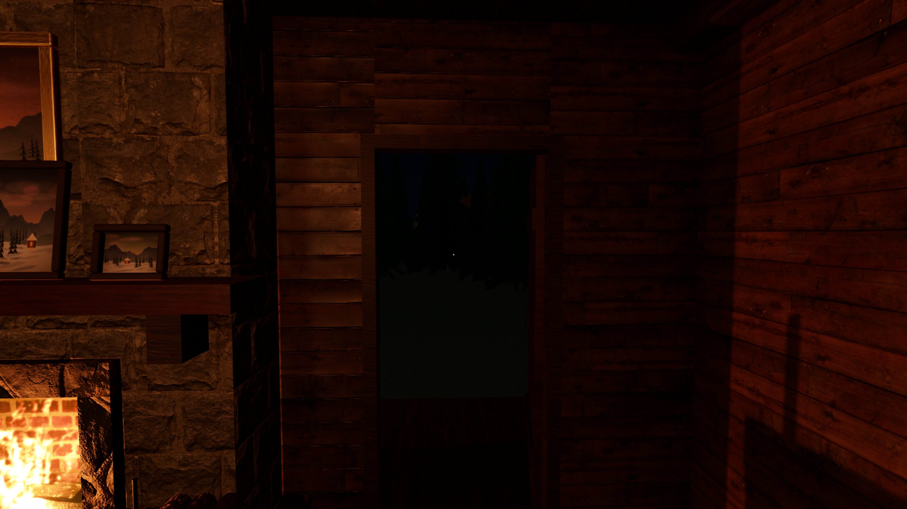 | | 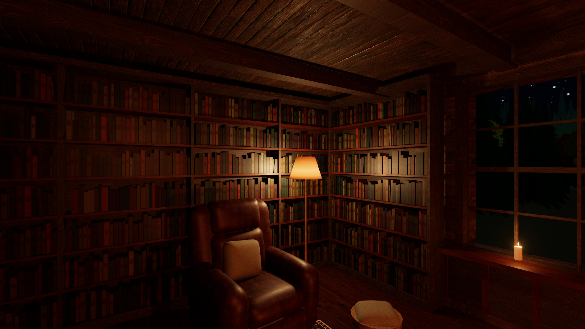 | |

| 그래픽 탭과 설정창의 끝내기 | 왼쪽 위 끝내기 (마당에서) |
|---|---|
| 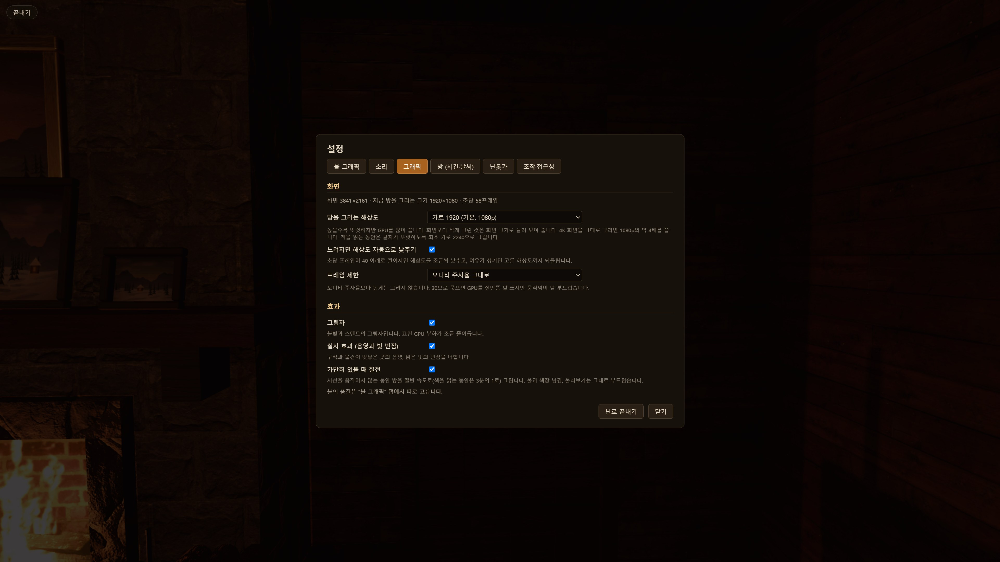 | 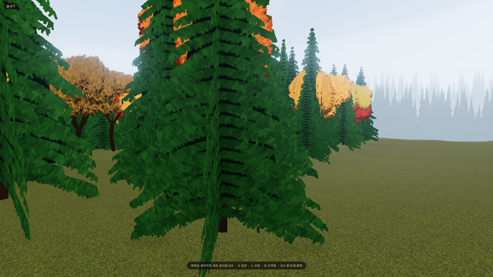 |

그 밖의 사진: `round4-day-ceiling2.jpg`, `round4-day-spines.jpg`.

눈에 띈 것:

- **창 위쪽에 지붕 처마 끝이 보인다.** 방 안에서 창을 보면 창 맨 위에 슬레이트 처마의 톱니 모양 끝이 걸쳐 보인다(낮 창 사진).
- **마당 끝에서 나무 속으로 들어간다.** 나무에는 막는 곳이 없어 마당 가장자리에서 나뭇잎 속으로 걸어 들어가진다(왼쪽 위 끝내기 사진).
- **밤에 박공 처마 밑이 밝다.** 밤의 집 바깥 사진에서 박공 아래 처마 밑면에 밝은 띠가 보인다. 방 안의 빛이 새는 것으로 보인다.
- 낮의 집 뒤쪽 사진에서 벽 오른쪽 모서리에 세로로 밝은 번짐이 있다(해 쪽).
- `tools/overlap-check.mjs`는 이 PC 에서 돌지 않았다(시험 도구의 자체 브라우저를 깔아 두지 않았다). 겹치는 면의 수는 세지 못했다.

## GPU (앉아서 불 보기, 밤, 60Hz, 1분씩)

| 조건 | 방을 그리는 크기 | GPU (프로그램) | 프레임 | 가장 긴 프레임 |
|---|---|---|---|---|
| 가로 1920, 문 닫힘 | 1920×1080 | 62% | 초당 60.0 | 18ms |
| 가로 1920, 문 열림 (40초) | 1920×1080 | 63% | 초당 60.0 | 17ms |
| 화면 그대로, 문 닫힘 | 3841×2161 | 99% | 초당 56.7 | 34ms |

- 4K 그대로 그리면 GPU 가 꽉 차고 60프레임을 지키지 못한다(56.7). 재는 동안 자동 낮추기는 켜져 있었지만 그리는 크기는 끝까지 3841×2161이었다(40프레임 아래로 내려가지 않았기 때문이다).
- 문을 여닫는 차이는 1%로, 잴 수 있는 차이가 아니다.
- 가로 1920의 62%는 0.2.0까지의 58~59%보다 조금 높다(지붕과 바깥이 더해진 뒤).

## 0.3.0 설치

난로가 켜져 있지 않은 것을 확인하고 덮어 깔았다(종료 코드 0). `C:\NanroApp\nanro.exe` 0.3.0, 빌드한 파일과 해시 같음. `C:\Nanro`는 설치 전후로 맨 위 항목 3개, 가장 최근 수정 시각이 같다(안은 읽지 않았다). .epub, .pdf 의 기본 프로그램도 그대로다.
# 0.3.1 확인: 처마 끝, 처마 밑 빛, 마당 끝 (커밋 259871f)

빌드: `cargo build --release --locked` 2분 18초(종료 코드 0), ISCC 한 번에 됨. `release\NanroSetup-v0.3.1.exe` 85.2MB.

| 항목 | 결과 |
|---|---|
| 창 위쪽의 처마 끝 (낮, 방 안) | **고쳐짐.** 창 맨 위에 걸쳐 보이던 슬레이트 톱니가 없다. |
| 처마 밑의 밝은 띠 (밤, 집 밖) | **거의 고쳐짐.** 박공 아래의 긴 밝은 띠는 없어졌다. 창 쪽 벽 위 모서리에 짧은 밝은 조각 하나가 남아 있다. |
| 마당 끝의 나무 | **나무 속으로 들어가지 않는다.** 남쪽(z -3), 남서쪽, 동쪽, 서쪽, 북쪽 끝에 서서 바깥을 본 사진에 화면을 덮는 나뭇잎이 없다. 동쪽과 북쪽 끝에서는 가지가 화면 가장자리 가까이까지 온다. |

| 낮, 창 | 밤, 집 바깥 | 밤, 처마 밑 올려다봄 |
|---|---|---|
| 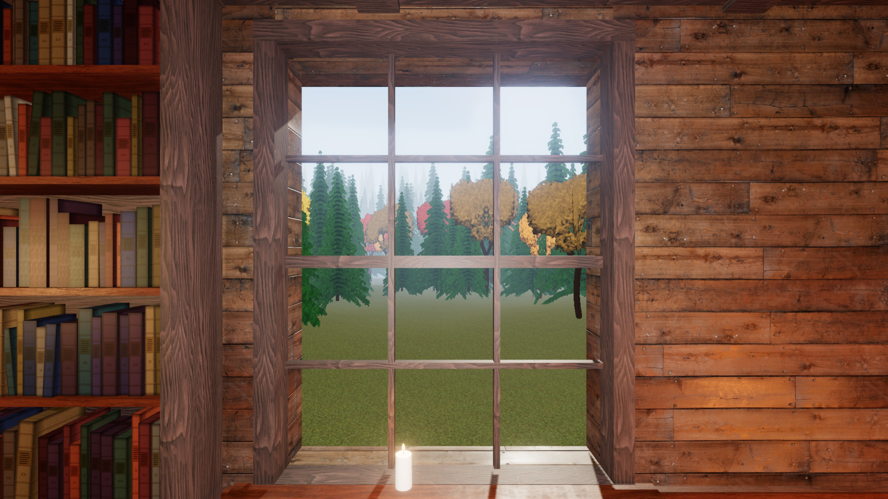 | 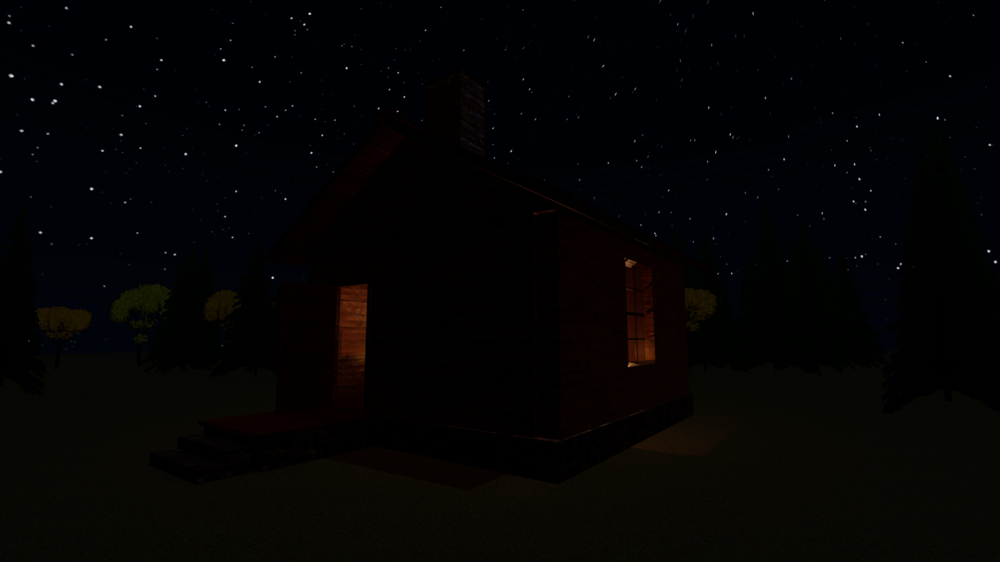 | 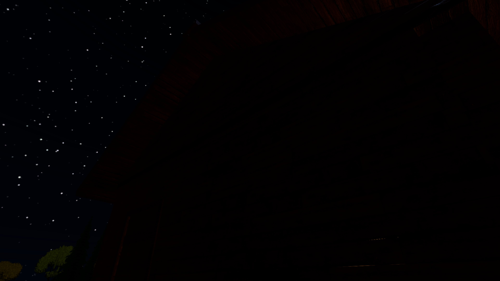 |

| 마당 남쪽 끝 | 동쪽 끝 | 서쪽 끝 | 북쪽 끝 |
|---|---|---|---|
| 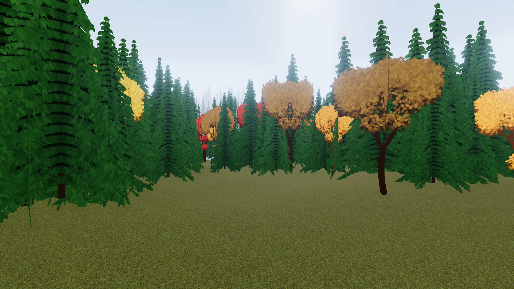 | 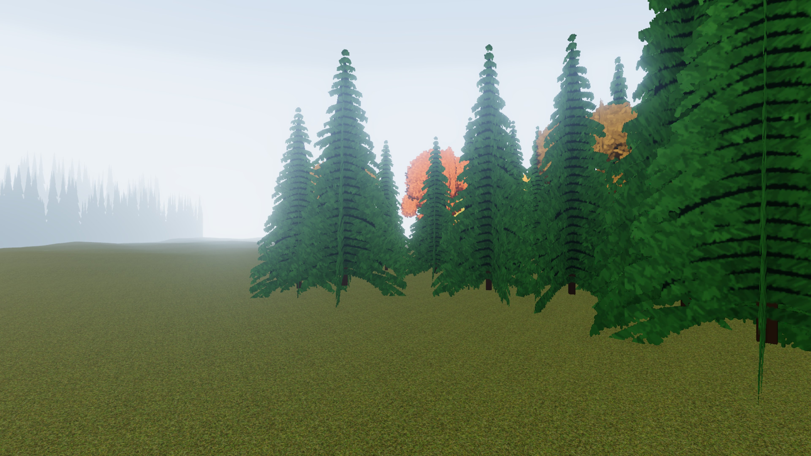 | 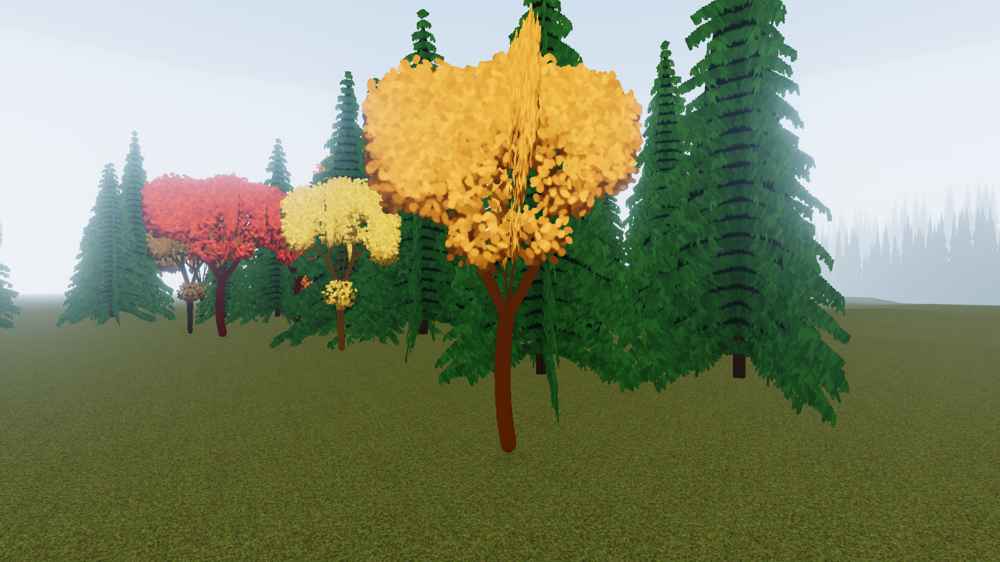 | 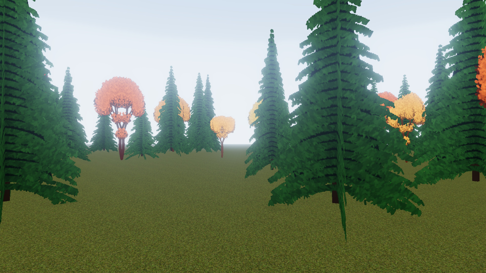 |

그 밖의 사진: `round4b-day-window-up.jpg`, `round4b-yard-southwest.jpg`.

`tools/overlap-check.mjs`가 이 PC 에서 돌지 않는 까닭: 오류 첫 줄은 `browserType.launch: Executable doesn't exist at C:\Users\pc\AppData\Local\ms-playwright\chromium_headless_shell-1255\chrome-headless-shell-win64\chrome-headless-shell.exe`다. 이 PC 에는 시험 도구의 자체 브라우저를 깔지 않고 설치된 Edge 만 쓰기 때문이다(개발 서버는 켜져 있었다).

설치: 난로가 켜져 있지 않은 것을 확인하고 0.3.1 을 덮어 깔았다. `C:\Nanro`는 설치 전후로 항목 수와 수정 시각이 같다(안은 읽지 않았다).
# 0.3.2 확인: 책장 책의 질감 (커밋 33221fa)

빌드: `cargo build --release --locked` 2분 28초(종료 코드 0), ISCC 한 번에 됨. `release\NanroSetup-v0.3.2.exe` 85.2MB.

| 내 서재 칸 (가운데 단) | 왼쪽 벽 책장 |
|---|---|
| 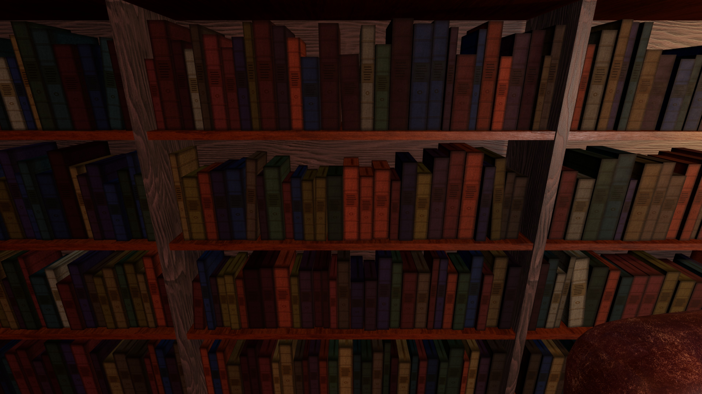 |  |

- 내 서재 칸의 책이 옆 책들과 같아 보인다. 책등에 천의 올 무늬와 띠, 줄무늬가 있고, 0.3.1 묶음에서 보이던 돌판 같은 책은 없다.
- 책 윗면은 여전히 책등과 같은 재질이다(종이 단면처럼 보이지 않는다).
- 앞선 묶음(e6efb30)의 사진은 `round4c-shelf-wall.jpg`, `round4c-shelf-library.jpg`다.

설치: 난로가 켜져 있지 않은 것을 확인하고 0.3.2 를 덮어 깔았다. `C:\Nanro`는 설치 전후로 항목 수와 수정 시각이 같다(안은 읽지 않았다).