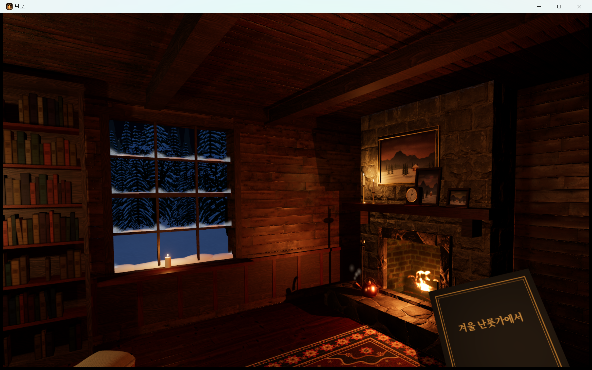
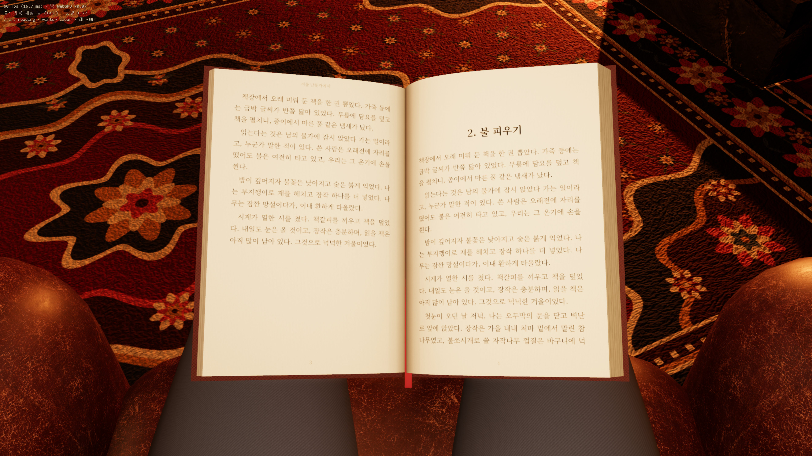
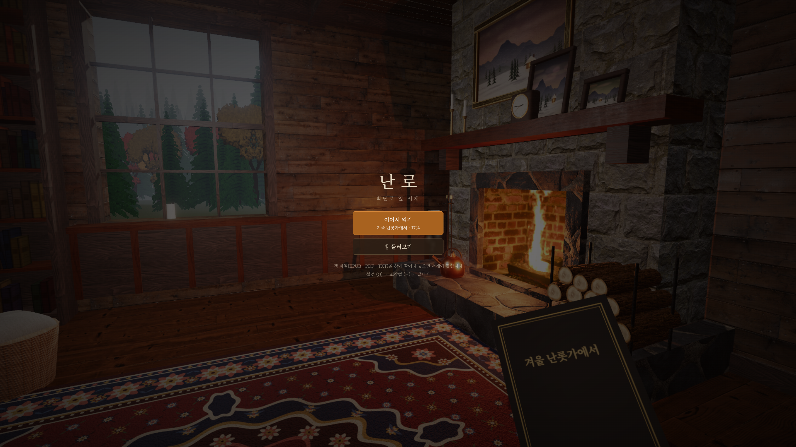

# 윈도우 프로그램 1단계: 빌드와 확인 (Intel Arc B390)

2026-11-22, 커밋 3f08652. 화면 3840×2160, 배율 175%. 시험은 자료 폴더를 `NANRO_DATA=C:\claude-notebook\nanro-test\appdata`(매번 비우고 시작)로 주고 했다. `C:\Nanro`는 만들지 않았다. 책은 견본 책만 썼다.

## 요점

- 빌드와 설치 파일 만들기는 고친 것 없이 한 번에 됐다.
- 프로그램은 전체 화면으로 뜨고, WebGPU가 켜지며, 흐름 시험 19개를 모두 통과했다.
- **켠 직후 약 12초 동안 화면이 크게 버벅인다.** 시작 카드는 4초에 뜨지만, 그 뒤 5.7초와 4.3초짜리 멈춤이 이어진다.
- GPU는 전체 화면에서 앉은 상태 58~59%, 읽기 38%다.
- 백업 내보내기를 눌러도 파일이 생기지 않았다.

## 1. 빌드

| 단계 | 결과 | 걸린 시간 |
|---|---|---|
| `npm install`, `npm run build` | `dist` 77.1MB | 3초 |
| `cargo build --release --locked` (휴대용 MSVC, target은 `src-tauri\target`) | `src-tauri\target\release\nanro.exe` 84.0MB | 3분 27초 |
| `ISCC packaging\nanro.iss` | `release\NanroSetup-v0.1.0.exe` 81.5MB | 17초 |

`--locked` 그대로 통과했고 `Cargo.lock`은 바뀌지 않았다. 크레이트 몇 개(wry 0.57.3 등)를 새로 받았다. `nanro.iss`도 그대로 썼다(`Korean.isl` 있음). 실행 중인 개발 서버를 건드리지 않으려고 `npm ci` 대신 `npm install`을 썼다.

## 2. 실행 확인

### 처음 켜기

| 항목 | 결과 |
|---|---|
| 전체 화면 | 됨. 안쪽 2195×1235(CSS) = 화면 전체 |
| `location.origin` | `https://tauri.localhost` |
| WebGPU | 켜짐. 방 렌더러 WebGPU, 방 캔버스 1920×1080, 불 있음 |
| 엔진 | WebView2 Edg/157 |
| 끝내기 단추 | 시작 화면에 보임 |
| 콘솔 오류 | 없음 |

### 켠 직후의 끊김

켠 지 0.3~0.5초 뒤부터 프레임 간격을 쟀다.

| 실행 | 평균 fps (20초) | 가장 긴 프레임 | 100ms 넘는 프레임 |
|---|---|---|---|
| 처음 (새 자료 폴더, 전체 화면) | 2.2 | 14.2초 | 5 |
| 두 번째 (전체 화면) | 23.6 | 5.7초 | 6 |
| 세 번째 (창 상태) | 1.5 | 15.2초 | 5 |

네 번째 실행에서 언제 멈추는지를 따로 기록했다(시각은 페이지가 뜬 뒤 기준).

| 시각 | 멈춘 길이 |
|---|---|
| 0.2초 | 0.4초 |
| 0.6초 | 1.6초 |
| 2.6초 | 0.9초 |
| 3.5초 | **5.7초** |
| 9.2초 | 0.3초 |
| 9.5초 | **4.3초** |
| 14.8초 | 1.3초 |

- 실행부터 시작 카드의 단추가 뜨기까지는 4.0초다(`NANRO.ready` 3.7초).
- 그 뒤 약 12초 동안 화면이 거의 갱신되지 않는다. 그동안 타이머는 2초마다 정상으로 돌았고 창은 보이는 상태에 포커스도 있었다. 화면 그리기만 밀린 것이다.
- 켜져 있는 프로그램에서 페이지만 다시 불러오면 3초 안에 끝나고 그 뒤 멈춤이 없다(1.5초, 0.2초, 0.7초가 불러오는 동안에만). 프로그램을 새로 켤 때만 생긴다.
- 새 자료 폴더가 아니어도 생긴다(두 번째 이후에도 5~15초).
- 원인은 확인하지 않았다. 그래픽 쪽 준비(그리기 준비, 텍스처 올리기)가 새 프로세스에서 다시 일어나는 것으로 보인다(추정).

### 흐름 시험

`NANRO_CDP=http://127.0.0.1:9336`, `NANRO_URL=https://tauri.localhost`로 `node tools/flow.mjs`: **19개 모두 통과.**

### GPU (전체 화면 3840×2160, 밤)

측정 도구를 먼저 띄우고 5초 뒤부터 20초를 쟀다.

| 상태 | GPU 3D | fps | 가장 긴 프레임 | 방 캔버스 | 불 캔버스 |
|---|---|---|---|---|---|
| 앉음 1 | 59% | 59.9 | 33.0ms | 1920×1080 | 320×320 |
| 앉음 2 | 58% | 60.0 | 17.2ms | 1920×1080 | 320×320 |
| 앉음 3 | 58% | 60.0 | 17.3ms | 1920×1080 | 320×320 |
| 읽기 (불 기록 재생 중, `&rec=10`) | 38% | 60.0 | 17.2ms | 2240×1260 | |
| 최소화 (10초) | 20% | | | | |

- 앉은 상태는 Edge에서 잰 값(56~59%)과 같다.
- 읽기는 38%다. 흉내 낸 창에서 잰 23~29%보다 높다.
- 최소화하면 58% → 20%로 내려가지만 0에 가깝지는 않다. 최소화한 동안에도 페이지는 "보임" 상태로 남아 있었다.

### 창 명령

| 항목 | 결과 |
|---|---|
| `toggle_fullscreen` | 됨. 전체 화면 2195×1235 → 창 1601×901, 다시 부르면 전체 화면 |
| 창 크기와 위치 기억 | 됨. 창을 (200, 120)에 2400×1500으로 옮기고 끄니 `window.json`에 `{"x":200,"y":120,"w":2376,"h":1436,"fullscreen":false}`가 남았고, 다시 켜니 같은 크기(안쪽 1358×821)의 창으로 떴다 |
| 켜져 있을 때 한 번 더 실행 | 새 창이 뜨지 않음 (프로세스 1개, 페이지 1개 그대로). 기존 창이 앞으로 오는지는 눈으로 확인하지 못함 |
| `quit` | 됨. 프로세스가 끝나고 `window.json`이 저장됨 |

처음 전체 화면에서 `quit`하면 `window.json`의 크기가 `w:0, h:0`으로 남는다. 그 상태에서 F11로 창으로 바꾸면 기본 크기(1600×900)로 뜨므로 문제는 없었다.

### 프로그램 창에서 달라질 수 있는 것

| 항목 | 결과 |
|---|---|
| 유튜브 | 됨. 볼륨 0에서 공개 영상 링크를 넣으니 "불러오는 중…" → "재생 중"이 됐다. 오류 없음. 확인 뒤 멈추고 링크를 지웠다 |
| 위치 | 허용을 묻는 창은 뜨지 않았다. 권한 상태가 "denied"이고 `NANRO.env.opts.located`는 false, 기본 위치(37.57, 126.98)를 쓴다 |
| 낭독 목소리 | 1개: Microsoft Heami - Korean (ko-KR) |
| 내려받기 (백업 "파일 하나로 내보내기") | **안 됨.** 단추는 눌렸지만 내려받기, 문서, 바탕화면, 자료 폴더 어디에도 새 파일이 생기지 않았다 |

## 3. 사진

| 창 상태의 방 | 전체 화면 읽기 | 시작 화면 |
|---|---|---|
|  |  |  |

- 창 상태: 제목 표시줄에 난로 아이콘과 "난로", 최소화·최대화·닫기 단추가 보인다.
- 시작 화면: "이어서 읽기", "방 둘러보기" 아래에 설정, 조작법, **끝내기**가 보인다.

## 확인하지 못한 것

- 마우스 잡기(방 둘러보기)와 파일을 실제로 끌어다 놓기. 흐름 시험은 통과했지만 자동으로 누른 것이라, 사람이 직접 눌러 봐야 한다.
- 한 번 더 실행했을 때 기존 창이 실제로 앞으로 나오는지.
- F11 키와 Alt+F4 키(명령을 직접 불러 확인했다).
- 켠 직후 끊김의 원인.

시험 창이 떠 있던 시간은 합쳐서 약 9분으로, 정해 준 6분을 넘겼다. GPU 측정과 끊김 원인을 가리는 추가 실행 때문이다.

## 4. 설치

설치 명령을 담은 `.cmd`를 `explorer.exe`로 열어 실제 셸에서 `NanroSetup-v0.1.0.exe /SILENT /TASKS=desktopicon`을 실행했다. 설치 기록에 "Installation process succeeded"가 남았다.

| 확인 | 결과 |
|---|---|
| `C:\NanroApp\nanro.exe` | 있음 (84.0MB). 제거 프로그램 `unins000.exe`, `THIRD_PARTY_NOTICES.md`도 있음 |
| 시작 메뉴 "난로" | 있음 (`%APPDATA%\Microsoft\Windows\Start Menu\Programs\난로.lnk`) |
| 바탕화면 "난로" | 있음 (`C:\Users\pc\Desktop\난로.lnk`) |
| 제어판 제거 항목 | 있음 ("난로" 0.1.0, 설치 위치 `C:\NanroApp\`) |
| 설치 뒤 자동 실행 | 없음 (실행 중인 nanro 0개) |
| `C:\Nanro` | 만들어지지 않음. 처음 켤 때 깨끗하다 |

설치된 프로그램은 켜지 않았다. 시작 메뉴 바로가기는 설치 기록의 경로와 이 세션에서 본 경로가 같지만, 시작 메뉴에 실제로 보이는지는 눈으로 확인하지 못했다.

# 0.1.1 확인 (커밋 55b54ad)

## 빌드

| 단계 | 결과 | 걸린 시간 |
|---|---|---|
| `npm run build` | 됨 | 1초 |
| `cargo build --release --locked` | `nanro.exe` 84.0MB | 2분 49초 |
| `ISCC packaging\nanro.iss` | `release\NanroSetup-v0.1.1.exe` 81.5MB | 17초 |

고친 파일 없음.

## 고친 것 확인 (시험용 자료 폴더, 견본 책)

| 항목 | 결과 |
|---|---|
| a. 시작 단추 | 새 자료 폴더에서 켠 뒤 **24.6초**에 뜬다. 그때까지 "불러오는 중…" → "불을 지피는 중…"이 보인다. 단추가 뜬 뒤 10초 동안 가장 긴 프레임은 33ms다. 끊김이 단추 뒤로 넘어오지 않는다 |
| b. 흐름 시험 | 19개 모두 통과 |
| c. 파일 저장 | 됨. "저장했습니다: C:\Users\pc\Downloads\난로-백업-2026-11-22.json" 알림이 뜨고 파일(14KB)이 생긴다. 한 번 더 하면 "난로-백업-2026-11-22 (2).json"으로 번호가 붙는다. 시험 파일 2개는 지웠다 |
| d. 최소화 | 프로그램의 GPU가 57% → **0%**. 최소화한 5초 동안 `requestAnimationFrame` 0번. 다시 띄우면 60.0fps(가장 긴 프레임 17.1ms)로 돌아온다. 최소화 중에도 `document.visibilityState`는 "visible"로 읽혔다 |
| e. `window.json` | `quit` 명령과 창 닫기(WM_CLOSE) 둘 다 남는다 |

## 준비 시간을 줄일 수 있는지

준비 시간은 페이지가 열리기 시작한 때부터 50ms를 넘지 않는 프레임이 60장 이어진 첫 순간까지다. 같은 폴더로 두 번씩 켰다.

| 조건 | 1회 준비 | 2회 준비 | 가장 긴 프레임 (1회 / 2회) | 안쪽 크기 |
|---|---|---|---|---|
| a. 프로그램, 원래 주소, 전체 화면 (새 폴더) | 25.0초 | | 14.4초 | 2195×1235 |
| f. 프로그램, 개발 서버 주소 `http://127.0.0.1:5320/` | 25.2초 | 19.1초 | 14.4초 / 8.1초 | 2195×1235 |
| g. 프로그램, 원래 주소, 작은 창 | 26.6초 | 24.6초 | 15.2초 / 14.2초 | 1062×1031 |
| i. 프로그램, `?nowarmup`, 작은 창 | 14.0초 | | 5.8초 | 1062×1031 |
| h. Edge 고정 프로필, 전체 화면 | 15.6초 | 8.1초 | 7.0초 / 1.6초 | 2195×1192 |
| (0.1.0 프로그램, 지난 측정) | 16.7초 | 16.9초 | 5.8초 / 5.7초 | 2195×1235 |

읽는 법:

- **0.1.1에서 준비 시간이 17초 → 25초로 늘었다.** 3.5초 시점의 가장 긴 멈춤이 5.7초에서 14.4초로 커졌다. `?nowarmup`으로 켜면 그 멈춤이 5.8초로 돌아오고 준비가 14.0초다. 미리 그리기가 약 8.5초를 더 쓰고 있다.
- **창 크기는 원인이 아니다.** 작은 창(g)이 전체 화면(a)과 같다.
- **주소 방식은 일부 영향이 있다.** 개발 서버 주소(f)로 열면 두 번째에 25.2초 → 19.1초로 6초 줄었다. 원래 주소(g)는 26.6초 → 24.6초로 2초만 줄었다. 그래도 Edge만큼(절반)은 줄지 않는다.
- **Edge는 큰 창에서도 두 번째에 절반으로 준다**(15.6초 → 8.1초).
- 미리 그리기를 꺼도 3.4초 시점에 5.8초, 9.7초 시점에 3.4초짜리 멈춤이 남는다. 이 둘은 미리 그리기와 무관하다.

## 0.1.1 설치

`explorer.exe`로 여는 방식으로 `NanroSetup-v0.1.1.exe /SILENT /TASKS=desktopicon`을 덮어 깔았다. 설치 전에 난로가 켜져 있지 않은 것을 확인했다.

| 확인 | 결과 |
|---|---|
| `C:\NanroApp\nanro.exe` | 0.1.1로 바뀜 (빌드한 파일과 해시 같음) |
| 제어판 제거 항목 | "난로" 0.1.1 |
| 바탕화면 "난로" | 있음 |
| 설치 뒤 자동 실행 | 없음 |
| `C:\Nanro` | 아직 없음 |

# 0.1.2 확인: 켜는 시간 (커밋 897e59d)

빌드: `cargo build --release --locked` 2분 10초, `nanro.exe` 84.0MB, `release\NanroSetup-v0.1.2.exe` 81.5MB.

## 켜는 시간

| 실행 | 준비 시간 | 시작 단추 | 가장 긴 프레임 | 200ms 넘는 멈춤 [시각ms, 길이ms] |
|---|---|---|---|---|
| a. 프로그램, 새 자료 폴더 | 19.1초 | 18.6초 | 12.8초 (2.8초 시점) | [122,400] [572,1617] [2265,274] [2805,12751] [15673,367] [17356,350] |
| b1. 같은 폴더 | 11.7초 | 11.2초 | 6.1초 (2.6초 시점) | [111,383] [561,1567] [2645,6084] [8778,267] [9878,350] |
| b2. 같은 폴더 | 11.8초 | 11.3초 | 6.1초 (2.7초 시점) | [145,400] [612,1583] [2729,6117] [8879,283] [10046,350] [10596,200] |
| c1. Edge, 새 프로필, 개발 서버 주소, 전체 화면 | 11.5초 | 11.0초 | 5.9초 (2.7초 시점) | [555,1567] [2155,300] [2672,5917] [8639,417] |
| c2. Edge, 같은 프로필 | 5.4초 | 4.9초 | 1.6초 (0.3초 시점) | [332,1550] [1915,250] |

- **0.1.1보다 빨라졌다.** 시작 단추가 처음 24.6초 → 18.6초, 두 번째부터 11.2초다. 0.1.0의 준비 시간(17초)보다도 두 번째부터는 짧다.
- **프로그램에서도 두 번째부터 줄어든다**(19.1초 → 11.7초). 0.1.1까지는 켤 때마다 같았다.
- 단추가 뜬 뒤 10초 동안의 가장 긴 프레임은 17~21ms다. 끊김이 단추 뒤로 넘어오지 않는다.
- Edge는 같은 코드로 11.0초 → 4.9초다. 프로그램은 Edge보다 여전히 6~7초 더 걸린다.
- 남은 멈춤의 대부분은 2.7초 시점의 한 번(프로그램 6.1초, 처음에는 12.8초)이다.

## 준비되는 동안의 화면

| 준비 중 (켠 지 약 2초) | 단추가 뜬 뒤 |
|---|---|
|  |  |

- 준비 중에는 **검은 화면**에 시작 카드만 보인다. 불은 보이지 않았다(켠 지 약 2초 시점의 사진).
- 그 사진에 "불러오는 중…" 글과 함께 **"책 읽기", "방 둘러보기" 단추가 이미 보인다.** 단추 묶음의 `hidden` 값은 켜져 있었는데 화면에는 그려져 있다. 준비가 끝나기 전에 눌리는지는 확인하지 않았다.
- 단추가 뜬 뒤의 방은 정상이다(텍스처, 불, 창밖, 손에 든 책).

## 흐름 시험과 책

- 흐름 시험: **19개 모두 통과.** 다만 처음에는 실패했다. 새 자료 폴더로 켜면 "tauri.localhost이(가) 사용자의 위치 파악을 하려고 합니다 (차단 / 이번만 허용)" 권한 창이 뜨고, `tools/flow.mjs`가 그 창을 프로그램 화면으로 잘못 골랐기 때문이다. `tools/flow.mjs`가 주소로 프로그램 화면을 고르게 한 줄을 고쳤다.
- 책을 처음 펼 때: 가장 긴 프레임 250ms 1번. 처음 넘길 때 33.6ms, 처음 덮을 때 33.3ms.

## 새로 눈에 띈 것

- **처음 켜면 위치 권한을 묻는 창이 뜬다.** 0.1.0 확인 때는 "denied" 상태로 창이 없었다(그때는 새 폴더가 아니었다). 주인님이 처음 켤 때 이 창을 보게 된다.

## 0.1.2 설치

난로가 켜져 있지 않은 것을 확인하고 `explorer.exe` 방식으로 덮어 깔았다. `C:\NanroApp\nanro.exe`가 빌드한 파일과 해시가 같고, 제거 항목이 "난로 0.1.2"다. 설치된 프로그램은 켜지 않았고 `C:\Nanro`는 아직 없다.
